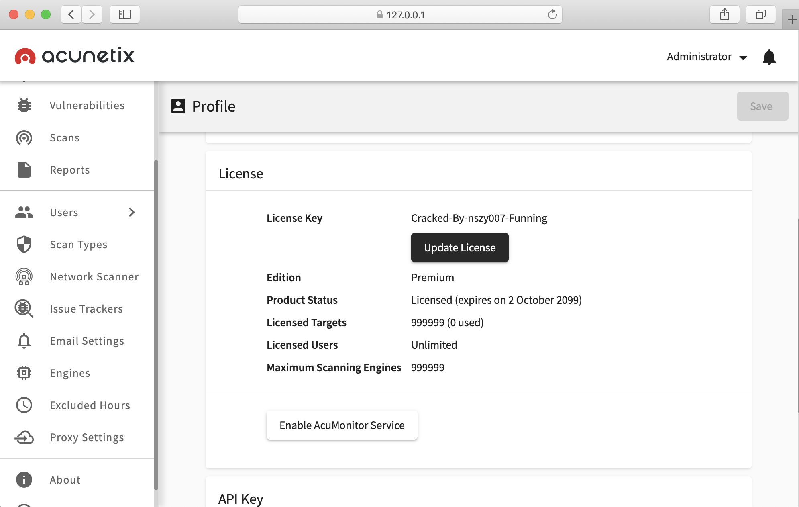
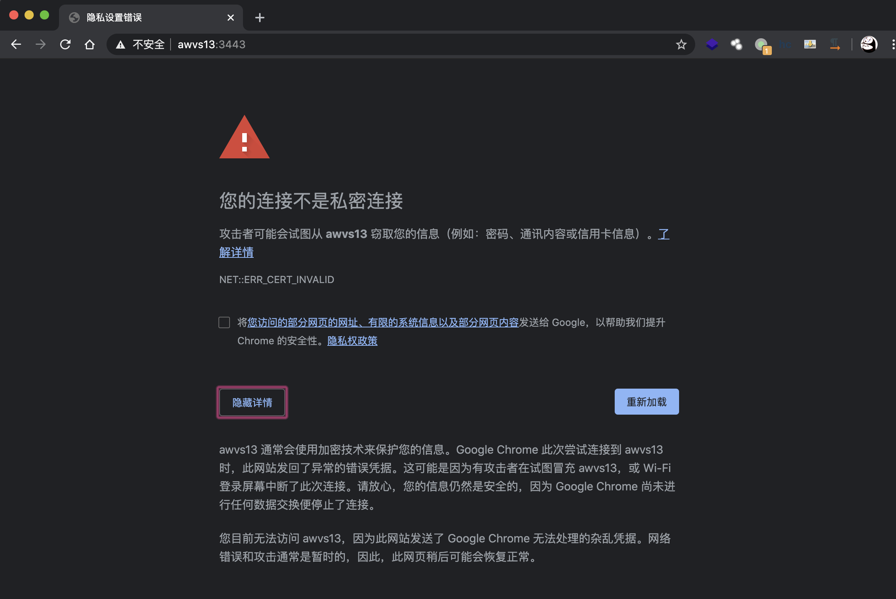
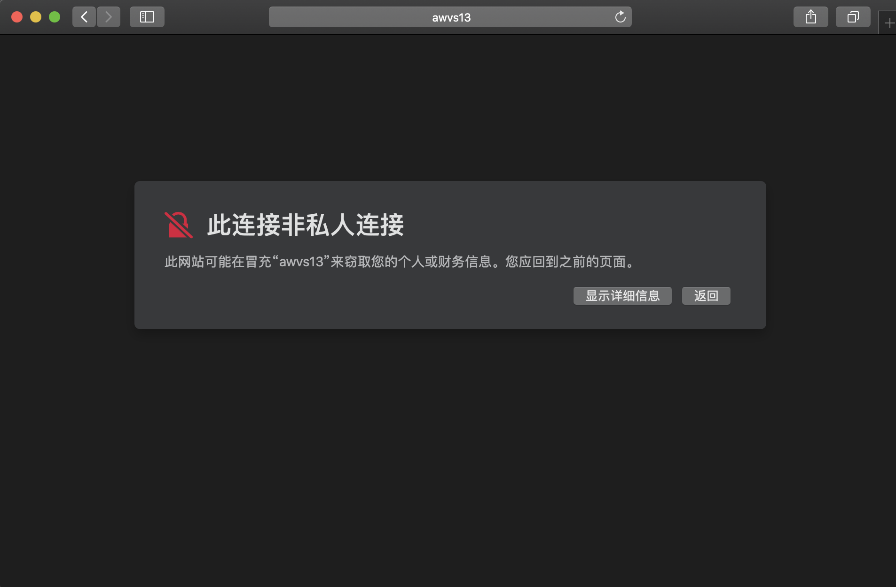
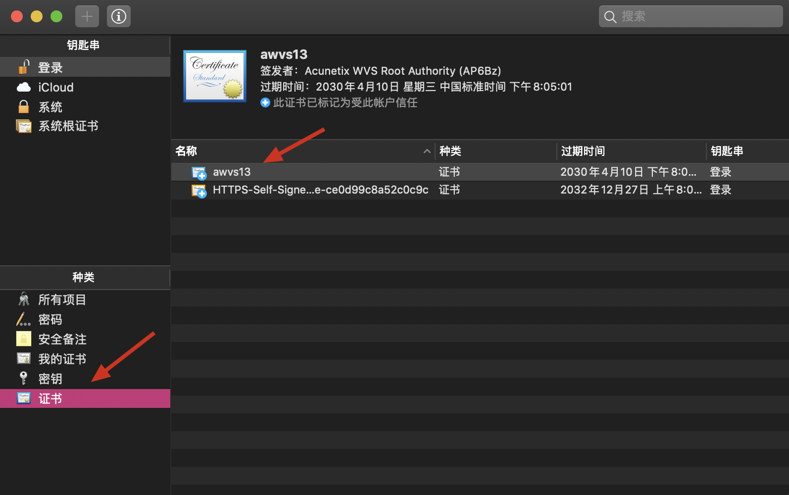
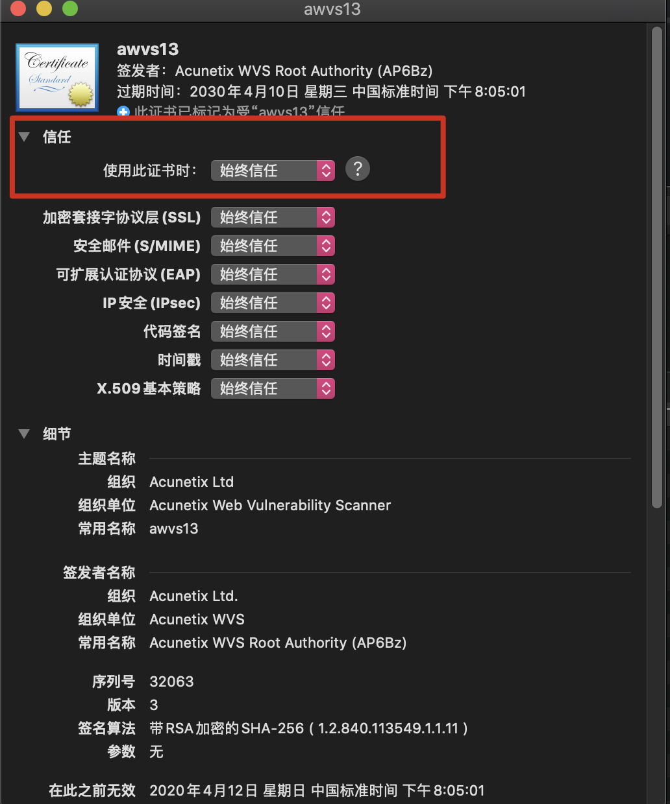
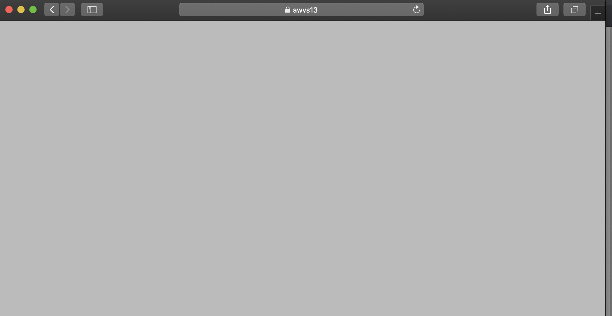
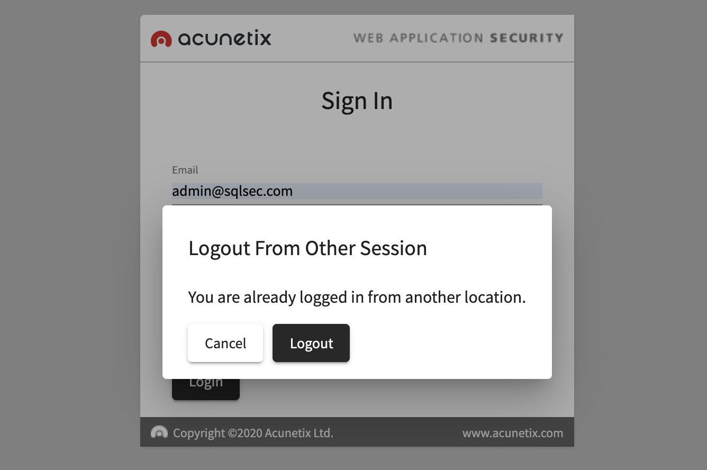

# AWVS13.X 破解版Windows、Linux、Docker

> GitHub 仓库源文件：[点击打开网页渲染版](https://github.com/ben2023niao/ben-ops-notes/blob/main/doc/md/200205120000-%E5%AE%89%E5%85%A8%E8%BF%90%E7%BB%B4%2BLinux%2BShell-AWVS13.X%20%E7%A0%B4%E8%A7%A3%E7%89%88Windows%E3%80%81Linux%E3%80%81Docker.md)

> 原文：[AWVS13.X 破解版Windows、Linux、Docker](https://xn--6o0a585a.gitbook.io/devops/an-quan/awvs13.x-po-jie-ban-windowslinuxdocker.html)

> 来源：GitBook 网页 HTML｜页面时间：2002-05-12 00:00｜日期依据：正文原始日期

Acunetix Web Vulnerability Scanner（AWVS）经典商业漏扫工具，最近更新了 13 的版本，本文分享的 AWVS 的破解版是网上大佬们分享出来的国光我只是一个小小搬运工，折腾 AWVS 的原因是正好最近准备用 Django 去调用一些 AWVS 的接口，所以就来写一篇系统的文章记录折腾安装的过程。

## 下载地址

- **Windows**

因为蓝奏云不支持特殊的分卷后缀，所以下载下来手动重命名，解压001后缀的文件即可。

[Windows acunetix_13.0.200205121.zip.001.zip](https://sqlsec.lanzoux.com/ibcfgti)

手动重命名为 **Windows acunetix_13.0.200205121.zip.001**

[Windows acunetix_13.0.200205121.zip.002.zip](https://sqlsec.lanzoux.com/ibcf87i)

手动重命名为 **Windows acunetix_13.0.200205121.zip.002**

- **Linux**

因为蓝奏云不支持特殊的分卷后缀，所以下载下来手动重命名，解压001后缀的文件即可。

[Linux acunetix_13.0.200217097.zip.001.zip](https://sqlsec.lanzoux.com/ibcf0ib)

手动重命名为 **Linux acunetix_13.0.200217097.zip.001**

[Linux acunetix_13.0.200217097.zip.002.zip](https://sqlsec.lanzoux.com/ibcevmf)

手动重命名为 **Linux acunetix_13.0.200217097.zip.002**

## 安装过程

国光感觉 Docker 版本最方便，部署起来也很简单，建议大家直接使用 Docker 版本。

### Windows

下一步下一步安装即可。破解过程：

1. `wvsc.exe` 覆盖`C:\Program Files (x86)\Acunetix\13.0.200205121`目录下同名文件
2. `license_info.json` 覆盖`C:\ProgramData\Acunetix\shared\license`目录下同名文件

以上操作都做完依然没有效果的话，那么重启电脑试试看呢？(重启大法好！)

### Linux

那么接下来就访问:`https://ip:3443` 愉快地使用 AWVS 吧：

### Docker

复制成功bash

浏览器访问：[https://203.0.113.1:13443/](https://203.0.113.1:13443/#/about) 即可

关于 Dokcer 更多的操作可以参考我的写的这篇总结文章：[Docker温故知新](https://www.sqlsec.com/2019/10/docker2.html)

## 疑难杂症

### macOS 导入 AWVS 证书

当我们兴高采烈地在虚拟机中安装好 AWVS 的时候，然后 macOS 的 Chrome 浏览器去访问的时候居然碰到了下面的情况，居然还没有任然继续访问的选项！！！黑人问号？？？：

然而在 Windows 的 Chrome 浏览器下是有`继续前往`的选项的。

不要慌问题不大，下面是解决方法：

首先使用 Safari 浏览器打开 awvs，看到如下信息后 点击「`显示详细信息`」

接着点击「`访问此网站`」，此时Safari浏览器已经可以访问了，与此同时「`钥匙串访问`」中新增了刚刚自签名的 AWVS13 证书：

鼠标选中证书，「`右键`」-「`显示简介`」-「`信任`」选择「`始终信任`」:

接下来就可愉快地 在macOS 的 Chrome 浏览器下使用 AWVS 了，再配上 Chrome 浏览器强大的网页翻译功能，使用起来简直美滋滋。

评论区网友 **独自等待** 大佬也补充了个细节：

告诉你一个秘密，Mac 下面对着G oogle浏览器输入 `thisisunsafe` 即可成功出现继续访问。
然后点击上面的证书，打开钥匙串访问，设置相应的证书为始终信任即可（我这边对应的证书显示的不是 awvs13）

### AWVS 登录界面无法加载

Windows 平台安装的 AWVS13 经常遇到过 AWVS 登录之后刷新页面的时候登录界面依然无法加载的现象：

这个可能是破解版本的 BUG 吧，国光的解决方法是：是**用另一个浏览器浏览器来登录**，这样会将当前没有加载出登录界面的会话给挤出（Logout）~~，因为新版本AWVS不允许一个账号同时被多处登录。

**img**

什么 你两个浏览器都无法登录？！？！ 这种情况国光也遇到过，解决方法就是多刷新几次，耐心等一等~~

**无法加载是因为url是/#/，把这个去了就能加载了**
