# 安卓手机微信聊天记录怎么导出到电脑：通过VMOS软件

本文介绍的安卓手机微信聊天记录导出到电脑的大概流程如下：首先将安卓手机微信聊天记录备份到PC版微信中，接着在安卓手机上安装上VMOS软件，再把备份到电脑上的微信聊天记录还原到VMOS虚拟系统中的微信中，最后再进行导出，详细操作流程如下 ：

**视频教程：<https://louyue.com/video/androidwechat-vmos-pc.mp4>**

第1步：在电脑上登录电脑版微信，按下图所示将安卓手机微信聊天记录备份到电脑上。
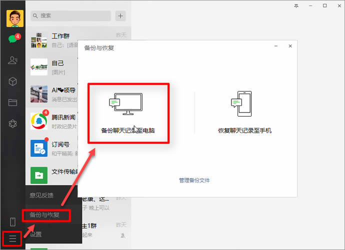

第2步：在手机上安装并打开VMOS，并在VMOS中打开微信并登录（注意：在这里是登录VMOS中的微信，并不是手机原有系统上的微信）。
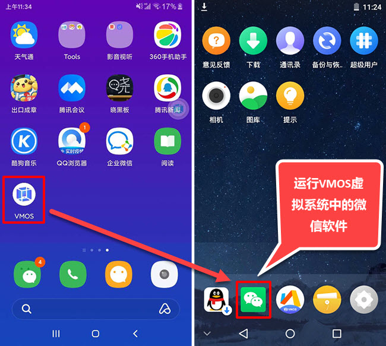

第3步：重新在电脑上登录电脑版微信。

第4步：进入电脑版微信的备份与恢复页面，将之前备份的微信聊天记录全部恢复到VMOS虚拟系统中的微信app中。
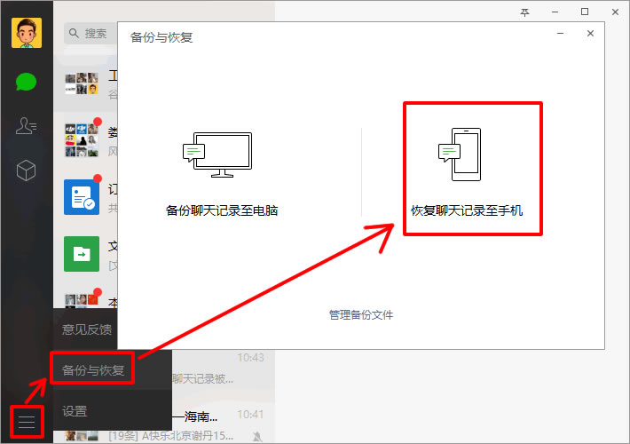

第5步：打开VMOS中的"备份与恢复"，点击"新建备份"，为了节省备份时间及空间，将其它数据都取消勾选，点击进入“应用程序”。
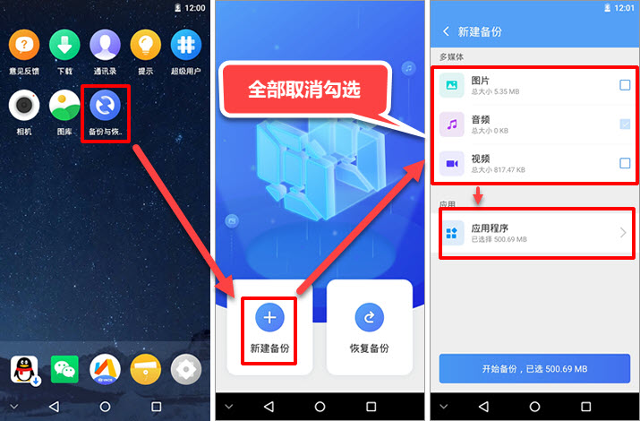

第6步：在应用程序列表中，将其它应用程序均取消勾选，仅勾选微信软件，然后返回并点击“开始备份”按钮进行备份。
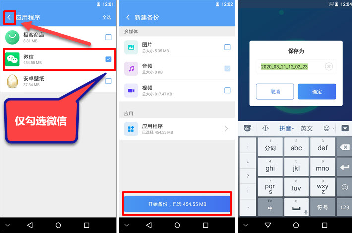

第7步：备份完成后，将手机连接到电脑上，手机上将弹出提示，这里需要将USB用途设置为“传输文件”。
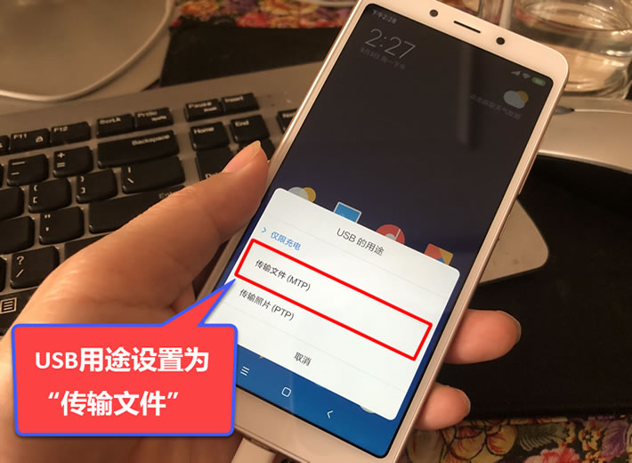

第8步：在电脑上进入手机盘符下的VMOSfiletransferstation\Vmos_Backups\备份日期与时间\appinfoData\[com.tencent.com](http://com.tencent.com)\目录，然后将里面的[com.tencent.mm](http://com.tencent.mm).tar.gz文件复制并粘贴到电脑上。
说明：也可按上方视频中的方法，通过360手机助手将该文件导出。
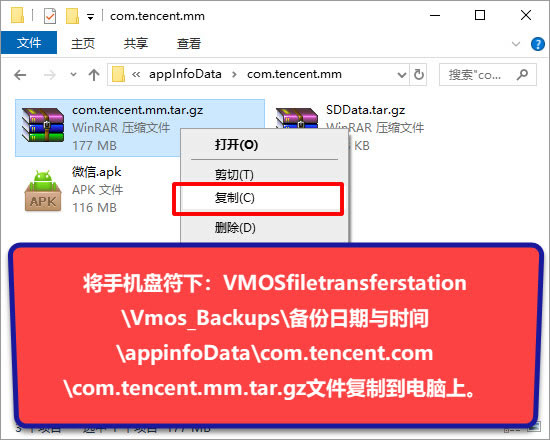

第9步：再次进入手机所在盘符下的tencent目录，将该目录下的MicroMsg文件夹复制并粘贴到电脑上。
说明：复制后，下图所示窗口不能关闭，只能最小化，否则可能粘贴到电脑上的只是一个空文件夹，或MicroMsg文件夹里的数据会有丢失。
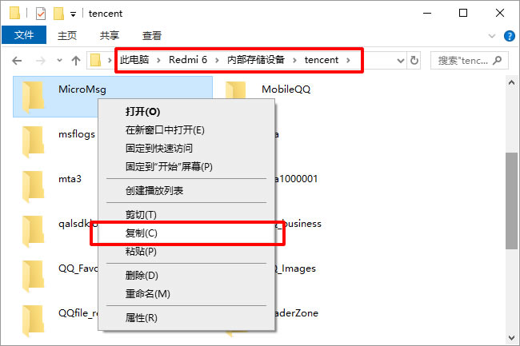

第10步：把刚导出到电脑上的[com.tencent.mm](http://com.tencent.mm).tar.gz右击“解压到[com.tencent.mm](http://com.tencent.mm)”。
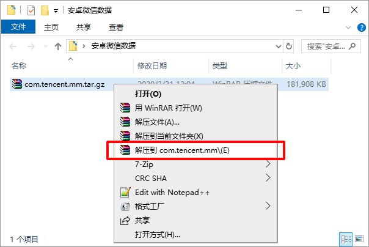

第11步：运行楼月微信聊天记录导出恢复助手软件，微信版本设置为“安卓版微信”，数据目录设置从[com.tencent.mm](http://com.tencent.mm).tar.gz解压出来的MicroMsg文件夹，资源目录设置从Tencent文件夹导出的MicroMsg文件夹。
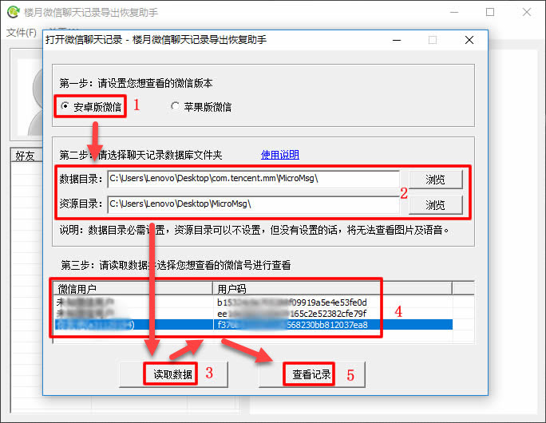

第12步，如果软件要求输入手机IMEI码，则在手机拨号界面按下*#06#，就可以看到手机的IMEI码。
说明：如果输入IMEI码后，软件提示不正确的话，请尝试在软件中输入MEID码。

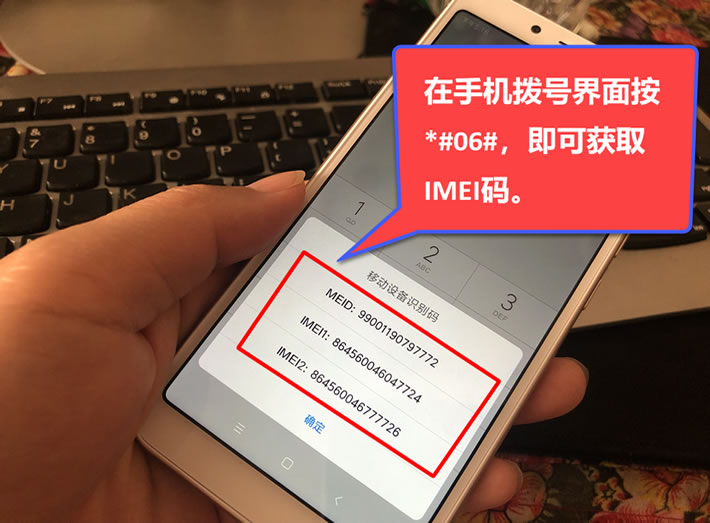

第13步：现在就可以在界面上查看到安卓手机上的所有微信聊天记录了。
说明：左边好友列表中显示的聊天记录数量可能为0，但这并不影响查看聊天记录。如果很介意的话，也可先在VMOS中的微信中，先与该好友任意收发一条消息，这样，导出的微信聊天记录显示的数量就会是真实数量了。
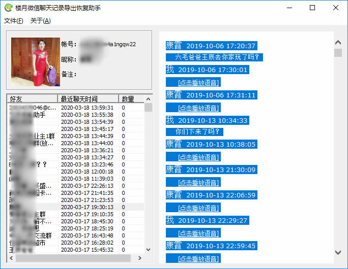

第14步：也可通过导出聊天记录功能，来批量导出微信聊天记录中的所有文字，图片，语音，视频等，其中导出的语音消息可以直接使用电脑上的播放器进行播放。
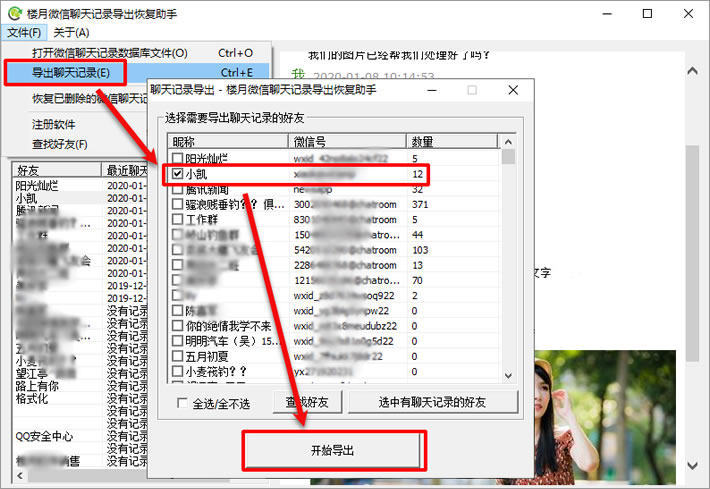

您也可以点击以下链接了解更多关于导出安卓手机微信聊天记录到电脑的方法：[安卓手机微信聊天记录如何导出到电脑](https://louyue.com/awx.htm)

常见问题：

问1：为什么我导出的微信聊天记录中的图片无法查看，语音消息无法播放？
答：这可能是在导出手机盘符下tencent目录里的MicroMsg文件夹时，数据有丢失引起的，你可以尝试先在手机上打开文件管理，对tencent目录下的MicroMsg进行压缩，再将压缩文件导出到电脑上再解压即可。
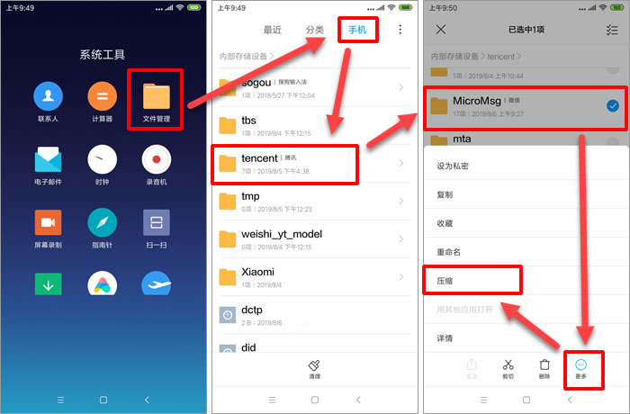
另外还有一个原因，并且最新版微信极有可能是该原因（以下内容2020年7月25日更新），需要按照以下步骤导出资源目录MicroMsg才可以成功查看图片及播放语音，步骤如下：
1，先打开VMOS中的“文件中转站”，点击“我要导出”，再进入“文件”选项卡下的“tencent”目录，注意：不是进入“Tencent”目录。

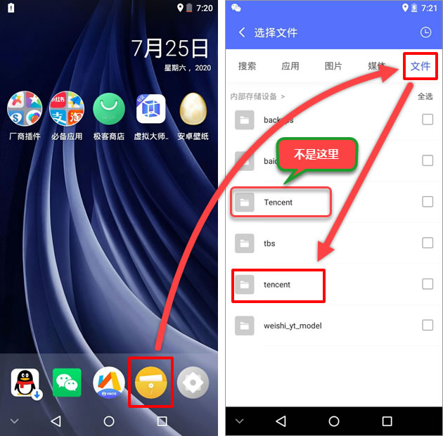

2， 勾选上MicroMsg文件夹，再点击“导出”按钮，导出结束后，会提示导出的MicroMsg保存在“手机存储/VMOSfiletransferstation"目录下。

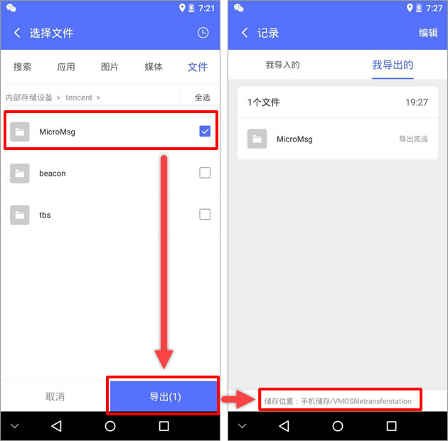

3，将手机连接到电脑上，进入手机盘符下载VMOSfiletransferstation目录，再将该目录下的MicroMsg文件夹复制出来即可，该文件夹即为资源目录MicroMsg。
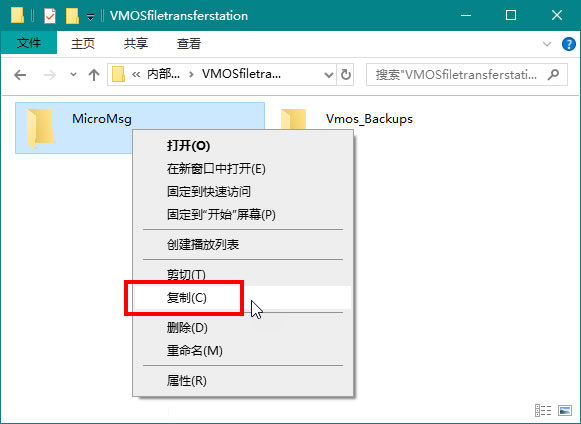
