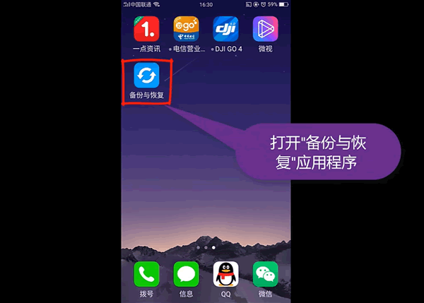
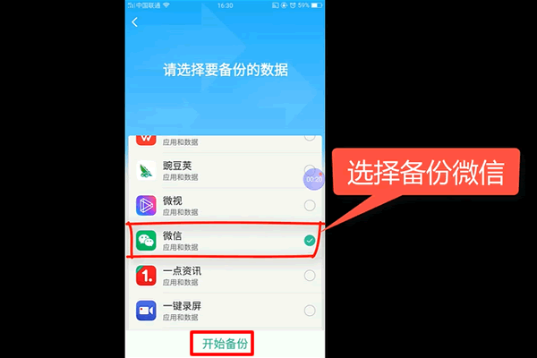
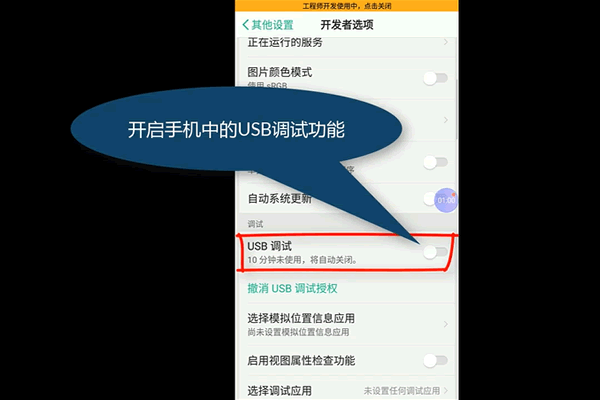
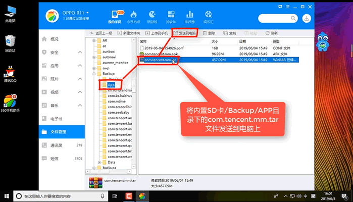
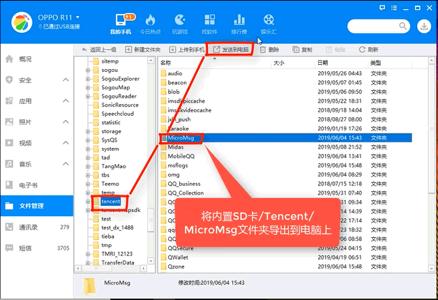
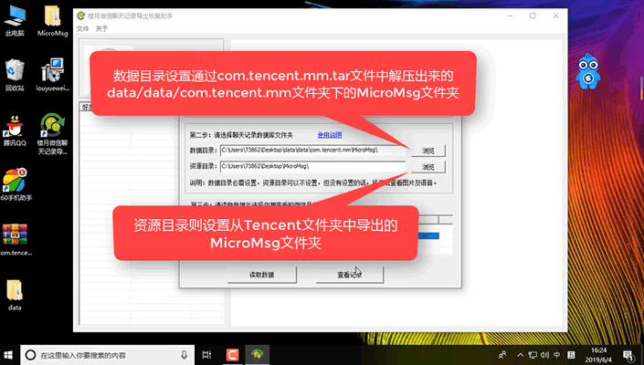
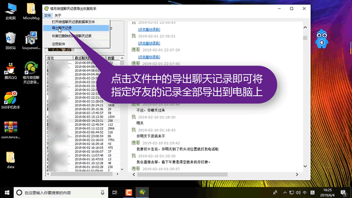

# OPPO手机微信聊天记录如何导出电脑查看：免ROOT

自己的OPPO手机微信聊天记录如何导出到电脑上保存或查看呢？微信聊天记录导出听上去比较麻烦，其实方法并不难。今天就来给大家介绍一下如何导出OPPO手机里面的微信聊天记录。

**OPPO手机微信聊天记录导出到电脑视频教程：<https://louyue.com/video/oppowechat.mp4>**

1，运行手机中自带的备份与恢复应用程序 。
说明：如果手机上安装有“手机搬家”软件的话，需要先将“手机搬家”软件卸载，再运行“备份与恢复”软件。如果不删除“手机搬家”的话，会导致无法备份微信聊天记录。

2，进入新建备份选择备份微信数据，为了节省时间，我们在这里仅备份微信即可，其它应用及数据我们不需要进行备份。

3，备份完成后打开手机的设置，其它设置，开发员选项，将里面的USB调试功能打开，并将手机通过数据线连接到电脑上。
注：USB调试功能可能在不同的手机上打开方法不一样，具体自己手机USB调试功能打开方法可到网上查询。

4，接下来到电脑上运行360手机助手软件，打开文件管理，展开内置SD卡/Backup/App将这里面的com/[tencent.mm](http://tencent.mm).tar文件导出到电脑上并将其解压。

5，接下来再通过手机管理器将内置SD卡/Tencent文件夹下的MicroMsg文件夹导出到电脑上。
2020年7月27日更新：新版微信（V7.0.16及以后版本）资源文件不再保存在“tencent/MicroMsg”文件夹中，因些如果是新版微信，则需要进入“SD卡/Android/data/[com.tencent.mm](http://com.tencent.mm)”目录，并将该目录下的MicroMsg文件夹导出到电脑上。

6，运行楼月微信聊天记录导出恢复助手（[点击此处下载](https://louyue.com/down/louyueweixin_setup.exe)），在设置窗口中设置微信版本(安卓版微信)，再设置好数据目录（从[com.tencent.mm](http://com.tencent.mm).tar文件中解压出来的data/data/[com.tencent.mm](http://com.tencent.mm)目录下的MicroMsg文件夹）和资源目录（从Tencent文件夹下导的MicroMsg文件夹），点击查看记录按钮后，再到上面的微信用户列表中选中需要查看的微信号，并点查看记录按钮就能查看到所有微信聊天内容。
说明：如果软件要求输入手机的IMEI码的话，请在手机拨号界面按*#06#，即可获取到手机的IMEI码，有的手机上输入IMEI码无法解密查看微信聊天记录的话，请尝试输入MEID码。

7，点击左上角文件菜单中的导出聊天记录即可将指定好友记录导出到电脑上来。导出来后我们就可以对聊天记录进行打印等其它操作。

