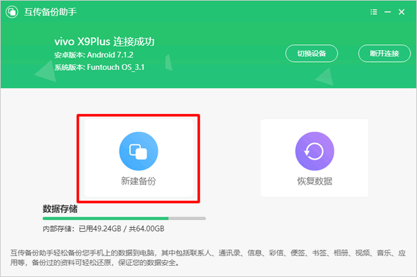
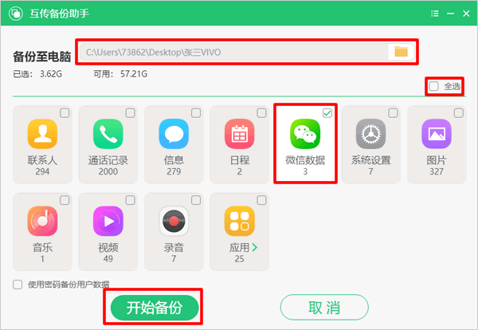
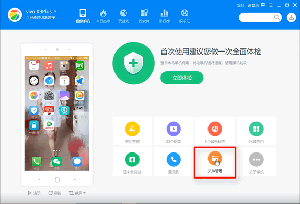
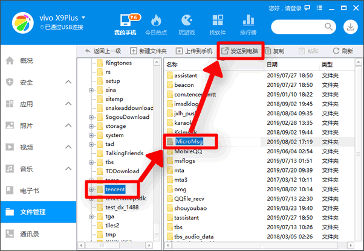
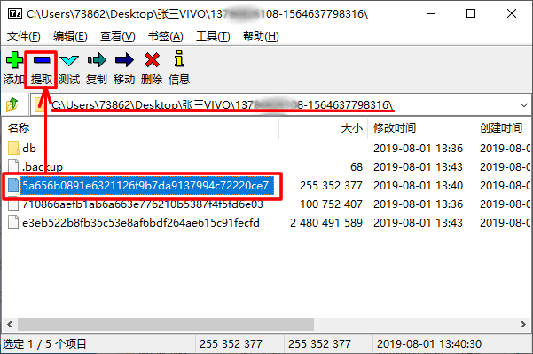
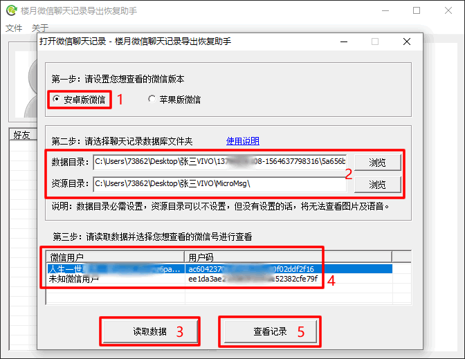
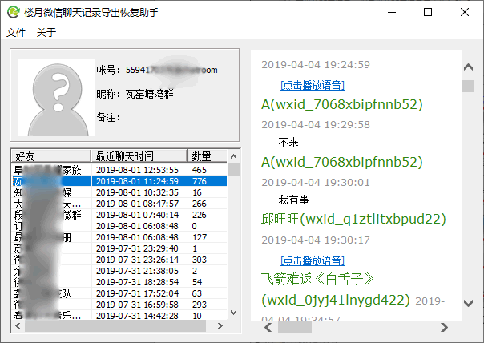

# vivo手机微信聊天记录如何导出电脑查看：免ROOT

> GitHub 仓库源文件：[点击打开网页渲染版](https://github.com/ben2023niao/ben-ops-notes/blob/main/doc/md/202007270000-DevOps%20%E4%B8%8E%20SRE%2B%E4%BC%98%E5%8C%96%E6%96%B9%E6%A1%88%2B%E5%A4%87%E4%BB%BD%E6%81%A2%E5%A4%8D%2B%E7%9F%A5%E8%AF%86%E7%AC%94%E8%AE%B0-vivo%E6%89%8B%E6%9C%BA%E5%BE%AE%E4%BF%A1%E8%81%8A%E5%A4%A9%E8%AE%B0%E5%BD%95%E5%A6%82%E4%BD%95%E5%AF%BC%E5%87%BA%E7%94%B5%E8%84%91%E6%9F%A5%E7%9C%8B%EF%BC%9A%E5%85%8DROOT.md)

现如今绝大部份的vivo手机都完全无法ROOT，于是以前的那种ROOT后导出微信聊天记录的方法显然已经行不通了。那么现在VIVO手机无法ROOT该如何导出查看微信聊天记录呢？下面小编就给大家介绍一下免ROOT查看VIVO手机微信聊天记录的方法。

**vivo手机微信聊天记录导出到电脑视频教程：<https://louyue.com/video/vivowechat.mp4>**

1，先在手机上打开“开发人员选项”并将USB调试功能打开。再将手机通过数据线连接到电脑，打开电脑上已经安装好的“互传备份助手”（[点击此处进入下载页面](https://es.vivo.com.cn/)），再点击界面上的新建备份。
注意：在电脑上运行互传备份助手时，会提醒手机上也要安装互传助手，按提示安装即可。

2，在互传备份助手窗口上设置好备份目录，再将全选取消，仅选择微信。并点击开始备份按钮等待备份完成，备份完成后关闭互传备份助手。

3，运行电脑上已经安装好的360手机助手（[点击此处进入下载页面](http://sj.360.cn/index.html)），进入文件管理。

4，进入内置SD卡目录下的Tencent目录，然后将该目录下的MicroMsg文件夹导出到电脑上，导出完成后关闭360手机助手。
2020年7月27日更新：新版微信（V7.0.16及以后版本）资源文件不再保存在“tencent/MicroMsg”文件夹中，因些如果是新版微信，则需要进入“SD卡/Android/data/[com.tencent.mm](http://com.tencent.mm)”目录，并将该目录下的MicroMsg文件夹导出到电脑上。

5，接下来在电脑上运行7-Zip解压工具，将刚才通过互传备份助手备份出来以5a65开头的文件进行提取，提取完成后关闭7Z解压工具。
说明1：每个人的手机所提取的文件名有所不同，大家可按照自己所导出的文件名进行提取即可。
说明2：也可使用WinRAR，360压缩等任意解压软件对该文件进行解压（或称为提取），但在解压前，需要手动给文件加上.rar的后缀，否则右击该文件后，是看不到解压菜单的。

6，接下来运行楼月微信聊天记录导出恢复助手（[点击此处下载](https://louyue.com/down/louyueweixin_setup.exe)），在打开的设置窗口上设置安卓版微信，数据目录设置从5a65文件中提取出来的MicroMsg文件夹，而资源目录则设置为通过360手机助手从Tencent文件夹中导出的MicroMsg文件夹。最后点击“读取数据“按钮后，在上方微信用户列表中选中需要查看的微信账号后，再点击”查看记录“按钮。
说明：如果软件要求输入手机的IMEI码的话，请在手机拨号界面按*#06#，即可获取到手机的IMEI码，有的手机上输入IMEI码无法解密查看微信聊天记录的话，请尝试输入MEID码。

7，现在就可以在软件界面上，查看vivo手机中的所有微信聊天记录了。

以上就是vivo手机微信聊天记录免ROOT如何导出到电脑的全过程，可在电脑上查看所有微信文字聊天记录，图片，也可在电脑上播放所有收发的语音消息，还可在电脑上对vivo手机微信聊天记录进行打印。
