# 小米手机微信聊天记录如何导出到电脑文档：免Root

> GitHub 仓库源文件：[点击打开网页渲染版](https://github.com/ben2023niao/ben-ops-notes/blob/main/doc/md/202007270000-DevOps%20%E4%B8%8E%20SRE%2B%E4%BC%98%E5%8C%96%E6%96%B9%E6%A1%88%2B%E5%A4%87%E4%BB%BD%E6%81%A2%E5%A4%8D%2B%E7%9F%A5%E8%AF%86%E7%AC%94%E8%AE%B0-%E5%B0%8F%E7%B1%B3%E6%89%8B%E6%9C%BA%E5%BE%AE%E4%BF%A1%E8%81%8A%E5%A4%A9%E8%AE%B0%E5%BD%95%E5%A6%82%E4%BD%95%E5%AF%BC%E5%87%BA%E5%88%B0%E7%94%B5%E8%84%91%E6%96%87%E6%A1%A3%EF%BC%9A%E5%85%8DRoot.md)

小米手机微信聊天记录导出到电脑的问题困扰了很多微信用户，其实小米手机app产生的数据，都可以通过系统自带的备份功能，将其导出到电脑上。微信app产生的聊天记录当然也不例外，接下来我来教大家如何把小米手机上的微信聊天记录保存到电脑上（含文字，图片，语音，视频等）。

小米手机微信聊天记录导出到电脑视频教程：<https://louyue.com/video/xiaomiwechat.mp4>

1，打开小米手机上的“设置”，点击“更多设置”，“备份和重置”。
说明：如果小米手机安装的是最新MIUI11系统，则进入手机“设置”后，再点击“我的设备”，“备份和重置”即可。

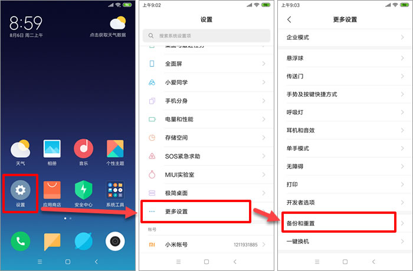
2，点击“本地备份”，按提示输入锁屏密码后，点击“下一步”，最后点击“新建备份”按钮。

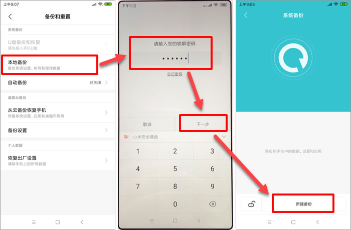
3，将“系统数据“及“软件程序”前面的勾去掉，再点击软件程序右边的小箭头，仅勾选上“微信”后，开始进行备份。

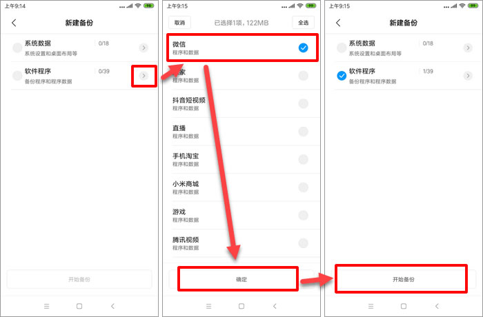
4，备份结束后，将小米手机用数据线连接到电脑上，手机上询问USB的用途，请选择“传输文件”，如果设置为默认的“仅限充电”的话，将无法在电脑上读取手机中的文件。

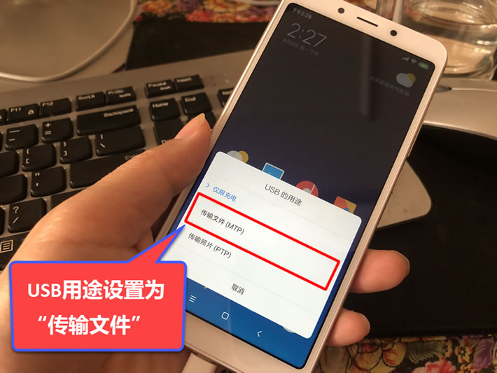
5，进入手机所在盘符下的“MIUI/backup/AllBackup/备份日期时间”目录，将该目录下的微信([com.tencent.mm](http://com.tencent.mm)).bak文件复制到电脑上。

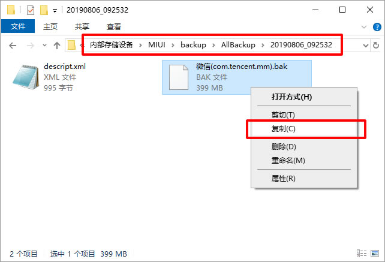
6，右击刚复制出来的“微信([com.tencent.mm](http://com.tencent.mm)).bak”文件，然后使用7-zip软件打开该压缩包。
说明：如果电脑上没有安装7-zip软件的话，需要先在网上搜索并下载安装该软件。
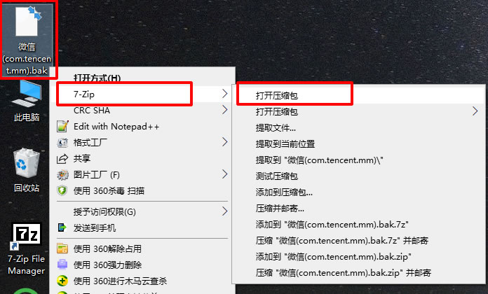
7，进入“apps/[com.tencent.mm/r”目录，将该目录下的MicroMsg文件夹提取出来。](http://com.tencent.mm/r”目录，将该目录下的MicroMsg文件夹提取出来。)

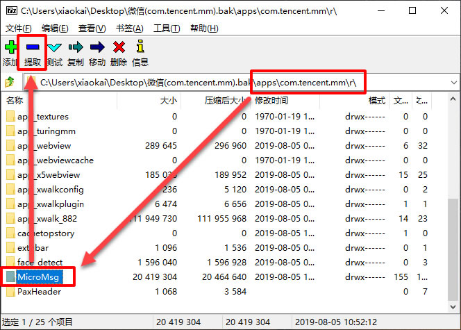
8，因为后面还需要在小米手机上导出另外一个MicroMsg文件夹，为了防止发生覆盖，先将该MicroMsg文件夹重命名为“数据库MicroMsg”，该文件夹中保存了小米手机微信聊天记录的数据库文件。

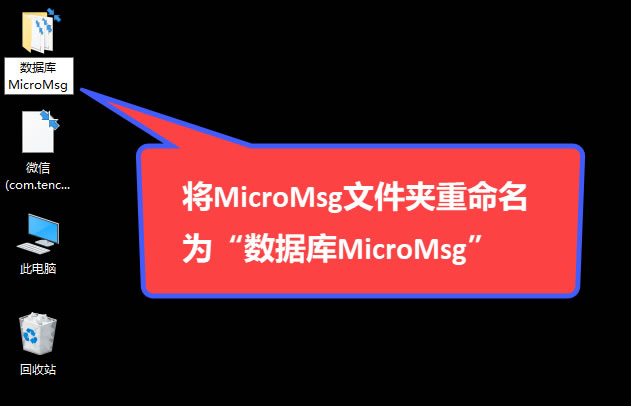
9，再次回到手机上进行操作，打开手机上的“文件管理”，点击右上角的“手机”，进入tencent目录，长按选中该目录下的MicroMsg文件夹后，对其进行压缩。
2020年7月27日更新：新版微信（V7.0.16及以后版本）资源文件不再保存在“tencent/MicroMsg”文件夹中，因些如果是新版微信，则需要打开文件管理后，进入“Android/data/[com.tencent.mm](http://com.tencent.mm)”目录，并长按该目录下的MicroMsg文件夹，并对其进行压缩。

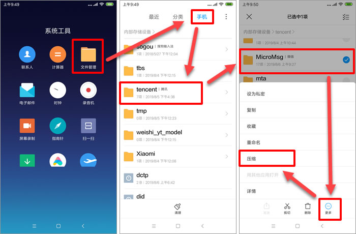
10，在电脑上进入手机所在盘符，如果是老版本微信，将tencent目录下的MicroMsg.zip复制到电脑上，并将其解压到当前文件夹。如果是V7.0.16及以后版本的微信，则需要将"Android/data/[com.tencent.mm](http://com.tencent.mm)"目录下的MicroMsg.zip复制到电脑，并解压到当前文件夹。

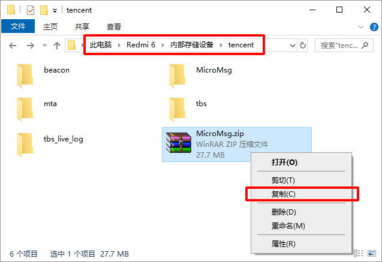
11，最后打开楼月微信聊天记录导出恢复助手（点击此处下载），微信版本设置为“安卓版微信”，数据目录设置为从7-zip软件中提取出来的“数据库MicroMsg”，资源目录设置为解压得到的另外一个MicroMsg文件夹，最后点击“读取数据”按钮，如果软件无法从数据库目录中获取到手机的IMEI码的话，会要求输入该手机的IMEI码。

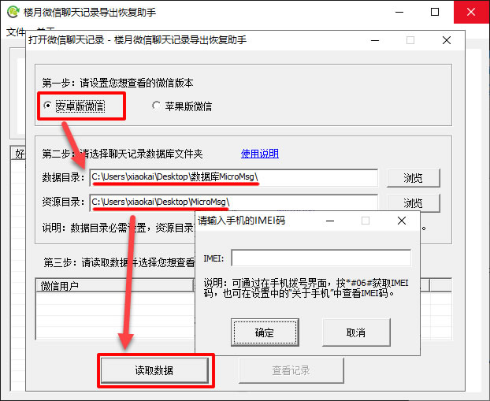
12，在手机拨号界面上，按下*#06#，即可获取到该小米手机的IMEI码，将该码输入到软件界面上即可。但有一些手机，需要输入MEID码才可以解密小米手机微信聊天记录。如果输入IMEI码后，无法解密查看微信聊天记录的话，请尝试输入MEID码，或输入另外一个IMEI码。

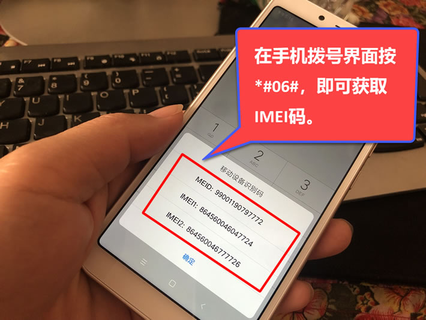
13，最后选择一个想查看的微信号后，点击“查看记录”按钮。

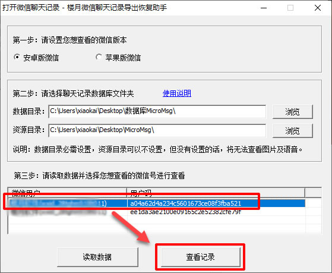
14，在界面上选中要导出的小米手机微信聊天记录，再在键盘上按Ctrl+C进行复制。

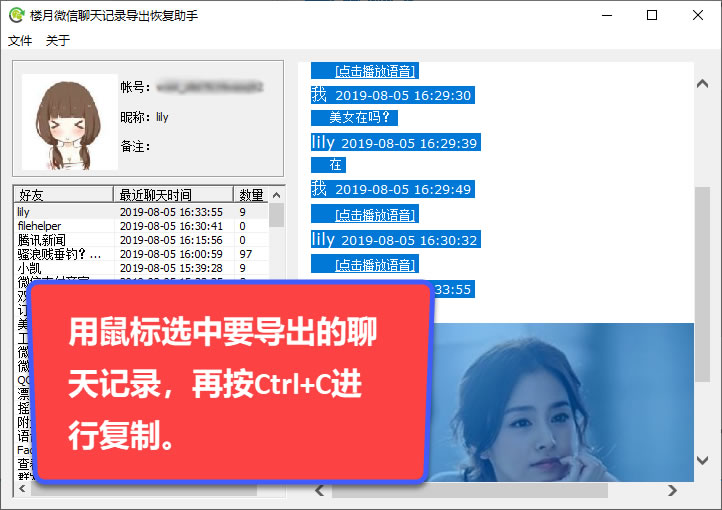
15，然后将复制的微信聊天记录粘贴到电脑上的Word文档中就可以了。

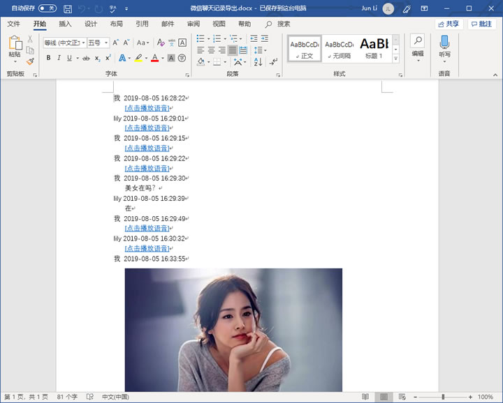
16，另外，也可以通过软件的微信聊天记录导出功能，来批量导出小米手机微信聊天记录中的文字消息，图片，语音消息，视频信息等。
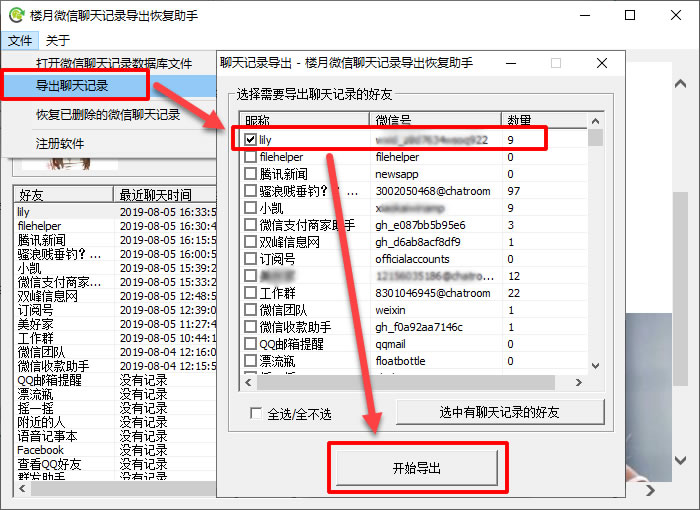
以上就是小米手机微信聊天记录导出到电脑的全过程，导出到电脑后，可在电脑上查看所有聊天内容，也可对小米手机微信聊天记录进行打印。
