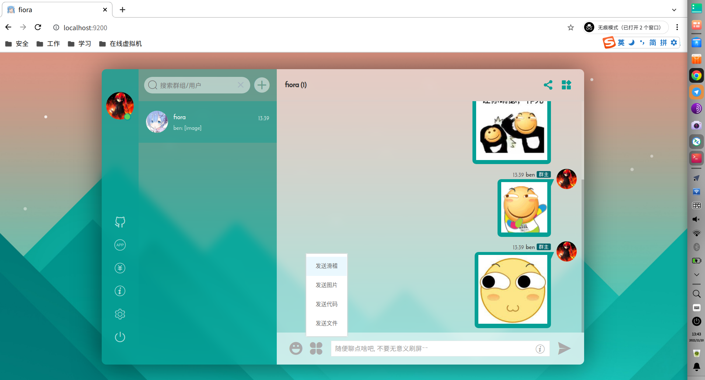

# 自建fiora聊天服务器

> GitHub 仓库源文件：[点击打开网页渲染版](https://github.com/ben2023niao/ben-ops-notes/blob/main/doc/md/202112211603-%E6%9C%8D%E5%8A%A1%E9%83%A8%E7%BD%B2%2BShell%2BDocker-%E8%87%AA%E5%BB%BAfiora%E8%81%8A%E5%A4%A9%E6%9C%8D%E5%8A%A1%E5%99%A8.md)

> 原文：[自建fiora聊天服务器](https://xn--6o0a585a.gitbook.io/devops/fu-wu/zi-jian-fiora-liao-tian-fu-wu-qi.html)

> 来源：GitBook 网页 HTML｜页面时间：2021-12-21 16:03｜日期依据：GitBook 页面更新时间

**直接从 DockerHub 镜像运行** [**https://github.com/yinxin630/fiora**](https://github.com/yinxin630/fiora)

```bash
# 创建虚拟网络
docker network create fiora-network
# 启动 mongodB
docker run --name fioradb -p 27017:27017 --network fiora-network mongo &
# 启动 redis
docker run --name fioraredis -p 6379:6379 --network fiora-network redis &
# 启动 fiora
docker run --name fiora -p 9200:9200 --network fiora-network -e Database=mongodb://fioradb:27017/fiora -e RedisHost=fioraredis suisuijiang/fiora &
```

### [http://203.0.113.1:9200](/devops/fu-wu/zi-jian-fiora-liao-tian-fu-wu-qi#undefined)


