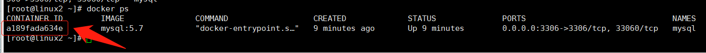
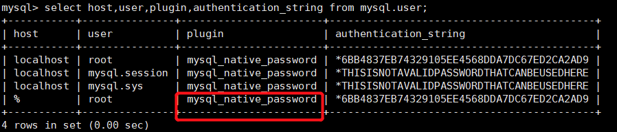
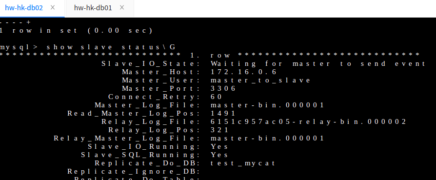
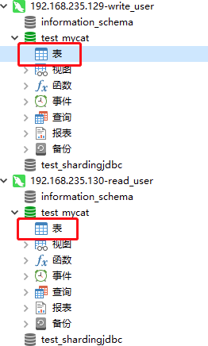
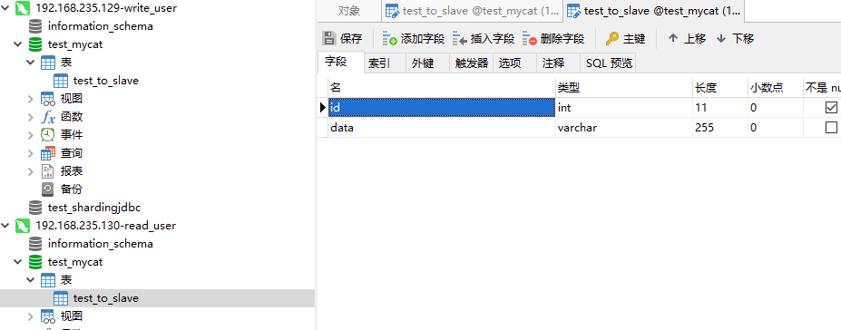
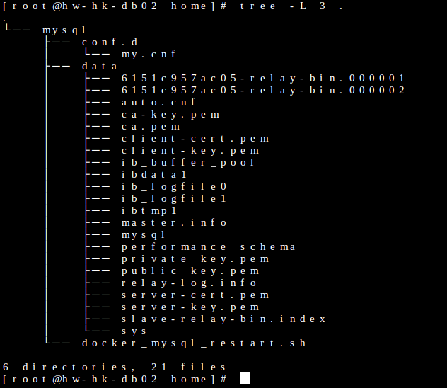
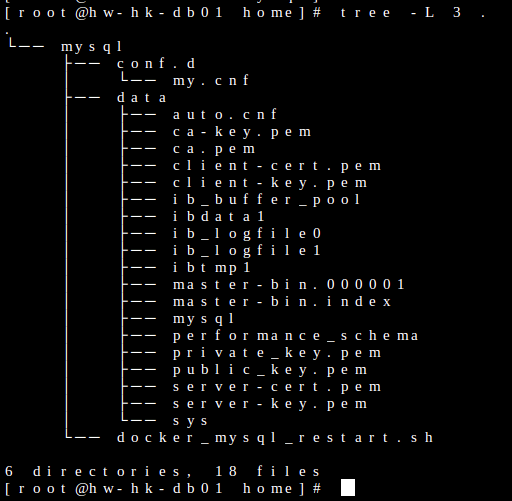

# docker搭建主从数据库及读写分离

> GitHub 仓库源文件：[点击打开网页渲染版](https://github.com/ben2023niao/ben-ops-notes/blob/main/doc/md/202112241757-%E6%95%B0%E6%8D%AE%E5%BA%93%E4%B8%8E%E6%81%A2%E5%A4%8D%2BMySQL%2BShell-docker%E6%90%AD%E5%BB%BA%E4%B8%BB%E4%BB%8E%E6%95%B0%E6%8D%AE%E5%BA%93%E5%8F%8A%E8%AF%BB%E5%86%99%E5%88%86%E7%A6%BB.md)

> 原文：[docker搭建主从数据库及读写分离](https://xn--6o0a585a.gitbook.io/devops/shu-ju-ku/docker-da-jian-zhu-cong-shu-ju-ku-ji-du-xie-fen-li.html)

> 来源：GitBook 网页 HTML｜页面时间：2021-12-24 17:57｜日期依据：GitBook 页面更新时间

### 1、安装准备

#### 1.1、读写分离账号

搭建mysql主从数据库(使用docker镜像分别在两台服务器上搭建数据库）
主服务器ip：203.0.113.1
从服务器ip：203.0.113.1

**拉取docker5.7**

```bash
docker pull mysql:5.7
```

**自定义配置**

**修改master节点配置文件** 进入/home/mysql/conf.d目录，添加my.cnf文件，增加如下内容

```
mkdir -p /home/mysql/conf.d && vim /home/mysql/conf.d/my.cnf
[mysqld]
server-id=1
log-bin=master-bin
```

**修改slave节点配置文件** 进入/home/mysql/conf.d目录，添加my.cnf文件，增加如下内容

```
mkdir -p /home/mysql/conf.d && vim /home/mysql/conf.d/my.cnf
[mysqld]
server-id=2
log-bin=slave-bin
read_only=1
```

**运行镜像**

-–privileged：权限
-–name：容器名
–p：映射宿主主机端口
-v：挂载宿主目录到容器目录
-e：设置环境变量，此处指定root密码
-d：后台运行容器



**进入容器内** 203.0.113.1

**登录** 203.0.113.1



如果上图的plugin不是mysql_native_password可能会导致外网访问不了

**添加账号**

**配置master账号** 203.0.113.1

**配置slave账号** 203.0.113.1



**测试master新增表及表数据是否会同步到slave节点**

初始状态，数据库并不存在表，现在master创建test表 203.0.113.1



用写账号write_user新增test_to_slave表，然后能看到在slave节点同样生成





从mysql文件结构



主 文件结构

主3306 203.0.113.1

root ok5nnbwzfe653c39
主从账号 slave ok5nnbwzfe653c39

从3306 203.0.113.1
root ok5nnbwzfe653c39
主从账号 slave ok5nnbwzfe653c39
