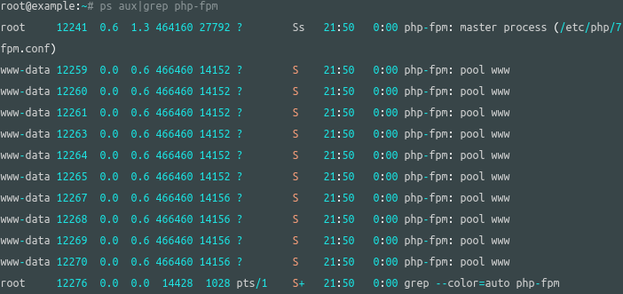

# Laravel 部署：PHP-fpm 配置调优

> GitHub 仓库源文件：[点击打开网页渲染版](https://github.com/ben2023niao/ben-ops-notes/blob/main/doc/md/202112271353-%E6%9C%8D%E5%8A%A1%E9%83%A8%E7%BD%B2%2BShell%2B%E6%BA%90%E7%A0%81%E4%B8%8E%E9%85%8D%E7%BD%AE-Laravel%20%E9%83%A8%E7%BD%B2%EF%BC%9APHP-fpm%20%E9%85%8D%E7%BD%AE%E8%B0%83%E4%BC%98.md)

> 原文：[Laravel 部署：PHP-fpm 配置调优](https://xn--6o0a585a.gitbook.io/devops/fu-wu/laravel-bu-shu/laravel-bu-shu-phpfpm-pei-zhi-tiao-you.html)

> 来源：GitBook 网页 HTML｜页面时间：2021-12-27 13:53｜日期依据：GitBook 页面更新时间

使用 `ps aux|grep php-fpm` 查看 php-fpm 进程，可以看到有三个子进程。

```
root@example:/# ps aux|grep php-fpm
root       574  0.0  0.0 463668   104 ?        Ss   Jun16   0:49 php-fpm: master process (/etc/php/7.2/fpm/php-fpm.conf)
www-data  5320  0.7  2.5 475660 25248 ?        S    00:27   6:41 php-fpm: pool www
www-data  5321  0.7  2.6 475784 26312 ?        S    00:27   6:37 php-fpm: pool www
www-data  9412  0.7  2.5 474632 26156 ?        S    14:04   0:41 php-fpm: pool www
root     11647  0.0  0.1  16148  1040 pts/0    S+   15:33   0:00 grep --color=auto php-fpm
```

进程数是由 `/ etc/php/7.4/fpm/pool.d/www.conf` 指定的：

**pm = dynamic**：子进程的数量是根据以下指令来动态生成的
`pm.max_children`  `pm.start_servers` `pm.min_spare_servers` `pm.max_spare_servers`

**pm = ondemand**：在服务启动的时候根据 `pm.start_servers` 指令生成进程，而非动态生成。

**pm = static**：子进程的数量是由 `pm.max_children` 指令来确定的。

安装好，默认是 `pm = dynamic`

如果服务器内存小，可以默认就好，大内存服务器则可以设置为 `pm = static`，然后 `pm.max_children` 数量根据服务器的内存来决定，这样就可以最大化服务器负载能力。

#### 如何配置

**环境**

- PHP 7.4

这边示例，调为 10 个: `pm.max_children = 10`

设置好重启 php-fpm：`sudo systemctl restart php7.4-fpm`最后看下是否成功：



更多详细信息可以查看 [PHP-FPM 调优：使用 ‘pm static’ 来最大化你的服务器负载能力](https://learnku.com/laravel/t/14952/php-fpm-tuning-use-pm-static-to-maximize-your-server-load-capability)
