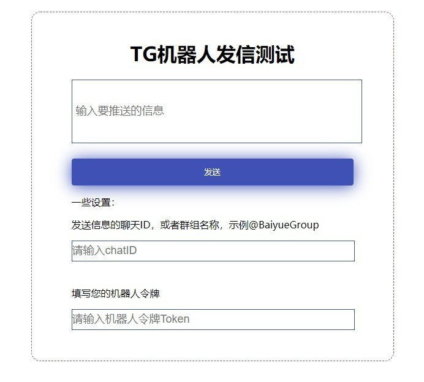
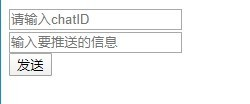

# Javacript创建信息推送页面

> 原文：[Javacript创建信息推送页面](https://xn--6o0a585a.gitbook.io/devops/telegram-ji-qi-ren/javacript-chuang-jian-xin-xi-tui-song-ye-mian.html)

> 来源：GitBook 网页 HTML｜页面时间：2021-12-27 17:11｜日期依据：GitBook 页面更新时间

### 1.初步尝试js调用TGbot机器人

目录：

首先写个简单的Send发送按钮

然后编写`script.js`代码

运行效果如下：

Telegram机器人：用Javacript创建信息推送页面

### 2.逐步完善一下后

代码如下：

最终效果如开篇截图那样。

### 3.小评

这是个人学习TG机器人，初步尝试的产品，虽然再shell命令行和python里有更多扩展，但是最方便入手的，肯定比不上这种单一页面组成的程序。所以，JavaScript还是有必要多学习下。
