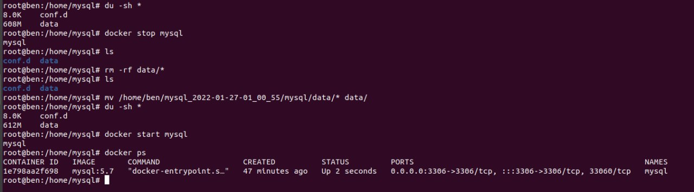

# docker快速恢复备份数据库

> 原文：[docker快速恢复备份数据库](https://xn--6o0a585a.gitbook.io/devops/shu-ju-ku/docker-kuai-su-hui-fu-bei-fen-shu-ju-ku.html)

> 来源：GitBook 网页 HTML｜页面时间：2022-01-30 20:45｜日期依据：GitBook 页面更新时间



```bash
#找台有 docker 环境的电脑
docker run \
--privileged=true \
--name mysql \
-p 3306:3306 \
-v /home/mysql/data:/var/lib/mysql \
-v /home/mysql/conf.d:/etc/mysql/conf.d \
-e MYSQL_ROOT_PASSWORD=[已脱敏] \
-d mysql:5.7

cd /home/mysql
docker stop mysql
rm -rf data/*
mv 备份的二进制文件/* data/*
docker restart mysql

#使用phpmyadmin工具连接 mysql 导出 sql
docker run \
--name phpmyadmin \
--link mysql \
-e PMA_HOST="mysql" \
-p 6061:80 \
-d phpmyadmin/phpmyadmin

#浏览器打开 http://203.0.113.1:6061
root
ok5nnbwzfe653c39
#登陆导出 sql
```
