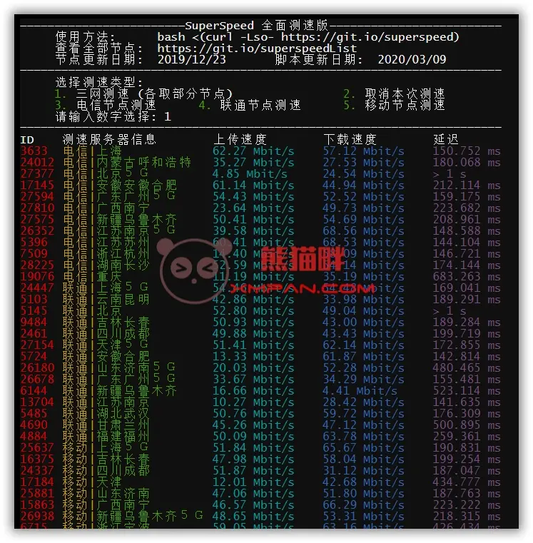

# 一键测试服务器到国内外各地速度脚本

> 原文：[一键测试服务器到国内外各地速度脚本](https://xn--6o0a585a.gitbook.io/devops/an-quan/yi-jian-ce-shi-fu-wu-qi-dao-guo-nei-wai-ge-di-su-du-jiao-ben.html)

> 来源：GitBook 网页 HTML｜页面时间：2022-01-31 14:04｜日期依据：GitBook 页面更新时间



```
#3个脚本
superbench
wget -qO- git.io/superbench.sh | bash

Bench.sh
wget -qO- bench.sh | bash

三网测速
bash <(curl -Lso- http://yun.789888.xyz/speedtest.sh)
```
