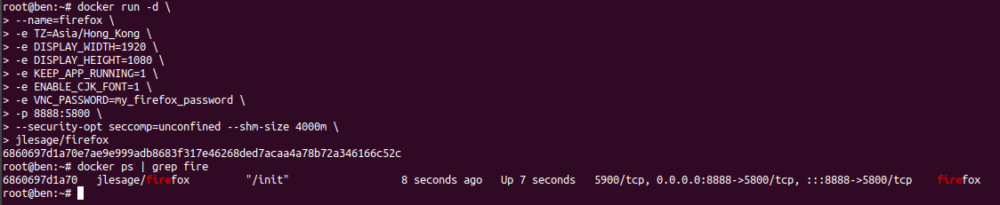
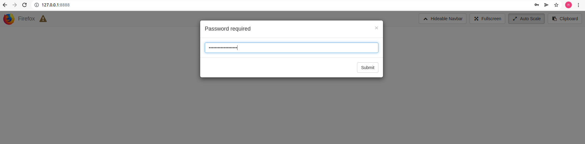

# 后台安全登陆

> 原文：[后台安全登陆](https://xn--6o0a585a.gitbook.io/devops/an-quan/hou-tai-an-quan-deng-lu.html)

> 来源：GitBook 网页 HTML｜页面时间：2022-02-04 12:09｜日期依据：GitBook 页面更新时间

```bash
docker run -d \
--name=firefox \
-e TZ=Asia/Hong_Kong \
-e DISPLAY_WIDTH=1920 \
-e DISPLAY_HEIGHT=1080 \
-e KEEP_APP_RUNNING=1 \
-e ENABLE_CJK_FONT=1 \
-e VNC_PASSWORD=my_firefox_password \
-p 6888:5800 \
--security-opt seccomp=unconfined --shm-size 4000m \
jlesage/firefox
```

参数解释样例TZ

时区。

Asia/Hong_Kong

DISPLAY_WIDTH

浏览器分辨率长。

1920

DISPLAY_HEIGHT

浏览器分辨率高。

1080

KEEP_APP_RUNNING

是否保持运行。不保持的话选 `0`，即所有标签关闭后容器停止。

1

ENABLE_CJK_FONT

字体选项不开启中文会乱码。

1

VNC_PASSWORD

访问密码。

my_*firefox*_password

`--security-opt seccomp=unconfined` 允许容器执行全部的系统的调用，即给予容器最大权限；
`--shm-size 4000m` 限制容器内存占用。





[http://203.0.113.1:6888](http://203.0.113.1:8888/)
密码 my_*firefox*_password

然后 nginx 设置后台目录路径只指定 firefox 容器 ip 访问
