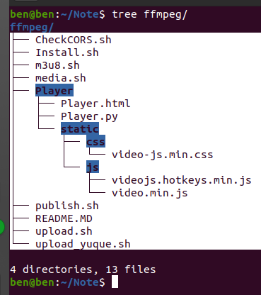

# ffmpeg一键切片并发布

> GitHub 仓库源文件：[点击打开网页渲染版](https://github.com/ben2023niao/ben-ops-notes/blob/main/doc/md/202202051649-%E9%9F%B3%E8%A7%86%E9%A2%91%E5%A4%84%E7%90%86%2BShell%2B%E6%BA%90%E7%A0%81%E4%B8%8E%E9%85%8D%E7%BD%AE-ffmpeg%E4%B8%80%E9%94%AE%E5%88%87%E7%89%87%E5%B9%B6%E5%8F%91%E5%B8%83.md)

> 原文：[ffmpeg一键切片并发布](https://xn--6o0a585a.gitbook.io/devops/se-zhan-zi-dong-hua/ffmpeg-yi-jian-qie-pian-bing-fa-bu.html)

> 来源：GitBook 网页 HTML｜页面时间：2022-02-05 16:49｜日期依据：GitBook 页面更新时间

**1、安装ffmpeg**

```
wget https://www.moerats.com/usr/down/ffmpeg/ffmpeg-git-$(getconf LONG_BIT)bit-static.tar.xz
tar xvf ffmpeg-git-*-static.tar.xz
mv ffmpeg-git-*/ffmpeg  ffmpeg-git-*/ffprobe /usr/local/bin/
rm -rf ffmpeg-git-*
```

**2、安装脚本**

```
#新建/opt/ffmpeg文件夹存放脚本等文件
mkdir /opt/ffmpeg && cd $_
#下载并运行脚本
wget https://raw.githubusercontent.com/MoeClub/Note/master/ffmpeg/Install.sh
bash Install.sh
```

**3、启动播放器**
由于切片生成`m3u8`文件后，需要播放器才能播放，而上传脚本也会自动推送`m3u8`文件到播放器根目录，所以这里可以配合一起用，当然自己会播放`m3u8`的也可以不用搭建，自行选择。



ffmpeg一键切片并发布.zip 目录结构

[ffmpeg一键切片并发布.zip](https://2790782217-files.gitbook.io/~/files/v0/b/gitbook-x-prod.appspot.com/o/spaces%2F1B0zycoBrU18tXqA0db8%2Fuploads%2FeMLICtygdmp0WP9Yx8qo%2Fffmpeg%E4%B8%80%E9%94%AE%E5%88%87%E7%89%87%E5%B9%B6%E5%8F%91%E5%B8%83.zip?alt=media&token=[已脱敏] · 150KB[Open](https://2790782217-files.gitbook.io/~/files/v0/b/gitbook-x-prod.appspot.com/o/spaces%2F1B0zycoBrU18tXqA0db8%2Fuploads%2FeMLICtygdmp0WP9Yx8qo%2Fffmpeg%E4%B8%80%E9%94%AE%E5%88%87%E7%89%87%E5%B9%B6%E5%8F%91%E5%B8%83.zip?alt=media&token=[已脱敏]

ffmpeg一键切片并发布.zip 解压将 upload.sh, publish.sh, m3u8.sh, media.sh 放入同一个文件夹中

## 获取媒体文件时长

## 获取媒体文件大小

## 获取媒体文件比特率

## 获取视频文件编码

## 视频文件直接切片

## M3U8合成视频文件

## 分片时长计算(VBR, 大约)

## 字幕格式转换([webvtt.org](https://www.webvtt.org/))
