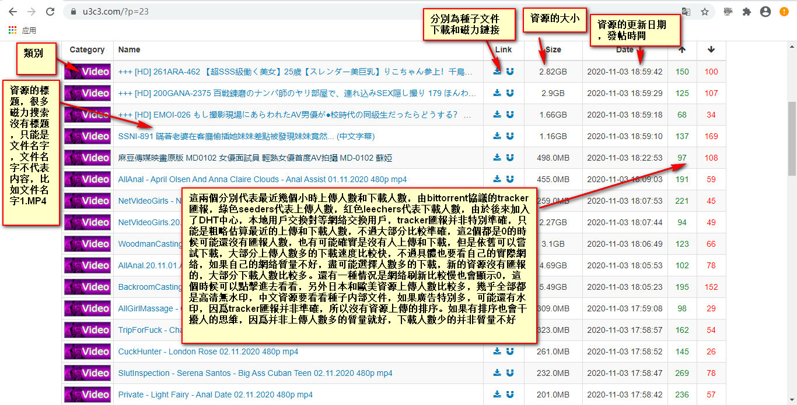

# 自动化下载片源

> GitHub 仓库源文件：[点击打开网页渲染版](https://github.com/ben2023niao/ben-ops-notes/blob/main/doc/md/202202071929-%E9%9F%B3%E8%A7%86%E9%A2%91%E5%A4%84%E7%90%86%2B%E8%87%AA%E5%8A%A8%E5%8C%96-%E8%87%AA%E5%8A%A8%E5%8C%96%E4%B8%8B%E8%BD%BD%E7%89%87%E6%BA%90.md)

> 原文：[自动化下载片源](https://xn--6o0a585a.gitbook.io/devops/se-zhan-zi-dong-hua/zi-dong-hua-xia-zai-pian-yuan.html)

> 来源：GitBook 网页 HTML｜页面时间：2022-02-07 19:29｜日期依据：GitBook 页面更新时间

<https://u3c3.com/?p=23>

自动化采集视频 种子 和 磁力连接 下载脚本

1. 主页面 https://u3c3.com/
2. 综合 https://u3c3.com/?p=1
3. 国产图片 https://u3c3.com/?type=U3C3&p=1
4. 视频 https://u3c3.com/?type=Video&p=1
5. 照片 https://u3c3.com/?type=Photo&p=1
6. 黄书 https://u3c3.com/?type=Book&p=1
7. 游戏 https://u3c3.com/?type=Game&p=1
8. 软件 https://u3c3.com/?type=Software&p=1
9. 其它 https://u3c3.com/?type=Other&p=1
10. 上传 https://u3c3.com/upload
