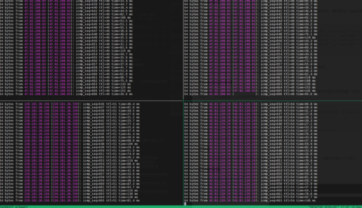

# 多线程parallel命令 「纯干货」

> GitHub 仓库源文件：[点击打开网页渲染版](https://github.com/ben2023niao/ben-ops-notes/blob/main/doc/md/202202091358-%E8%BF%9B%E9%98%B6%E6%8A%80%E6%9C%AF%2BShell%2BPython-%E5%A4%9A%E7%BA%BF%E7%A8%8Bparallel%E5%91%BD%E4%BB%A4%20%E3%80%8C%E7%BA%AF%E5%B9%B2%E8%B4%A7%E3%80%8D.md)

> 原文：[多线程parallel命令 「纯干货」](https://xn--6o0a585a.gitbook.io/devops/jin-jie-ji-shu/duo-xian-cheng-parallel-ming-ling-chun-gan-huo.html)

> 来源：GitBook 网页 HTML｜页面时间：2022-02-09 13:58｜日期依据：GitBook 页面更新时间

有时，我们需要处理一批数据，使用while循环是个不错的想法，但while循环中的命令是一个一个执行的，如果要批量处理的数据很多，执行时间就会很长，而parallel可以让命令并行执行，从而缩短命令执行时间。 下面，我们先用ncat来模拟一个处理数据的接口。

**模拟接口**

```
apt -y install ncat
ncat -lk 8088 -c 'sleep 1;printf "HTTP/1.1 200 OK\r\nContent-Type: plain/text\r\nContent-Length: 3\r\n\r\nok\n"'
```

此接口直接睡眠1秒，然后返回一个ok，表示数据处理成功。

**调用接口**

```
curl -X POST http://localhost:8088/user/add -d '{"user_id": 1, "user_name":"u1"}'
```

**测试数据**

假设有10条数据，在data.txt中，如下：

```
1 u1
2 u2
3 u3
...
```

**使用while循环处理**

```
time while read -r -a line; do
      curl -X POST http://localhost:8088/user/add -d '{"user_id": '${line[0]}', "user_name":"'${line[1]}'"}'
  done < data.txt
ok
ok
ok
ok
ok
ok
ok
ok
ok
ok

real    0m10.276s
user    0m0.094s
sys     0m0.096s
```

使用while循环处理，其中time命令用来计时，real表示while命令的执行时间，可以看到，处理完10条数据花了约10秒，接下来我们使用parallel并发执行。

**使用parallel并发执行**

使用parallel命令并发执行curl，-j10表示最多10个并发进程，`-C '\s+'` 表示使用空白来拆分每行(注：\s+是表示空白的正则表达式)，这样就可以使用{1}表示第1列，{2}表示第2列了，如我们所预期的，10条数据使用10个并发，处理完约1秒。

**有用的--tag选项**

上例的接口很简单，直接返回ok，但在有大量数据需要处理时，有可能出现部分数据处理失败，像上面的执行结果中，就很难知道是哪些数据处理失败了，还好parallel提供了`--tag`选项，可以将处理的数据与执行结果都打印出来，如下：

这样，什么数据执行对应什么结果，就一目了然了。

**查看进度**

如果有大量数据需要处理[，](https://www.pinganzhangjinping.cn/zhongjixian) 处理时能直观的看到一个进度就再好不过了，parallel提供了3个查看进度的选项，`--bar`、`--progress`和`--eta`，一般使用`--bar`、`--progress`即可。 其中`--bar`适合待处理数据量确定的场景，因为parallel需要读取所有数据后才能根据数据总量计算进度条。 而`--progress`适合待处理数据量未知的场景，只能看到已经处理了多少条数据，如下：

**--joblog与--resume-failed选项**

相信当你使用脚本处理有一定数据量的数据时，一定会遇到数据偶尔处理失败的情况(由于网络不稳定)，这时你需要将处理失败的数据再次找出来，然后再次处理，过程还是挺麻烦的。 好在parallel命令已经考虑到了这种场景，并提供了--joblog与--resume-failed选项，当有失败产生时，你只需要再次执行整个命令行即可。

**--semaphore选项**

parallel既然提供了并发，那么必然会遇到并发冲突问题，比如sed命令就不支持并发的修改同一文件，不过parallel已经提供了`--semaphore`选项来解决这个问题了。 如下，其中sem是`parallel --semaphore`的别名，与其是等价的。

这里的逻辑是，每处理成功`data.txt`中的一条数据，就使用sed将`data.txt`中的那行数据末尾加一个ok，表示执行成功，然后在前面使用grep找不包含ok的数据，就达到了命令每次都处理未处理或处理失败数据的逻辑。而sem -j1保护了sed，避免sed命令并发执行。

**与mysql结合使用**

parallel还可以和mysql结合使用，将任务导入mysql中或是执行mysql中的任务，如下：

**处理csv数据**

parallel命令还能很方便的处理csv文件数据，比如将`data.txt`改为`data.csv`，如下：

**--pipe选项**

有很多文本处理命令，并不从参数中获取数据，而是从标准输入中获取，比如paste，通过指定`--pipe`选项，能将数据传入到待执行命令的输入流中去。

第一个parallel将每条数据变成了`{"user_id": 1, "user_name":"u1"}`形式。 第二个parallel将每3个json传给paste的输入流，然后paste使用逗号将它们连接起来。 每三个sed给首尾加上[]，即成为了需要的数据格式。

**与tmux结合使用**

parallel提供了`--tmuxpane`，使得可以实现在tmux的多个panel中执行命令，这非常适合用来观察一些监控命令的结果，比如查看每台主机的网络情况。

如下，为tmux面板的内容，你将能直观的看到4台机器的ping实时结果。



#### 总结

如果你经常使用shell来帮助你处理各种问题，我想parallel命令就非常适合你，它真的太强大太方便了。
