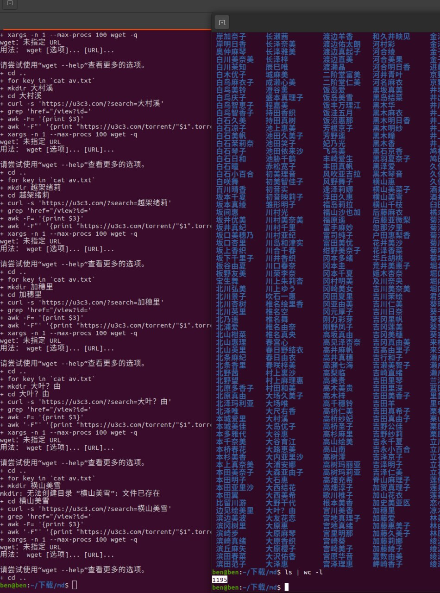

# 自动化按照 AV 分类下载种子 脚本

> GitHub 仓库源文件：[点击打开网页渲染版](https://github.com/ben2023niao/ben-ops-notes/blob/main/doc/md/202202091701-%E9%9F%B3%E8%A7%86%E9%A2%91%E5%A4%84%E7%90%86%2BShell%2B%E8%87%AA%E5%8A%A8%E5%8C%96-%E8%87%AA%E5%8A%A8%E5%8C%96%E6%8C%89%E7%85%A7%20AV%20%E5%88%86%E7%B1%BB%E4%B8%8B%E8%BD%BD%E7%A7%8D%E5%AD%90%20%E8%84%9A%E6%9C%AC.md)

> 原文：[自动化按照 AV 分类下载种子 脚本](https://xn--6o0a585a.gitbook.io/devops/se-zhan-zi-dong-hua/zi-dong-hua-an-zhao-av-fen-lei-xia-zai-zhong-zi-jiao-ben.html)

> 来源：GitBook 网页 HTML｜页面时间：2022-02-09 17:01｜日期依据：GitBook 页面更新时间



```bash
#!/bin/bash
for n in {1..21}; do for i in `curl -s "https://www.jieav.com/special/av-$n.html" | grep '<li class="title">' | sed "s/<li class=\"title\">//" | sed "s/<\/li>//"`; do echo $i ; done;done > av.txt
for key in `cat av.txt`;do
	#echo "高桥圣子" | tr -d '\n' | xxd -plain | sed 's/\(..\)/%\1/g'
	#echo "高桥圣子" | tr -d '\n' | od -An -tx1 | tr ' ' %
	#mkdir $key ; cd $key ; curl -s "https://u3c3.com/?search=$key" | grep 'href="/view?id=' | awk -F'=' '{print $3}' | awk -F'"' '{print "https://u3c3.com/torrent/"$1".torrent"}' | xargs -n 1 --max-procs 100 wget -q ; cd ..
	mkdir $key ; cd $key ; curl -s "https://u3c3.com/?search=`echo "$key" | tr -d '\n' | od -An -tx1 | tr ' ' %`" | grep 'href="/view?id=' | awk -F'=' '{print $3}' | awk -F'"' '{print "https://u3c3.com/torrent/"$1".torrent"}' | xargs -n 1 --max-procs 100 wget -q ; cd ..
done
```
