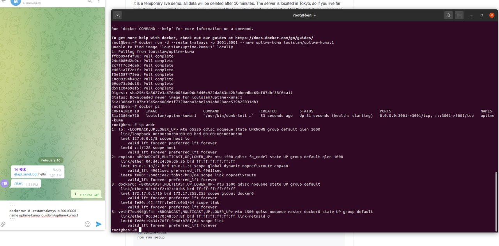
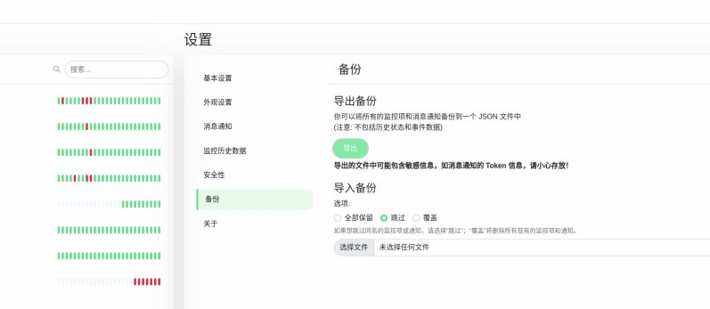

# 接口监控报警

> 原文：[接口监控报警](https://xn--6o0a585a.gitbook.io/devops/jian-kong/jie-kou-jian-kong-bao-jing.html)

> 来源：GitBook 网页 HTML｜页面时间：2022-02-16 14:36｜日期依据：GitBook 页面更新时间

```bash
docker run -d --restart=always -p 3001:3001 --name uptime-kuma louislam/uptime-kuma:1
```



迁移


