# 苹果自动化构建发布

> 原文：[苹果自动化构建发布](https://xn--6o0a585a.gitbook.io/devops/zi-dong-hua/ping-guo-zi-dong-hua-gou-jian-fa-bu.html)

> 来源：GitBook 网页 HTML｜页面时间：2022-02-18 15:30｜日期依据：GitBook 页面更新时间

docker run 苹果系统 然后做自动化 xcode 打包发布苹果 app

```
#docker run 苹果操作系统笔记
##################################
#linux安装环境
# ARCH
sudo pacman -S qemu libvirt dnsmasq virt-manager bridge-utils flex bison iptables-nft edk2-ovmf
# UBUNTU DEBIAN
sudo apt install qemu qemu-kvm libvirt-clients libvirt-daemon-system bridge-utils virt-manager libguestfs-tools
# CENTOS RHEL FEDORA
sudo yum install libvirt qemu-kvm
##################################
#自启动 libvirt 和加载 kvm 内核模块
sudo systemctl enable --now libvirtd
sudo systemctl enable --now virtlogd
echo 1 | sudo tee /sys/module/kvm/parameters/ignore_msrs
sudo modprobe kvm
##################################
#docker run 苹果操作系统
sudo docker run -it \
    --device /dev/kvm \
    -p 50922:10022 \
    -v /tmp/.X11-unix:/tmp/.X11-unix \
    -e "DISPLAY=${DISPLAY:-:0.0}" \
    -e GENERATE_UNIQUE=true \
    -e MASTER_PLIST_URL=https://raw.githubusercontent.com/sickcodes/osx-serial-generator/master/config-custom.plist \
    sickcodes/docker-osx:big-sur
#然后在弹出的界面安装初始化 mac 系统
##################################
#重启docker版mac系统
sudo docker ps -a

# xxx 为对应的CONTAINER ID
sudo docker start -ai xxxxx
##################################
#移植Docker版mac镜像
#在docker目录找到对应的镜像文件，然后备份这个文件
sudo find /var/lib/docker -size +10G | grep mac_hdd_ng.img
#使用naked启动，同时附上备份的文件，添加参数-e RAM=6，这个表示虚拟系统使用的内存大小，可以根据自己的硬件环境选择合适的大小
sudo docker run -it \
    --device /dev/kvm \
    -p 50922:10022 \
    -v "${PWD}/mac_hdd_ng.img:/image" \
    -v /tmp/.X11-unix:/tmp/.X11-unix \
    -e "DISPLAY=${DISPLAY:-:0.0}" \
    -e "NOPICKER=false" \
    -e RAM=6 \
    sickcodes/docker-osx:naked
```

linux安装环境
apt install qemu qemu-kvm libvirt-clients libvirt-daemon-system bridge-utils virt-manager libguestfs-tools

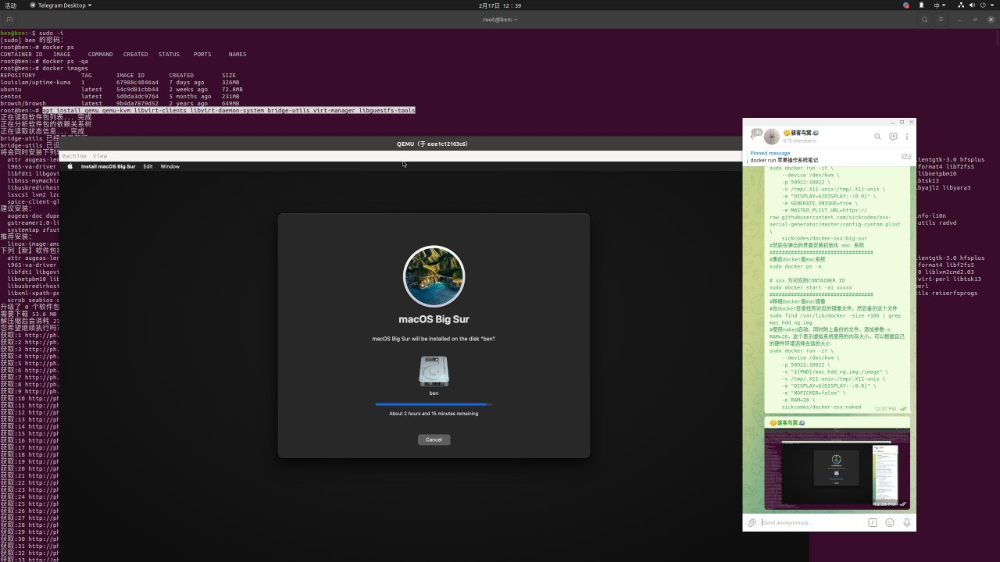

自启动 libvirt 和加载 kvm 内核模块
sudo systemctl enable --now libvirtd
sudo systemctl enable --now virtlogd
echo 1 | sudo tee /sys/module/kvm/parameters/ignore_msrs
sudo modprobe kvm

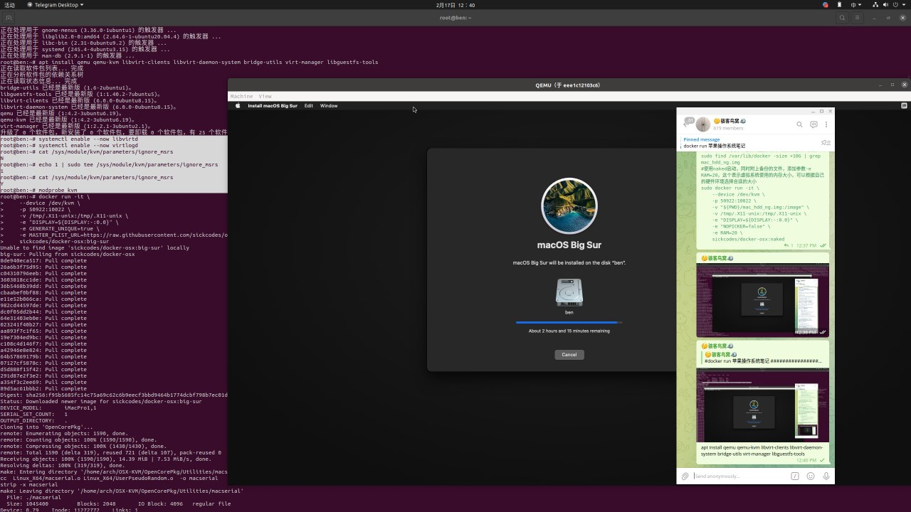

#docker run 苹果操作系统
sudo docker run -it
--device /dev/kvm
-p 50922:10022
-v /tmp/.X11-unix:/tmp/.X11-unix
-e "DISPLAY=${DISPLAY:-:0.0}"
-e GENERATE_UNIQUE=true
-e MASTER_PLIST_URL=https://raw.githubusercontent.com/sickcodes/osx-serial-generator/master/config-custom.plist
sickcodes/docker-osx:big-sur
#然后在弹出的界面安装初始化 mac 系统

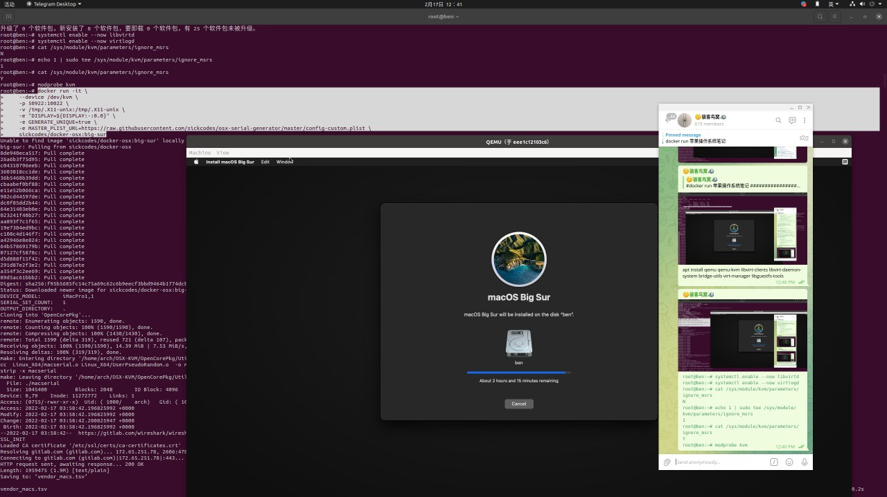

然后docker就会调起 qemu 窗口启动运行 mac 系统

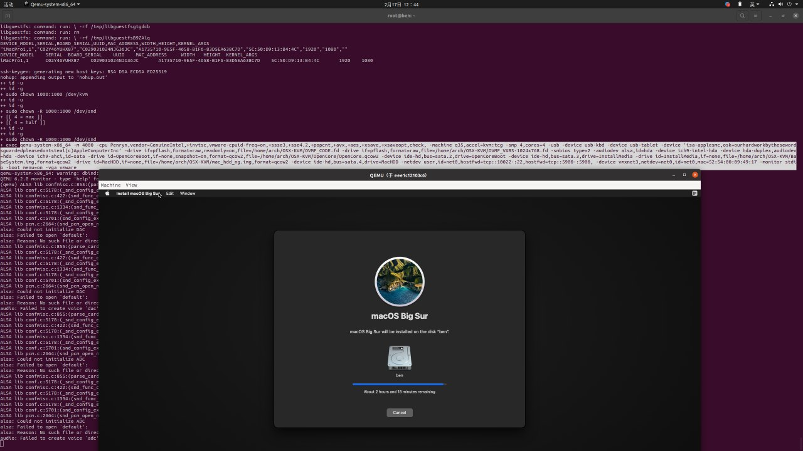

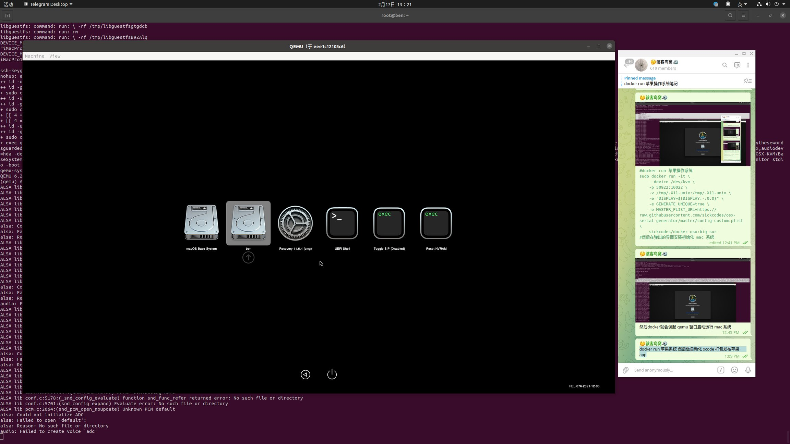

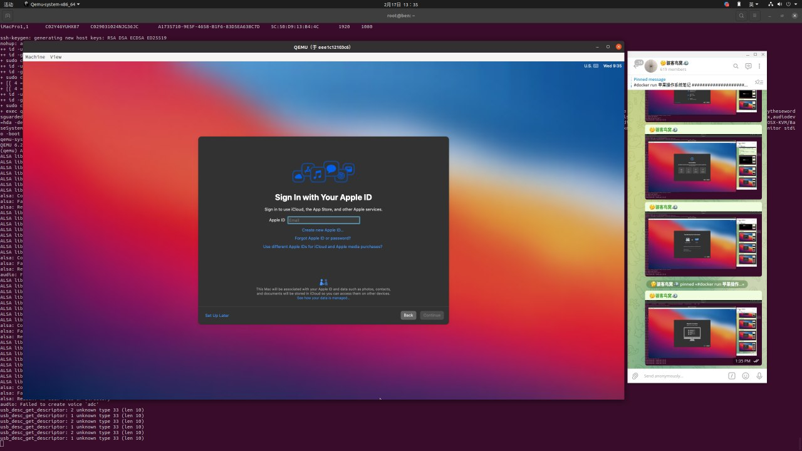

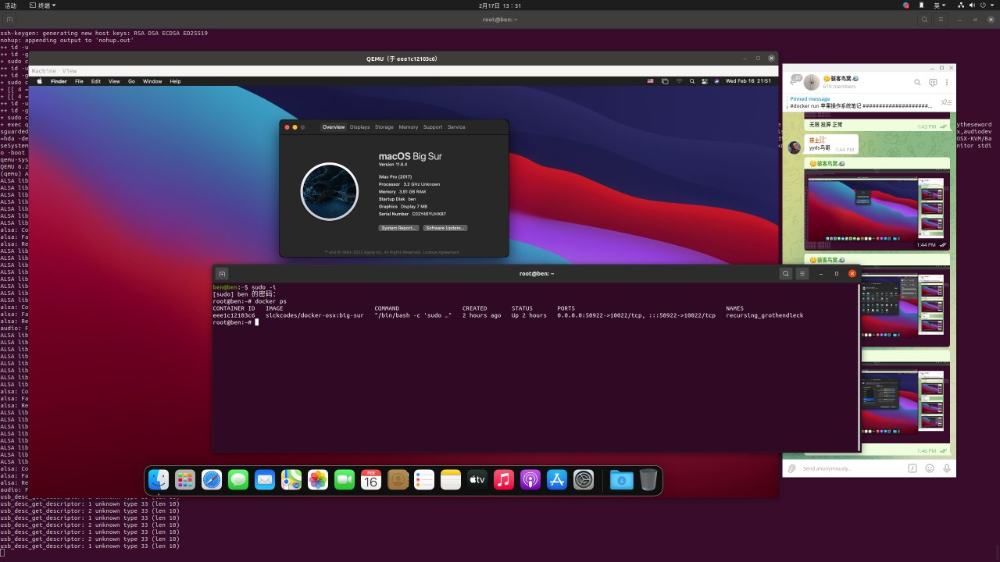

迁移 docker 版 mac 系统

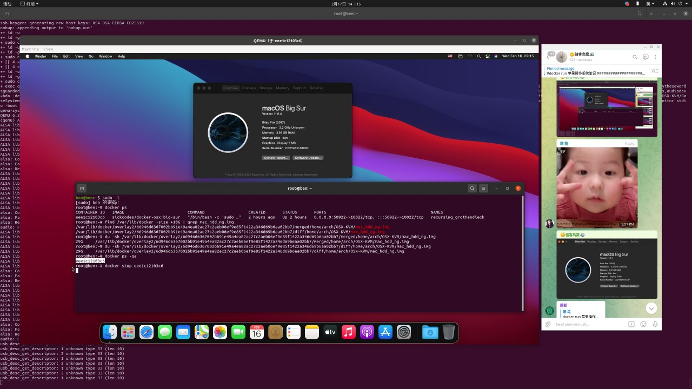

docker stop eee1c12103c6

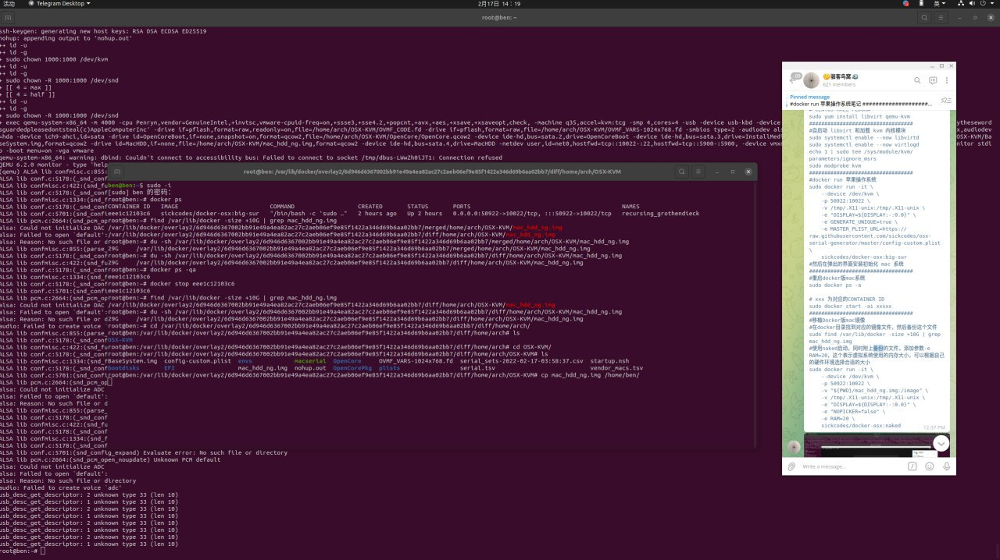

备份 mac_hdd_ng.img

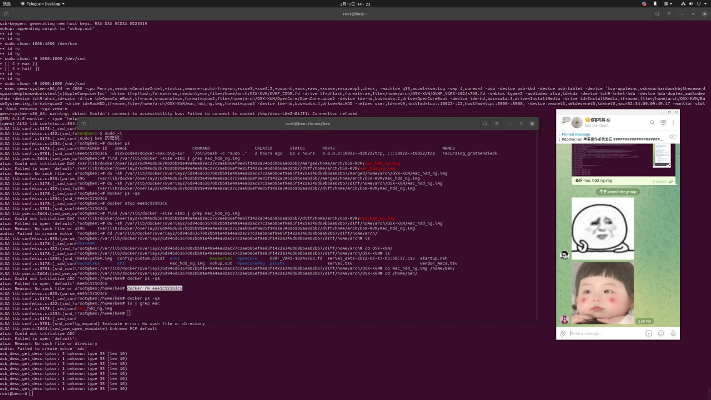

docker rm eee1c12103c6

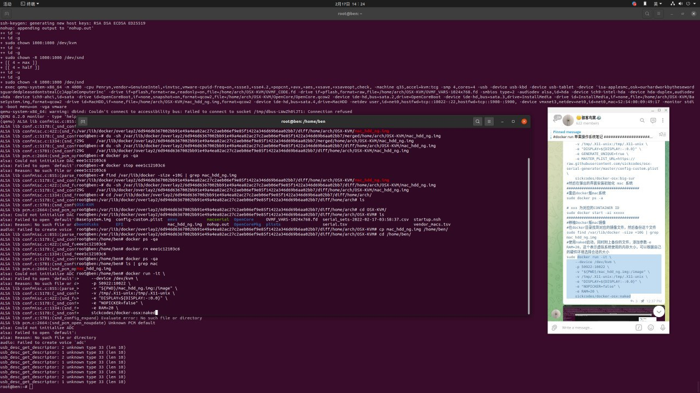

docker启动迁移的mac备份

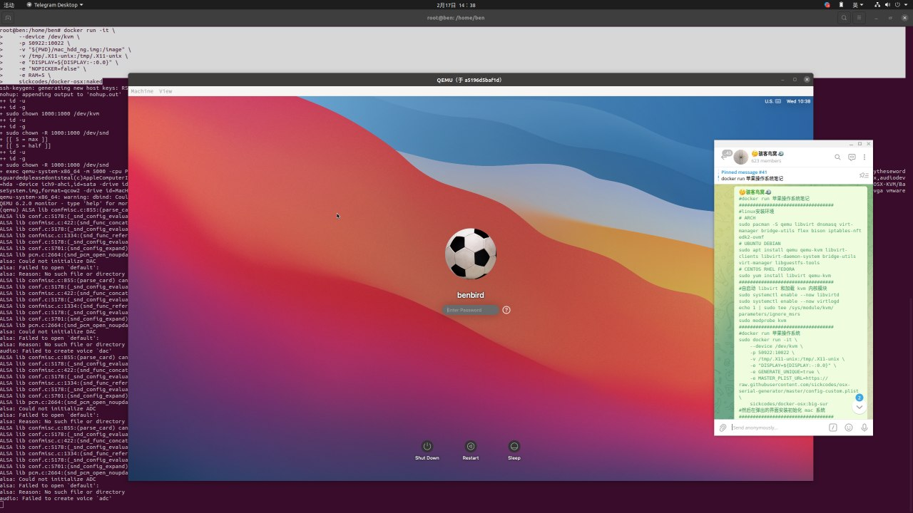

完美迁移docker 版 mac

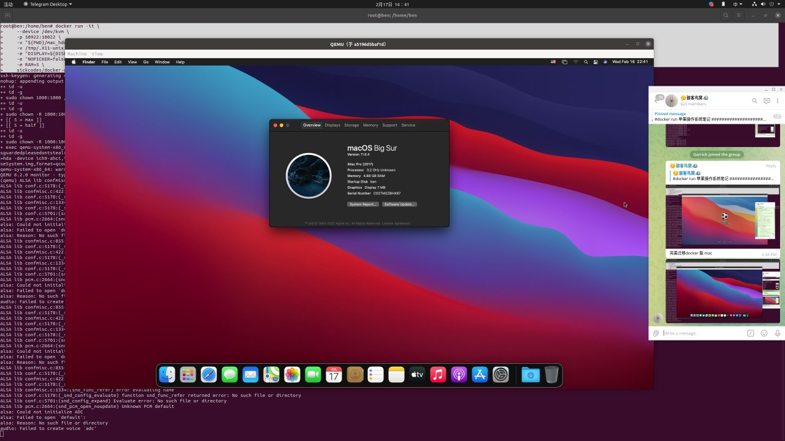

迁移启动的mac镜像 /home/ben/mac_hdd_ng.img

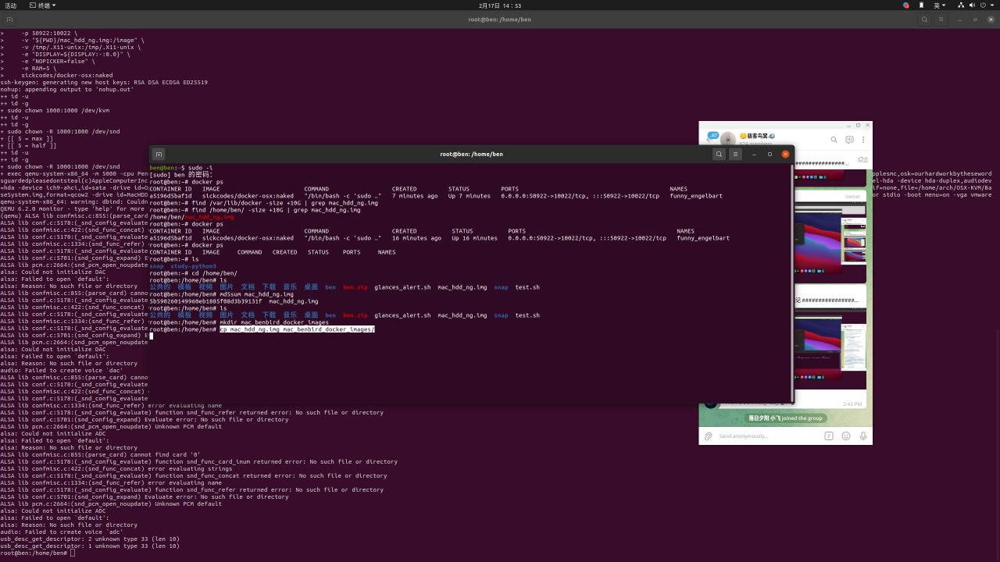

备份压缩 mac_hdd_ng.img 镜像 ，随身携带的 docker 版 mac
