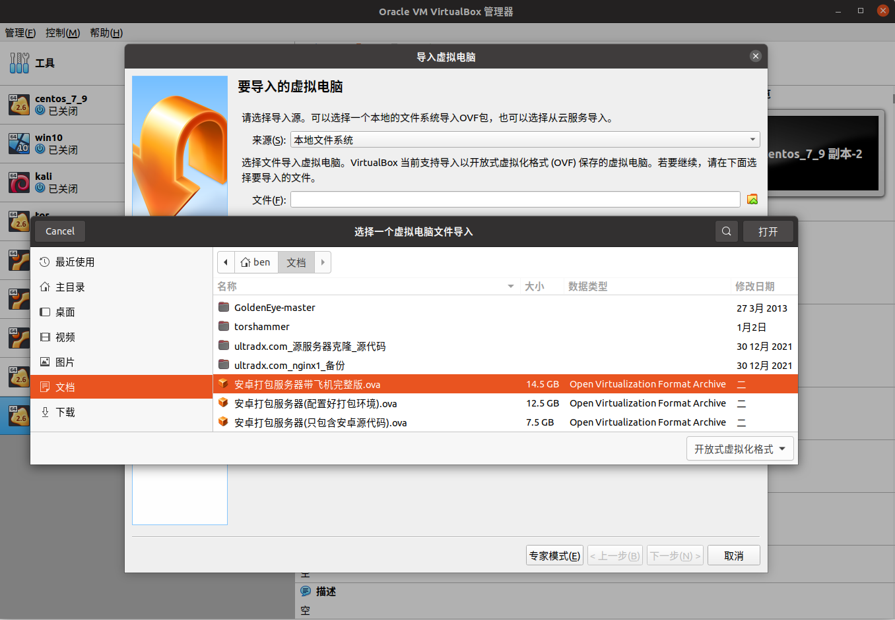
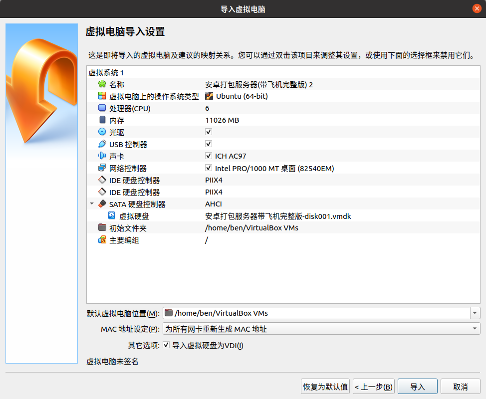
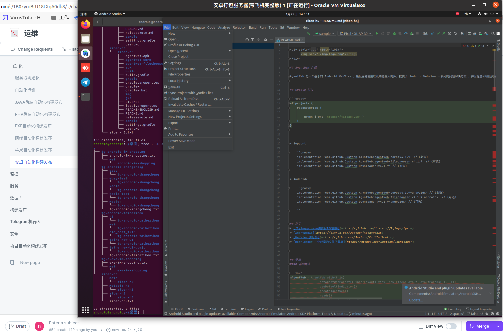
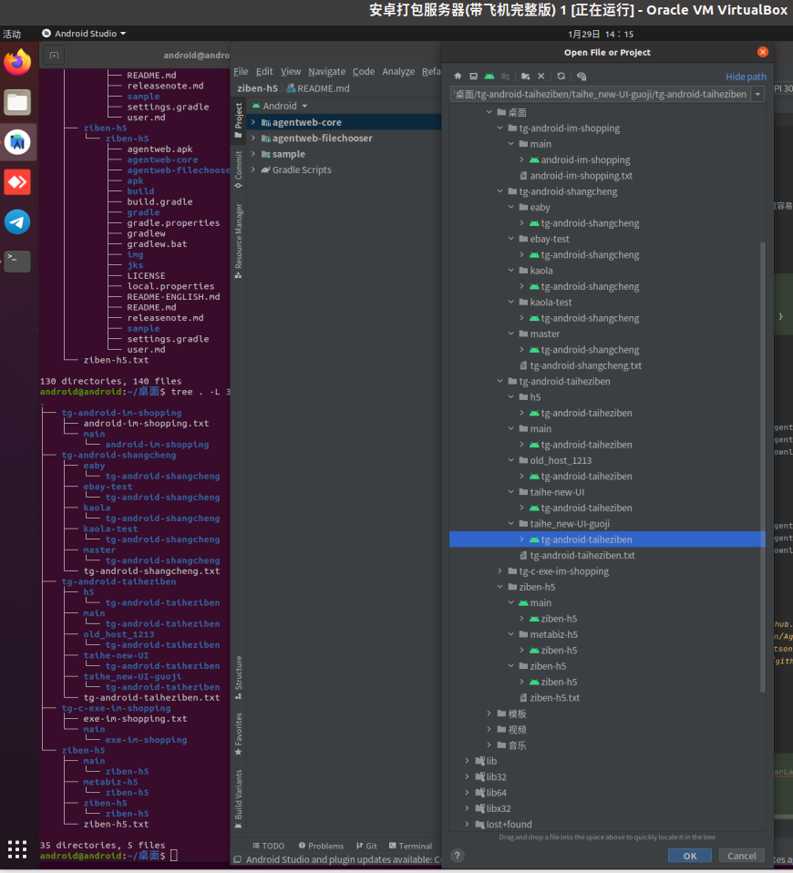
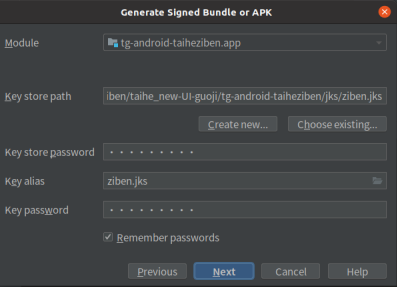
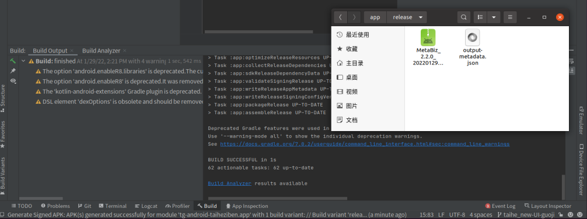

# VirtualBox 安卓自动化构建发布

> 原文：[VirtualBox 安卓自动化构建发布](https://xn--6o0a585a.gitbook.io/devops/zi-dong-hua/an-zhuo-zi-dong-hua-gou-jian-fa-bu/virtualbox-an-zhuo-zi-dong-hua-gou-jian-fa-bu.html)

> 来源：GitBook 网页 HTML｜页面时间：2022-02-24 14:01｜日期依据：GitBook 页面更新时间

安卓打包

1 电脑安装 virtualbox 注意电脑主板 boot 要开启 CPU 虚拟化

https://www.virtualbox.org/wiki/Downloads

2 下载镜像 安卓打包服务器带飞机完整版.ova 镜像
账号 android
密码 android

3 导入镜像开箱就可打包

导入 安卓打包服务器带飞机完整版.ova 镜像

选择 为所有网卡重新生成 MAC 地址

虚拟机内进入桌面的安卓各个分支源代码 git pull 就可拉最新代码
点击 android studio 点击 左上角 File -> Open -> 选择在桌面的 安卓各个分支源代码

1.IM项目

地址：android-im-shopping
分支main：主分支
项目语言：android+java项目

2.彩票项目

地址：tg-android-shangcheng

分支kaola：考拉的生产分支

分支kaola-test：考拉的测试分支

分支ebay：ebay的生产分支

分支ebay-test：ebay的测试分支

项目语言：android+kotlin项目

3.资本项目

地址：tg-android-taiheziben

分支taihe-new-UI ：泰和资本的分支

分支taihe-new-UI-guoji ：英文版本metabiz的分支

分支h5:蓝色版本的分支

分支main:白色版本的分支

项目语言：android+kotlin项目

4.h5打包的项目

地址：ziben-h5

分支taihe-h5：泰和资本的分支

分支metabiz-h5：英文版本metabiz的分支

项目语言：android+kotlin+java项目

5.IM C打包exe

地址：exe-im-shopping

项目语言：C#项目

点击 左上角 Build -> Generate Sigened Bundle... 选择 APK
key store password
key alias
key pasword
这3个都填写 证书文件名

选择 release 点击 左下角 Build BUILD SUCCESSFUL in 1s 就打包成功咯

后期 渠道包数量起来了 再整理 使用 grable 命令行快速批量打 几百个 包的笔记
