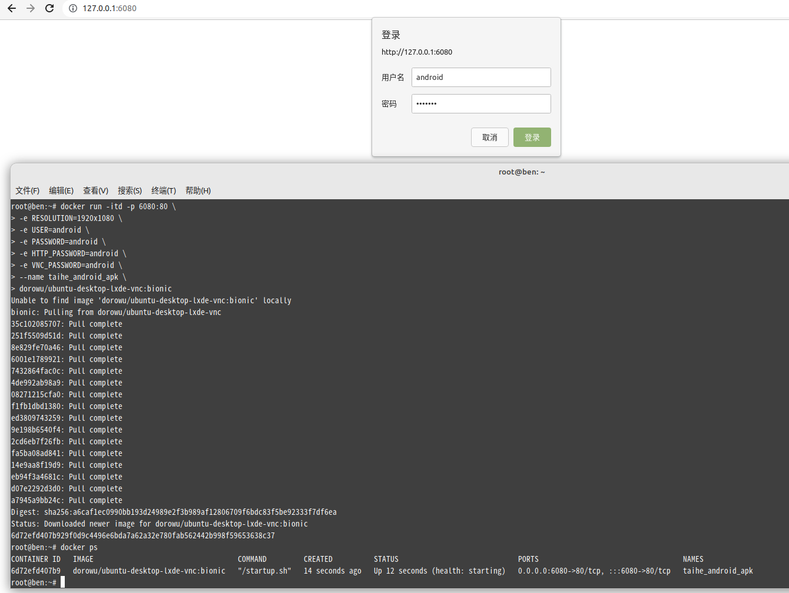
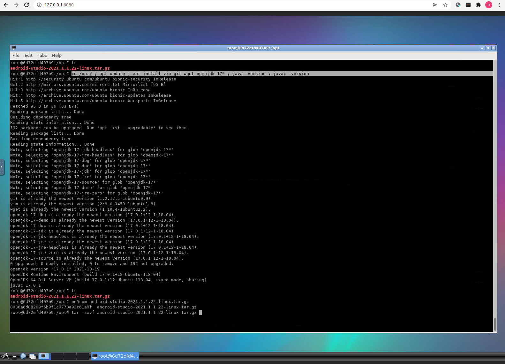
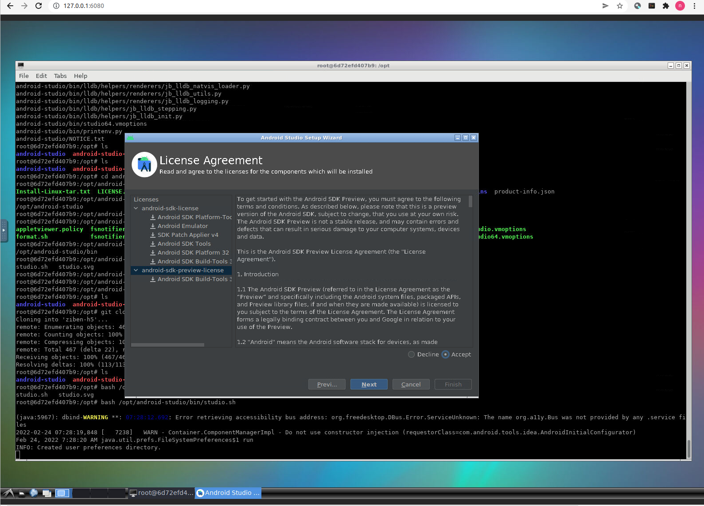
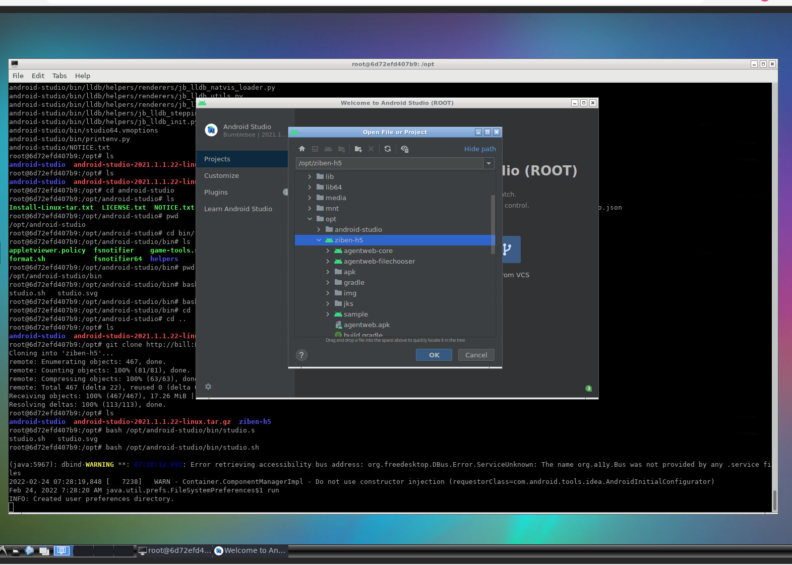
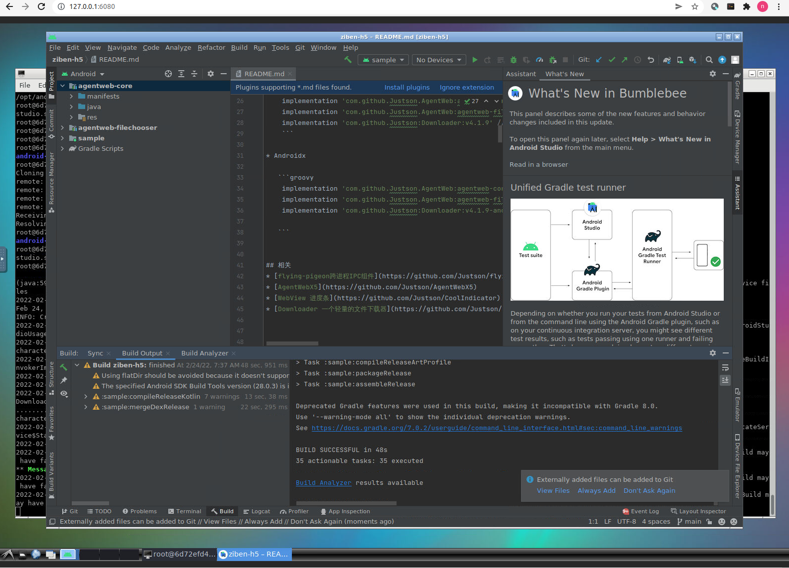
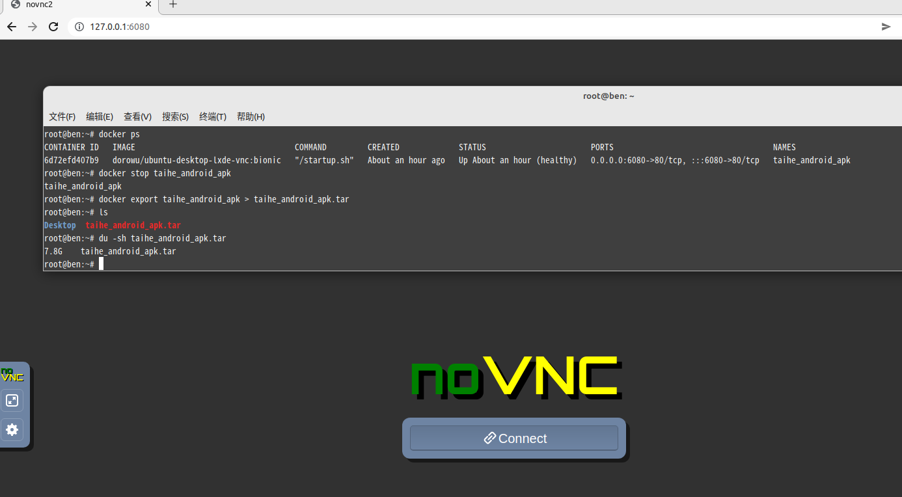
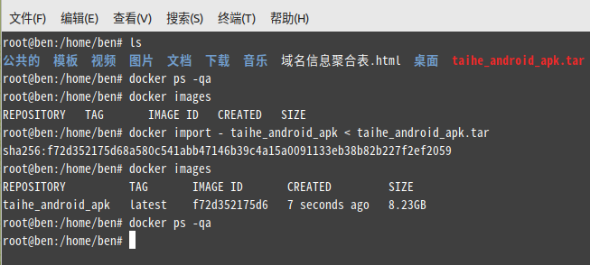

# Docker 安卓自动化构建发布

> GitHub 仓库源文件：[点击打开网页渲染版](https://github.com/ben2023niao/ben-ops-notes/blob/main/doc/md/202202241639-%E8%87%AA%E5%8A%A8%E5%8C%96%2BLinux%2BShell-Docker%20%E5%AE%89%E5%8D%93%E8%87%AA%E5%8A%A8%E5%8C%96%E6%9E%84%E5%BB%BA%E5%8F%91%E5%B8%83.md)

> 原文：[Docker 安卓自动化构建发布](https://xn--6o0a585a.gitbook.io/devops/zi-dong-hua/an-zhuo-zi-dong-hua-gou-jian-fa-bu/docker-an-zhuo-zi-dong-hua-gou-jian-fa-bu.html)

> 来源：GitBook 网页 HTML｜页面时间：2022-02-24 16:39｜日期依据：GitBook 页面更新时间

```bash
docker run -itd -p 6080:80 \
-e RESOLUTION=1920x1080 \
-e USER=android \
-e PASSWORD=[已脱敏] \
-e HTTP_PASSWORD=android \
-e VNC_PASSWORD=android \
-v /opt/ziben:/opt/ \
--name taihe_android_apk \
dorowu/ubuntu-desktop-lxde-vnc:bionic
```

以上代码默认拉取最新版的镜像latest版本，默认为最新版ubuntu20.04，当然也可以拉取其它版本的镜像，比如：

```bash
docker pull dorowu/docker-ubuntu-vnc-desktop:focal          # 拉取Ubuntu 20.04 (latest)
docker pull dorowu/docker-ubuntu-vnc-desktop: focal-lxqt:   # 拉取Ubuntu 20.04 LXQt
docker pull dorowu/docker-ubuntu-vnc-desktop: bionic:       # 拉取Ubuntu 18.04
docker pull dorowu/docker-ubuntu-vnc-desktop: bionic-lxqt:  # 拉取Ubuntu 18.04 LXQt
docker pull dorowu/docker-ubuntu-vnc-desktop: xenial:       # 拉取Ubuntu 16.04 (deprecated)
docker pull dorowu/docker-ubuntu-vnc-desktop: trusty:       # 拉取Ubuntu 14.04 (deprecated)
```











打包成功

导出docker



docker export taihe_android_apk > taihe_android_apk.tar

新服务器导入镜像



docker import - taihe_android_apk < taihe_android_apk.tar
