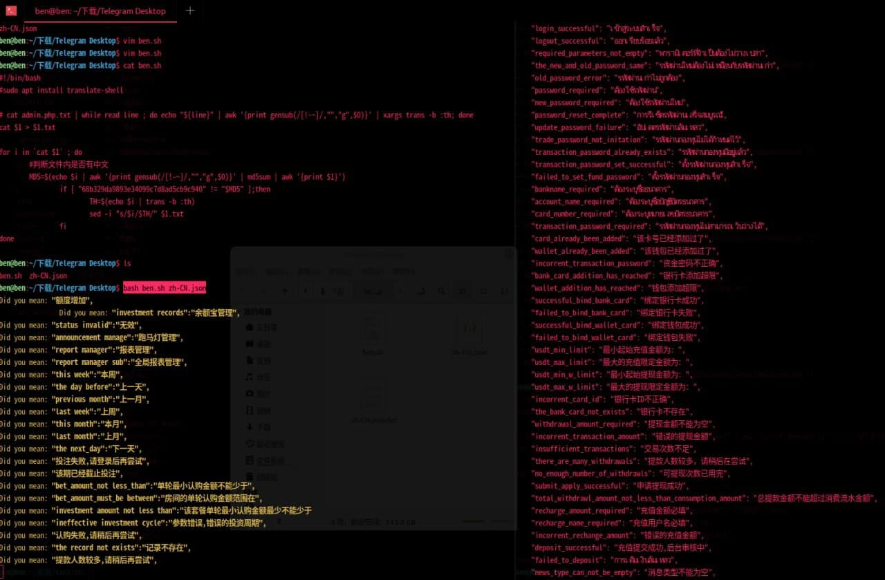

# 翻译 php 代码内 中文 为 泰语

> GitHub 仓库源文件：[点击打开网页渲染版](https://github.com/ben2023niao/ben-ops-notes/blob/main/doc/md/202205211536-%E8%BF%9B%E9%98%B6%E6%8A%80%E6%9C%AF%2B%E5%B7%A5%E7%A8%8B%E7%AC%94%E8%AE%B0-%E7%BF%BB%E8%AF%91%20php%20%E4%BB%A3%E7%A0%81%E5%86%85%20%E4%B8%AD%E6%96%87%20%E4%B8%BA%20%E6%B3%B0%E8%AF%AD.md)

> 原文：[翻译 php 代码内 中文 为 泰语](https://xn--6o0a585a.gitbook.io/devops/jin-jie-ji-shu/fan-yi-php-dai-ma-nei-zhong-wen-wei-tai-yu.html)

> 来源：GitBook 网页 HTML｜页面时间：2022-05-21 15:36｜日期依据：GitBook 页面更新时间

