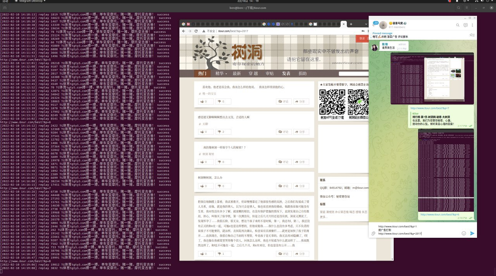
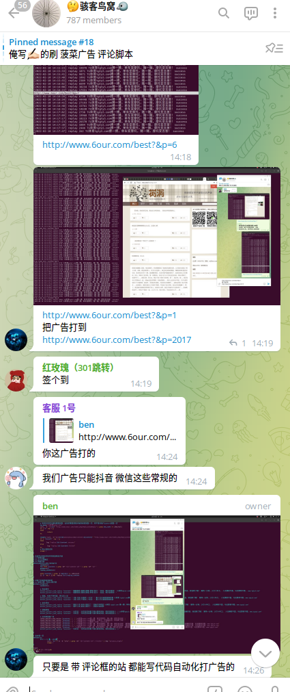

# 6our.com 刷评论广告

> GitHub 仓库源文件：[点击打开网页渲染版](https://github.com/ben2023niao/ben-ops-notes/blob/main/doc/md/202206031625-%E8%BF%9B%E9%98%B6%E6%8A%80%E6%9C%AF%2BShell%2B%E6%BA%90%E7%A0%81%E4%B8%8E%E9%85%8D%E7%BD%AE-%E7%9B%AE%E6%A0%87%E7%A4%BA%E4%BE%8B%20%E8%AF%84%E8%AE%BA%E9%A3%8E%E6%8E%A7%E6%B5%8B%E8%AF%95.md)

> 原文：[6our.com 刷评论广告](https://xn--6o0a585a.gitbook.io/devops/jin-jie-ji-shu/6our.com-shua-ping-lun-guang-gao.html)

> 来源：GitBook 网页 HTML｜页面时间：2022-06-03 16:25｜日期依据：GitBook 页面更新时间





<https://t.me/HackerNiao/34161>

```
#cat 6our.com.sh
#! /bin/bash
for username in "u1" "u2" "u3" "u4" "u5";do
	passwd="[已脱敏]" ad="TG体育www.tgty5.com"
	curl_Chrome(){
		curl -s --user-agent "Mozilla/5.0 (Windows NT 10.0; WOW64) AppleWebKit/537.36 (KHTML, like Gecko) Chrome/64.0.3282.119 Safari/537.36"  -b $username -c $username $@
	} #模拟chrome客户端
	hash_param=`curl_Chrome "http://www.6our.com/index.php/User/Index/login" | grep -oE "[0-9a-z]+\_[0-9a-z]+" | tail -n 1` #获取浏览器分配的 hash
	curl_Chrome -d "account=${username}&password=[已脱敏]" "http://www.6our.com/index.php/User/Index/checkLogin" | grep "登录成功" #进行 账户 密码 哈希 登陆
	for n in {1..2023};do #热门有 2023 页 http://www.6our.com/best?&p=2023
		for i in `curl_Chrome "http://www.6our.com/best?&p=$n" | tr -d "\r\n" | grep -oP 'id="content-\d+".+?</div>' | awk '{print $0}'`;do #获取每页的评论
			id=`echo $i | grep -oP 'id="content-\d+"' | grep -oP '\d+'` result=`curl_Chrome -d "pid=${id}&anonymous=0&arcontent=${ad}" "http://www.6our.com/index.php/Reply/checkReply2"` #根据每页评论id回复广告
			if [ "$result" -eq 1 ];then echo "`date +'%F %T'` http://www.6our.com/best?&p=$n $id $ad success" ; else echo "`date +'%F %T'` http://www.6our.com/best?&p=$n $id $ad failed" ; fi #判断广告回复是否成功
		done #一页一页回复广告结束
	done >> $username.log & #热门 2023 页 http://www.6our.com/best?&p=2023 广告回复结束
done
```
