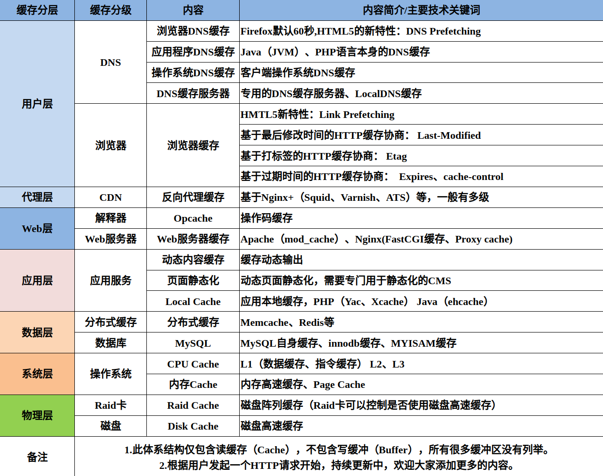

# 缓存体系

> GitHub 仓库源文件：[点击打开网页渲染版](https://github.com/ben2023niao/ben-ops-notes/blob/main/doc/md/202206041342-%E7%9F%A5%E8%AF%86%E4%BD%93%E7%B3%BB%2B%E5%B7%A5%E7%A8%8B%E7%AC%94%E8%AE%B0-%E7%BC%93%E5%AD%98%E4%BD%93%E7%B3%BB.md)

> 原文：[缓存体系](https://xn--6o0a585a.gitbook.io/devops/zhi-shi-ti-xi/huan-cun-ti-xi.html)

> 来源：GitBook 网页 HTML｜页面时间：2022-06-04 13:42｜日期依据：GitBook 页面更新时间

