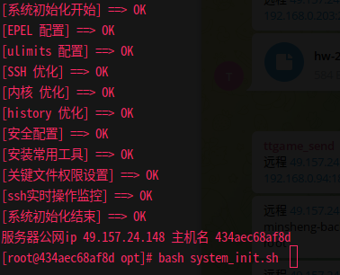

# 服务器初始化

> 原文：[服务器初始化](https://xn--6o0a585a.gitbook.io/devops/zi-dong-hua/fu-wu-qi-chu-shi-hua.html)

> 来源：GitBook 网页 HTML｜页面时间：2022-06-04 13:54｜日期依据：GitBook 页面更新时间



```
#/bin/bash

function init_epel(){
yum install epel-release -y >/dev/null 2>&1
sed -i 's/mirrorlist/#mirrorlist/g' /etc/yum.repos.d/epel.repo
sed -i 's/#baseurl/baseurl/g' /etc/yum.repos.d/epel.repo
sed -i '6s/enabled=0/enabled=1/g' /etc/yum.repos.d/epel.repo
sed -i '7s/gpgcheck=1/gpgcheck=0/g' /etc/yum.repos.d/epel.repo
yum clean all >/dev/null 2>&1
#阿里云机器用aliyun epel
echo "[EPEL 配置] ==> OK"
}

function init_ulimits(){
cat > /etc/security/limits.conf <<EOF
* soft noproc 20480
* hard noproc 20480
root soft nofile 65535
root hard nofile 65535
* soft nofile 65535
* hard nofile 65535
EOF
ulimit -n 65535
ulimit -u 20480
echo "[ulimits 配置] ==> OK"
}

function init_ssh(){
[ -f /etc/ssh/sshd_config ] && sed -ir '13 iUseDNS no\nGSSAPIAuthentication no' /etc/ssh/sshd_config && /etc/init.d/sshd restart >/dev/null 2>&1
echo "[SSH 优化] ==> OK"
}

function init_kernel(){
cat > /etc/sysctl.conf <<EOF
fs.file-max = 65535

net.ipv4.tcp_max_tw_buckets = 5000
#表示系统同时保持TIME_WAIT套接字的最大数量，如果超过这个数字，TIME_WAIT套接字将立刻被清除并打印警告信息。减少它的最大数量，避免Squid服务器被大量的TIME_WAIT套接字拖死。

net.ipv4.tcp_max_orphans = 3276800
#系统中最多有多少个TCP套接字不被关联到任何一个用户文件句柄上。

net.ipv4.tcp_fin_timeout = 30
#表示如果套接字由本端要求关闭，这个参数决定了它保持在FIN-WAIT-2状态的时间。

net.ipv4.tcp_keepalive_time = 1200
#表示当keepalive起用的时候，TCP发送keepalive消息的频度。缺省是2小时，改为20分钟。

net.ipv4.tcp_keepalive_probes = 3
net.ipv4.tcp_keepalive_intvl = 30
net.ipv4.tcp_syncookies = 1

net.ipv4.tcp_tw_reuse = 1
#表示开启重用，允许将TIME-WAIT sockets重新用于新的TCP连接。

net.ipv4.tcp_timestamps = 0
#时间戳可以避免序列号的卷绕。一个1Gbps的链路肯定会遇到以前用过的序列号，时间戳能够让内核接受这种“异常”的数据包，这里需要将其关掉。

net.ipv4.tcp_tw_recycle = 1
#表示开启TCP连接中TIME-WAIT sockets的快速回收。

net.ipv4.ip_local_port_range = 1024 65000
#表示用于向外连接的端口范围。缺省情况下很小：32768到61000，改为1024到65000。

net.ipv4.tcp_mem = 786432 1048576 1572864
#同样有3个值
#net.ipv4.tcp_mem[0]:低于此值，TCP没有内存压力
#net.ipv4.tcp_mem[1]:在此值下，进入内存压力阶段
#net.ipv4.tcp_mem[2]:高于此值，TCP拒绝分配socket。
#可根据物理内存大小进行调整，如果内存足够大的话，可适当往上调。建议94500000 915000000 927000000。

net.core.wmem_default = 8388608
#发送套接字缓冲区大小的缺省值（以字节为单位）

net.core.rmem_default = 8388608
#接收套接字缓冲区大小的缺省值（以字节为单位）

net.core.rmem_max = 16777216
#接收套接字缓冲区大小的最大值（以字节为单位）

net.core.wmem_max = 16777216
#发送套接字缓冲区大小的最大值（以字节为单位）

net.ipv4.tcp_wmem = 8192 436600 873200
#TCP写buffer,可参考的优化值: 8192 436600 873200

net.ipv4.tcp_rmem = 32768 436600 873200
#TCP读buffer,可参考的优化值: 32768 436600 873200

net.core.somaxconn = 65408
#web应用中listen函数的backlog默认会给我们内核参数的net.core.somaxconn限制到128，而nginx定义的NGX_LISTEN_BACKLOG默认为511，所以有必要调整这个值。

net.core.netdev_max_backlog = 262144
#每个网络接口接收数据包的速率比内核处理这些包的速率快时，允许送到队列的数据包的最大数目。

net.ipv4.tcp_max_syn_backlog = 8192
#表示SYN队列的长度，默认为1024，加大队列长度为8192，可以容纳更多等待连接的网络连接数。

net.ipv4.tcp_retries2 = 5
net.ipv4.conf.lo.arp_ignore = 0
net.ipv4.conf.lo.arp_announce = 0
net.ipv4.conf.all.arp_ignore = 0
EOF
sysctl -p >/dev/null 2>&1
echo "[内核 优化] ==> OK"
}

function init_history(){
if ! grep "HISTTIMEFORMAT" /etc/profile >/dev/null 2>&1
then echo '
UserIP=$(who -u am i | cut -d"(" -f 2 | sed -e "s/[()]//g")
export HISTTIMEFORMAT="[%F %T] [`whoami`] [${UserIP}] " ' >> /etc/profile;
fi
echo "[history 优化] ==> OK"
}

function init_security(){
> /etc/issue
sed -i 's/SELINUX=enforcing/SELINUX=disabled/g' /etc/selinux/config
sed -i 's/SELINUX=permissive/SELINUX=disabled/g' /etc/selinux/config
setenforce 0 >/dev/null 2>&1
#systemctl stop firewalld.service
#systemctl disable firewalld.service
yum install -y openssl openssh bash >/dev/null 2>&1
echo "[安全配置] ==> OK"
}

function init_other(){
yum groupinstall Development tools -y >/dev/null 2>&1
yum install -y vim wget lrzsz iftop iotop htop tree >/dev/null 2>&1
yum install -y git zlib-devel openssl-devel unzip libxslt-devel libxml2-devel libcurl-devel >/dev/null 2>&1
echo "[安装常用工具] ==> OK"
}

function init_chmod(){
chown root:root /etc/passwd /etc/shadow /etc/group /etc/gshadow && chmod 0644 /etc/group && chmod 0644 /etc/passwd && chmod 0400 /etc/shadow && chmod 0400 /etc/gshadow
echo "[关键文件权限设置] ==> OK"
}

function init_ssh_history(){
touch /var/log/check_user_history.log
chown nobody.nobody /var/log/check_user_history.log >/dev/null 2>&1
chmod 002 /var/log/check_user_history.log >/dev/null 2>&1
chattr +a /var/log/check_user_history.log >/dev/null 2>&1
cat >> /etc/profile << "EOF"
#ssh登陆报警到群
curl -s -o /dev/null -X POST "https://api.telegram.org/bot2133309226:AAECwiIYa-WuTtpW3S9_7U6ZwZ_z0GcBEwQ/sendMessage" -d chat_id="-767879585" -d text="`echo $SSH_CONNECTION | awk '{print "远程 "$1" 使用 '$USER' 用户登陆 '$HOSTNAME' "$3":"$4" 成功OK 路径'$PWD'"}'`"
touch /var/log/check_user_history.log
UserIP=$(who -u am i | cut -d"(" -f 2 | sed -e "s/[()]//g")
export HISTTIMEFORMAT="[%F %T] [`whoami`] [${UserIP}] "
export HISTORY_FILE=/var/log/check_user_history.log

export PROMPT_COMMAND='{ date "+%Y-%m-%d %T ##### USER:$USER IP:$SSH_CLIENT PS:$SSH_TTY ppid=$PPID pwd=$PWD #### $(history 1 | { read x cmd; echo "$cmd"; })";} >>$HISTORY_FILE'
EOF
source /etc/profile

cat > /root/.bash_logout << "EOF"
#!/bin/sh
# Telegram接收SSH退出提醒
#编辑 /root/.bash_logout 放入以下代码
curl -s -o /dev/null -X POST "https://api.telegram.org/bot2133309226:AAECwiIYa-WuTtpW3S9_7U6ZwZ_z0GcBEwQ/sendMessage" -d chat_id="-767879585" -d text="`echo $SSH_CONNECTION | awk '{print "远程 "$1" 使用 '$USER' 用户退出 '$HOSTNAME' "$3":"$4" 路径'$PWD'"}'`"
#每次退出 SSH 后 Telegram Bot 都会发送一条通知给你
cat /var/log/check_user_history.log | grep $(date "+%Y-%m-%d") > /var/log/$HOSTNAME.txt
curl -s "https://api.telegram.org/bot2133309226:AAECwiIYa-WuTtpW3S9_7U6ZwZ_z0GcBEwQ/senddocument?chat_id=-767879585&" \
-F document=@"/var/log/$HOSTNAME.txt"
#每次退出 SSH 后 Telegram Bot 都会发送操作记录到群
EOF
echo "[ssh实时操作监控] ==> OK"
}

function init_zabbix_agent(){
rpm -Uvh http://repo.zabbix.com/zabbix/4.4/rhel/7/x86_64/zabbix-agent-4.4.3-1.el7.x86_64.rpm >/dev/null 2>&1
yum install -y zabbix-agent >/dev/null 2>&1
sed -i "s/Server=203.0.113.1/Server=203.0.113.1/g" /etc/zabbix/zabbix_agentd.conf
systemctl enable zabbix-agent.service >/dev/null 2>&1
systemctl restart zabbix-agent.service >/dev/null 2>&1
echo "[zabbix-agent监控启动] ==> OK"
}

#依次导入函数

export -f init_epel
export -f init_ulimits
export -f init_ssh
export -f init_kernel
export -f init_history
export -f init_security
export -f init_other
export -f init_chmod
export -f init_ssh_history
export -f init_ssh_login_telegram
export -f init_ssh_logout_telegram
#export -f init_zabbix_agent

#依次执行函数
echo "[系统初始化开始] ==> OK"
init_epel
init_ulimits
init_ssh
init_kernel
init_history
init_security
init_other
init_chmod
init_ssh_history
init_ssh_login_telegram
init_ssh_logout_telegram
#init_zabbix_agent
echo "[系统初始化结束] ==> OK"
echo "服务器公网ip `curl -s ifconfig.me` 主机名 `hostname`"
```
