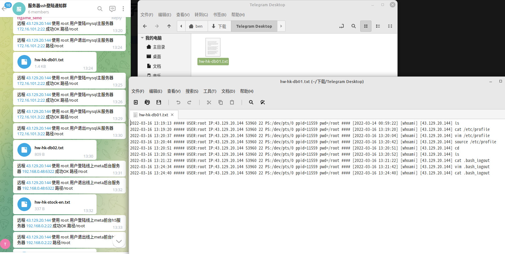

# 用户操作记录监控

> GitHub 仓库源文件：[点击打开网页渲染版](https://github.com/ben2023niao/ben-ops-notes/blob/main/doc/md/202206041357-%E8%87%AA%E5%8A%A8%E5%8C%96%2BShell%2B%E7%9B%91%E6%8E%A7%E5%91%8A%E8%AD%A6-%E7%94%A8%E6%88%B7%E6%93%8D%E4%BD%9C%E8%AE%B0%E5%BD%95%E7%9B%91%E6%8E%A7.md)

> 原文：[用户操作记录监控](https://xn--6o0a585a.gitbook.io/devops/zi-dong-hua/fu-wu-qi-chu-shi-hua/yong-hu-cao-zuo-ji-lu-jian-kong.html)

> 来源：GitBook 网页 HTML｜页面时间：2022-06-04 13:57｜日期依据：GitBook 页面更新时间



服务器操作记录

```bash
#!/bin/bash
touch /var/log/check_user_history.log
chown nobody.nobody /var/log/check_user_history.log
chmod 002 /var/log/check_user_history.log
chattr +a /var/log/check_user_history.log
cat >> /etc/profile << "EOF"
export HISTORY_FILE=/var/log/check_user_history.log
export PROMPT_COMMAND='{ date "+%Y-%m-%d %T ##### USER:$USER IP:$SSH_CLIENT PS:$SSH_TTY ppid=$PPID pwd=$PWD #### $(history 1 | { read x cmd; echo "$cmd"; })";} >>$HISTORY_FILE'
EOF
source /etc/profile
```
