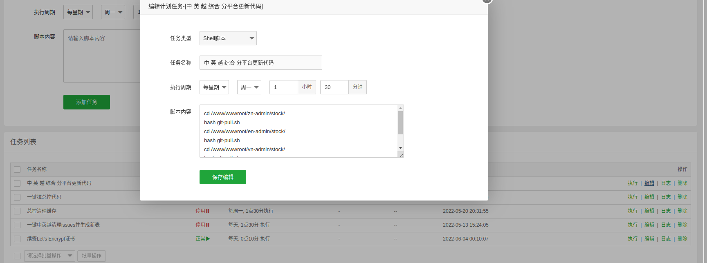

# PHP-laravel自动化构建发布

> GitHub 仓库源文件：[点击打开网页渲染版](https://github.com/ben2023niao/ben-ops-notes/blob/main/doc/md/202206041407-%E8%87%AA%E5%8A%A8%E5%8C%96%2BShell%2B%E6%BA%90%E7%A0%81%E4%B8%8E%E9%85%8D%E7%BD%AE-PHP-laravel%E8%87%AA%E5%8A%A8%E5%8C%96%E6%9E%84%E5%BB%BA%E5%8F%91%E5%B8%83.md)

> 原文：[PHP-laravel自动化构建发布](https://xn--6o0a585a.gitbook.io/devops/zi-dong-hua/phplaravel-zi-dong-hua-gou-jian-fa-bu.html)

> 来源：GitBook 网页 HTML｜页面时间：2022-06-04 14:07｜日期依据：GitBook 页面更新时间



```bash
#!/bin/bash
cd /www/wwwroot/zn-admin/stock/
bash git-pull.sh
cd /www/wwwroot/en-admin/stock/
bash git-pull.sh
cd /www/wwwroot/vn-admin/stock/
bash git-pull.sh
cd /www/wwwroot/zh-admin/stock/
bash git-pull.sh

# git-pull.sh 脚本内容
# git fetch --all ; git reset --hard origin/pingan_zk ; git pull ; git log -1
```
