# EXE自动化构建发布(CocosCreator)

> 原文：[EXE自动化构建发布(CocosCreator)](https://xn--6o0a585a.gitbook.io/devops/zi-dong-hua/exe-zi-dong-hua-gou-jian-fa-bu-cocoscreator.html)

> 来源：GitBook 网页 HTML｜页面时间：2022-06-04 14:25｜日期依据：GitBook 页面更新时间

## Jenkins实现CocosCreator的自动化构建和发布

## 一、安装Jenkins

需要一台机器作为构建机，在它上面安装`Jenkins`。`Jenkins`基于Java开发，跨平台支持非常好，几乎是所有平台都能运行`Jenkins`。不过对于CocosCreator项目来说，就只能选择`Windows或Mac机器`了，本文主要以`win10系统`为例。

1、到Jenkins官网([https://jenkins.io/](https://links.jianshu.com/go?to=https%3A%2F%2Fjenkins.io%2F))下载msi格式的Windows安装包，当前最新版本是2.277.1，正常安装；
2、安装完成后，打开浏览器输入地址：`http://localhost:8080/jenkins`，按页面提示从本地复制密码并输入；
3、安装默认推荐的插件；
4、创建第一个管理员用户。这是指Jenkins系统的管理员，因为`Jenkins`是个分布式平台，支持任意多个用户并行操作，不同用户有不同权限，所以在`Jenkins`第一次安装后需要立即创建一个管理员；
5、如果看到如下界面，代表`Jenkins`已经安装成功。

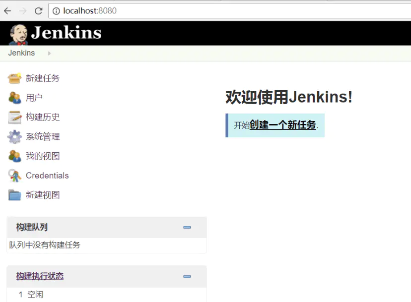

## 二、自动化脚本

本质上`Jenkins`是个`可视化的Web管理工具`，执行的各种任务其实都是通过命令完成的，我们要做什么任务，就为这个任务提供相应的命令。例如，`Windows平台`是`批处理命令`。

所以我们首先学会使用命令行来构建CocosCreator项目，之后才能在`Jenkins`中实现一键自动化构建和发布。

#### (1)命令行构建CocosCreator

CocosCreator.exe本身支持命令行，简单使用有以下参数就够了。

- –path - 指定项目路径
- –build - 指定构建项目使用的参数
- –compile - 指定编译项目使用的参数
在`--build` 或`--compile`后如果没有指定参数，则会使用Creator 构建面板当前的平台、模板等设置来作为默认参数。如果指定了其他参数设置，则会使用指定的参数来覆盖默认参数。

此次我们使用默认配置即可，所以在命令行中进入我们需要构建的Creator工程目录，输入命令：

即可在当前路径使用默认参数完成构建。

#### (2)命令行发布CocosCreator项目

构建完成后，如果是支持浏览器的H5游戏，我们还需要把构建后的版本上传到`Web服务器`，完成发布。Windows上有个免费的远程文件传输工具pscp，支持命令行把指定文件或目录上传到远程服务器。pscp的参数含义如下：

- -l 远程服务器的用户名
- -pw 远程服务器的密码
- -r 拷贝整个目录
如果Creator构建使用的是`web-mobile`方式，则构建后的版本目录默认是 `build\web-mobile\`，假设远程服务器已配置好 `nginx`来提供Web服务，端口是8000，IP地址是192.168.1.100，存放目录是 /usr/share/nginx/Hello，登录用户名是root，密码是123456，那么输入命令：

这样一个命令就把构建后的版本上传到了远程服务器，之后在浏览器中打开 203.0.113.1:8000，即可运行游戏的H5版本了。

#### (3)批处理

我们把这2个命令组合起来形成一个批处理文件，放在工程目录下，以后只要一个双击就完成了CocosCreator项目的构建和发布，非常方便。

## 三、配置Jenkins任务

上面介绍了如何编写Creator项目构建和发布的`Windows批处理`，接下来我们将要在`Jenkins`中部署该任务，以实现真正的`自动化`。步骤如下：

#### (1)创建Creator项目

首先用Creator新建一个HelloWorld项目，并通过Creator构建面板中试着构建一遍，确认工程本身没有问题；

#### (2)准备远程传输文件工具

为保持目录整洁，在Creator工程目录下新建一个tools目录，把`pscp.exe`放到该目录下（后面远程传输文件会用到），形成的目录结构如下：

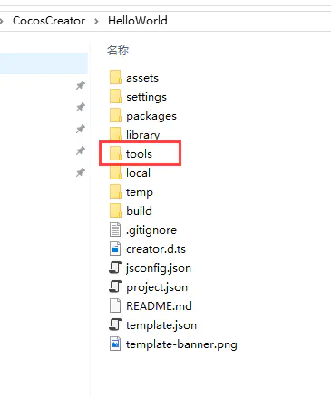

#### (3)创建Jenkins任务

登录`Jenkins`，新建一个名称为“HelloWorld”的任务，任务类型选择“自由风格的软件项目”，点击确定，就创建好了一个任务。在该任务视图中点击左侧的“配置”，按如下配置：

- General：可以不填，全部留空即可；
- 源码管理：选择“无”；
- 构建触发器：全部不填；
- 构建：增加一个“Windows批处理命令”，填写上篇文章介绍过的命令，如下：

注：此处我的Creator工程路径是 `e:\dev\CocosCreator\HelloWorld`，CocosCreator安装目录是：`c:\CocosCreator\CocosCreator.exe`，构建后版本上传到web服务器的目标路径是`/usr/share/nginx/hello`，读者可根据情况自行调整。

构建后操作：留空即可；

#### (4)开始构建

保存上述配置后，回到任务视图，点击左侧的“立即构建”，即开始执行任务，也就是开始调用Creator进行HelloWorld工程的构建。

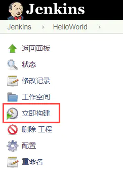

提示：如果是第一次使用Jenkins构建Creator项目，通常会失败，在进行到如下这一步停止，一直转圈：

原因是`Jenkins`服务调用了Creator进行构建，而默认情况下`Jenkins`服务的权限不够，所以我们还需要给`Jenkins`服务提高权限。
打开`Win10的“服务”面板`，找到`Jenkins`服务，我的做法是把登录账户设为当前管理员账户。对于这个问题，`Jenkins`官方文档也给出了答案，如下图：

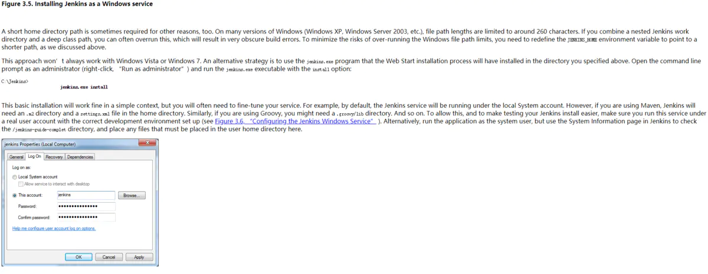

再次构建，就应该能顺利完成了，如果`Jenkins`成功执行了任务，将会在最后一行输出：

这样，通过`Jenkins`的开放式Web页面，任何人（例如：研发团队里的策划、美术）都可以一键完成Creator项目的构建和发布，程序员可以安心地写代码了。

## 四、增加Git管理

上面讲述了`Jenkins`如何一键构建和发布Creator项目，不过构建的都是本地代码。本篇文章讲述如何通过`Jenkins`中结合`代码Git管理`，使`本地提交代码`、`抓取最新代码`、`推送代码`至`Git服务器`等一套流程全跑通，并自动使用Git仓库中的最新代码进行CocosCreator的构建和发布。本文使用的环境为：`本机Win10系统`+`本机Jenkins`+`远程GitLab仓库`，步骤如下：

#### (1)Jenkins安装Git和GitLab插件

打开浏览器 -> 登录`Jenkins` -> 系统管理 -> 管理插件，切换到“可选插件”，搜索`"git"`关键字，找到`“GitLab Plugin”`和`“Git Plugin”`，点击下方的“直接安装”。如果在“可选插件”里没有搜到，可能默认你已经安装了，可以在“已安装”里查看。如下所示：

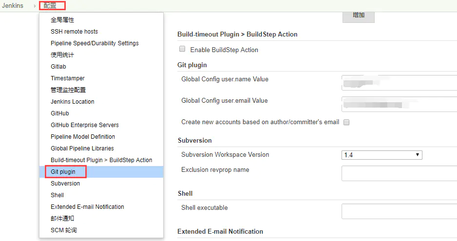

等待安装完成。

#### (2)配置GitLab插件

要让`Jenkins`连接上`GitLab`仓库，通常需要`Git密钥`或`token`。
`登录GitLab` -> `点击“setting”`——`“Account”`，复制`Private token`备用，如下所示：

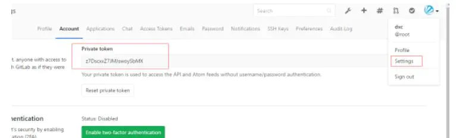

`打开浏览器` -> `登录Jenkins` -> `系统管理` -> `系统设置`，点击`配置`下拉框，点击`Gitlab`选项，如下所示：

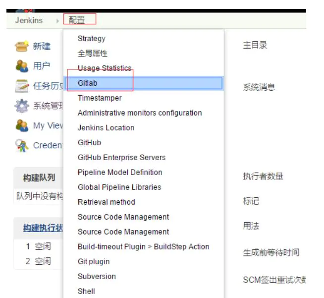

在`Gitlab`弹出框里，`kind`选择`GitLab API Token`，将先前复制的`Private token`粘贴到`API token`输入框中，然后点击`Add`，即配置好了。如下所示：

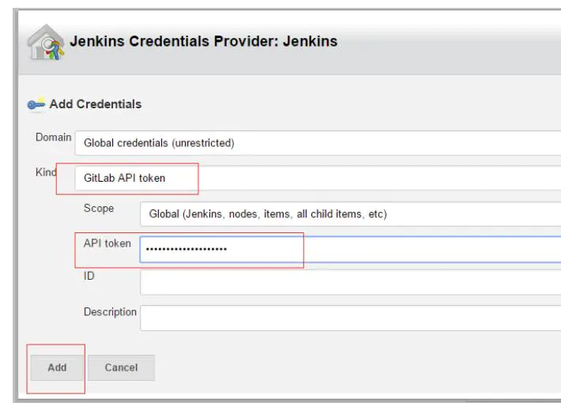

选择刚刚新建的`Credentials`，并根据自己情况填完整`Connection name` 和 `GitLab host URL`。设置完后，还要测试一下能否连接成功，点击`test connection`,要看到返回`Success`才行，如下所示：

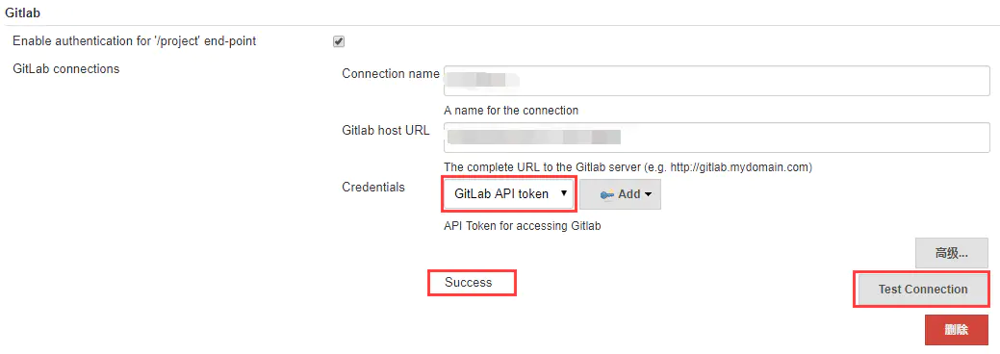

然后点击页面底下的`apply`,再点击`save`，保存`GitLab`配置。

#### (3)配置Git插件

`打开浏览器` -> `登录Jenkins` -> `系统管理` -> `系统设置`，点击`配置`下拉框，选择`Git plugin`选项，设置`Git`插件的全局配置，如下所示：

然后点击`apply`——`save`，保存`Git`配置。

#### (4)编写脚本

好了，现在把该配置的都配好了，`Jenkins`已经准备好了连接`Git仓库`，还剩最后一步，就是给`Jenkins`任务编写脚本。假设Creator工程路径是`e:\dev\CocosCreator\HelloWorld`，`git分支`是`master`，`pscp软件`在`tools子目录`下，按照 `commit` -> `pull` -> `push` 的`Git流程`，脚本命令如下：

如下图所示：

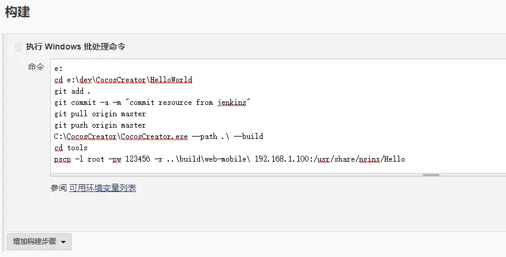

现在，只要`本地代码有修改`或`Git仓库里有新代码提交`，直接运行这个任务，就自动完成了所有的构建和发布工作，并把最新代码提交到`Git仓库`。

## 五、增加SSH远程操作

前面讲述了如何实现`CocosCreator`的自动化构建和发布，不过使用次数多了会发现一个问题：就是如果我们在Creator的构建选项中选定了`MD5`，则每次构建都会生成`新的文件名`，那么每一次上传新版本到服务器时，因为`新文件不会覆盖旧文件`，就会导致`发布目录下的文件越来越多`。所以我们还希望在每一次上传新版本前把`旧文件删除掉`，这就需要`Jenkins`能远程登录到服务器，并执行删除命令。

要让Jenkins支持远程登录需要安装SSH插件，并在`Jenkins`上设置好`Credentials`，然后在相应的`Jenkins`任务中使用该`Credentials`即可。步骤如下：

#### (1)新建Credentials

在`Jenkins`界面，依次点击： `Credentials` -> `System` -> `Add domain`。
`Domain Name`: 填写你的服务器地址，如：203.0.113.1；
`Description`: 随便写一点描述，如 This is the Credential for CocosCreator；
如下图所示：

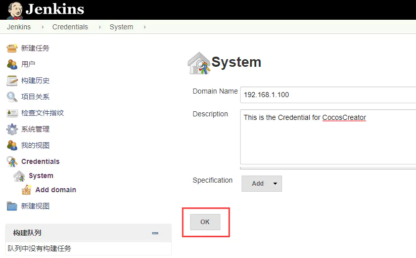

点击 ok，再点击 `“adding some credentials?”`进入页面后，可以选择 `Username with password`或者 `SSH Username with private key`, 根据自己情况选择，为简单起见，这里我们选择 `Username with password`：
`Username`: 远程登录的用户名，如：root
`Password`: 远程登录的密码，如：123456
`ID`: 空
`Description`: 空
如下图所示：

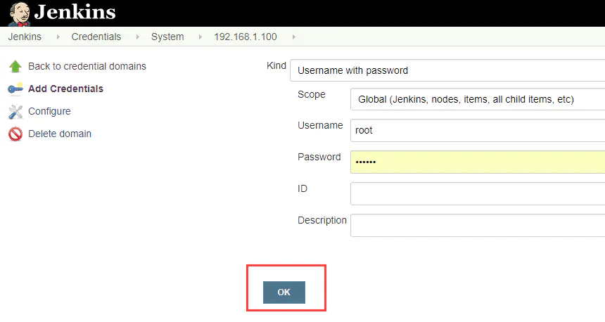

点击 ok，`Credential`就创建好了。

#### (2)SSH插件配置

再进入`Jenkins`系统管理 -> 系统设置，左上"配置"下拉菜单选择 `ssh remote hosts`，增加一个`remote host`，选择使用刚才创建好的 `Credential`，如下图所示：

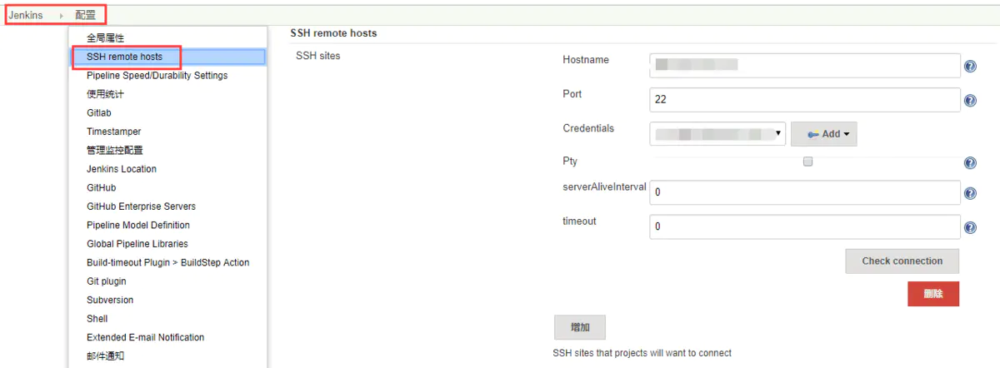

#### (3)Jenkins任务配置

在`Jenkins`任务配置的构建，选择增加`“Execute shell script on remote host using ssh”`，在`SSH site`选择使用刚才新建好的`SSH site`，并编写删除操作的shell命令：

如下图所示：

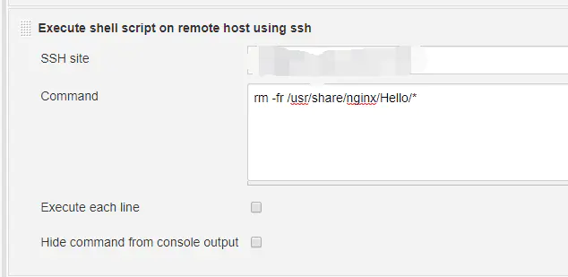

#### (4)执行命令

一切都准备就绪，为了让 `Creator构建` -> `删除旧文件` -> `上传新文件` 按顺序执行，我们再把前面所用过的命令拆分为3部分，这样Jenkins就会按顺序执行了。

## 六、增加用户权限管理

随着`Jenkins`的使用深入，会发现需要给不同的用户配置不同的使用权限，虽然`Jenkins`自带用户权限管理，但比较简单，不支持用户组和项目的划分，因此需要第三方插件来实现更精细的权限管理，使用比较广泛的是`Role Strategy Plugin`插件，可以满足所有关于用户和权限的管理需求。官网：[https://wiki.jenkins.io/pages/viewpage.action?pageId=57182927](https://links.jianshu.com/go?to=https%3A%2F%2Fwiki.jenkins.io%2Fpages%2Fviewpage.action%3FpageId%3D57182927)
