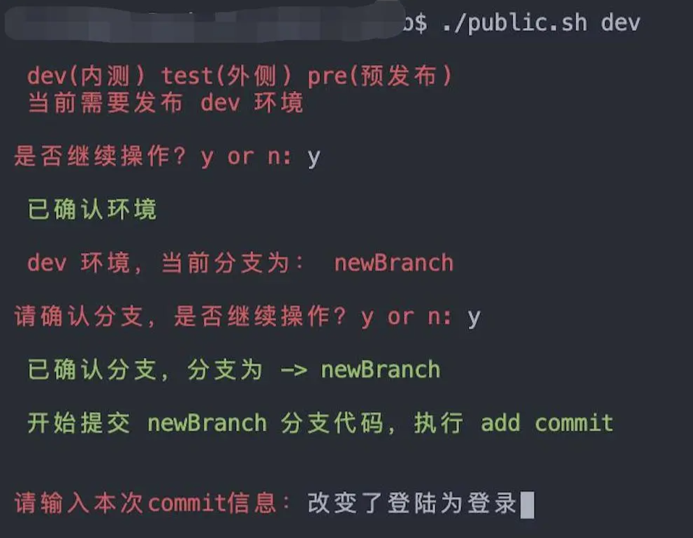
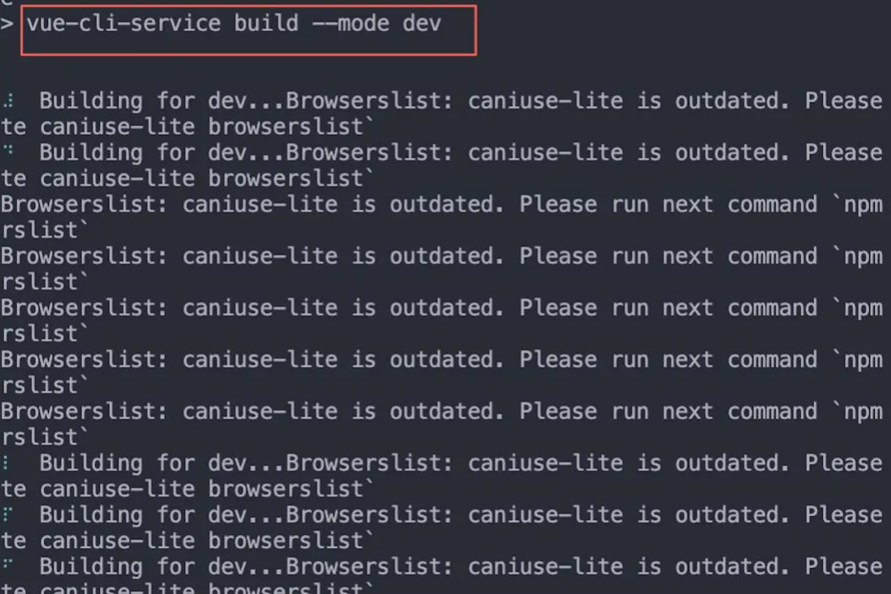
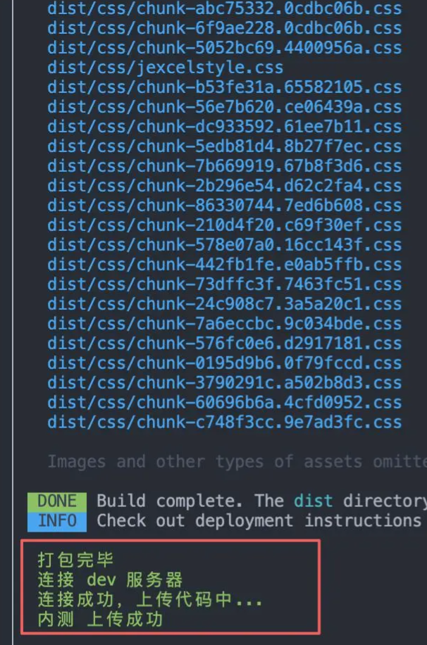

# 前端自动化构建发布

> GitHub 仓库源文件：[点击打开网页渲染版](https://github.com/ben2023niao/ben-ops-notes/blob/main/doc/md/202206041434-%E8%87%AA%E5%8A%A8%E5%8C%96-%E5%89%8D%E7%AB%AF%E8%87%AA%E5%8A%A8%E5%8C%96%E6%9E%84%E5%BB%BA%E5%8F%91%E5%B8%83.md)

> 原文：[前端自动化构建发布](https://xn--6o0a585a.gitbook.io/devops/zi-dong-hua/qian-duan-zi-dong-hua-gou-jian-fa-bu.html)

> 来源：GitBook 网页 HTML｜页面时间：2022-06-04 14:34｜日期依据：GitBook 页面更新时间

