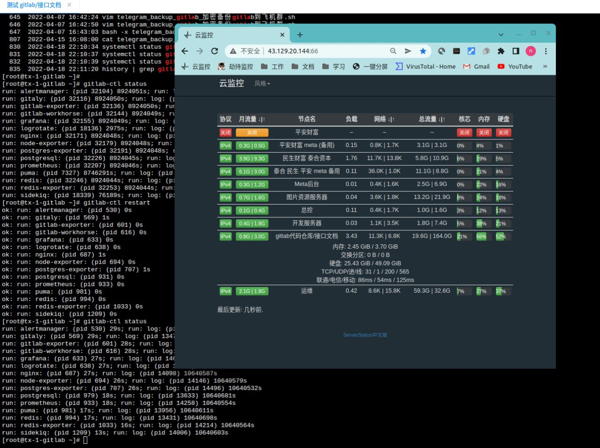

# serverstatus

> 原文：[serverstatus](https://xn--6o0a585a.gitbook.io/devops/jian-kong/serverstatus.html)

> 来源：GitBook 网页 HTML｜页面时间：2022-06-04 15:04｜日期依据：GitBook 页面更新时间

服务端



```
wget --no-check-certificate -qO ~/serverstatus-config.json https://raw.githubusercontent.com/cppla/ServerStatus/master/server/config.json && mkdir ~/serverstatus-monthtraffic
```

```json
{"servers":
        [
                {
                        "username": "hk-all-dev-test",
                        "name": "测试环境服务器",
                        "type": "kvm",
                        "host": "host1",
                        "location": "每月 22 日续费 国内机房-🇨🇳香港",
                        "password": "USER_DEFAULT_PASSWORD",
                        "monthstart": 1
                },
                {
                        "username": "china-all-spug",
                        "name": "数据库备份服务器",
                        "type": "kvm",
                        "host": "host1",
                        "location": "每月 22 日续费 国内机房-🇨🇳镇江",
                        "password": "USER_DEFAULT_PASSWORD",
                        "monthstart": 1
                },
                {
                        "username": "hw-hk-db01",
                        "name": "线上数据库服务器01",
                        "type": "docker",
                        "host": "host1",
                        "location": "每月 23 日续费 华为云 1 🇨🇳香港",
                        "password": "USER_DEFAULT_PASSWORD",
                        "monthstart": 1
                },
                {
                        "username": "hw-hk-db02",
                        "name": "线上数据库服务器02",
                        "type": "docker",
                        "host": "host1",
                        "location": "每月 23 日续费 华为云 1 🇨🇳香港",
                        "password": "USER_DEFAULT_PASSWORD",
                        "monthstart": 1
                },
                {
                        "username": "hw-hk-im",
                        "name": "IM聊天商城项目服务器",
                        "type": "java",
                        "host": "host1",
                        "location": "每月 xx 日续费 华为云 1 🇨🇳香港",
                        "password": "USER_DEFAULT_PASSWORD",
                        "monthstart": 1
                },
                {
                        "username": "hw-hk-stock-en",
                        "name": "MetaBiz英文版接口后台服务器",
                        "type": "php-laravel",
                        "host": "host1",
                        "location": "每月 03 日续费 华为云 2 🇨🇳香港",
                        "password": "USER_DEFAULT_PASSWORD",
                        "monthstart": 1
                },
                {
                        "username": "hw-hk-stock-en-new",
                        "name": "备用 MetaBiz英文版接口后台服务器",
                        "type": "php-laravel",
                        "host": "host1",
                        "location": "每月 03 日续费 华为云 2 🇨🇳香港",
                        "password": "USER_DEFAULT_PASSWORD",
                        "monthstart": 1
                },
                {
                        "username": "hw-hk-stock-pro",
                        "name": "泰合股票新接口后台服务器",
                        "type": "php-laravel",
                        "host": "host1",
                        "location": "每月 14 日续费 华为云 2 🇨🇳香港",
                        "password": "USER_DEFAULT_PASSWORD",
                        "monthstart": 1
                },
                {
                        "username": "VM-0-5-centos",
                        "name": "H5服务器",
                        "type": "php-laravel",
                        "host": "host1",
                        "location": "每月 13 日续费 华为云 2 🇨🇳香港",
                        "password": "USER_DEFAULT_PASSWORD",
                        "monthstart": 1
                },
                {
                        "username": "hk-tc-php-dev",
                        "name": "开发服务器",
                        "type": "php-laravel",
                        "host": "host1",
                        "location": "每月 13 日续费 腾讯云 1 🇨🇳香港",
                        "password": "USER_DEFAULT_PASSWORD",
                        "monthstart": 1
                },
                {
                        "username": "hk-tx-project-demon",
                        "name": "项目演示服务器",
                        "type": "php-laravel",
                        "host": "host1",
                        "location": "每月 27 日续费 腾讯云 1 🇨🇳香港",
                        "password": "USER_DEFAULT_PASSWORD",
                        "monthstart": 1
                },
                {
                        "username": "hk-tx-resources",
                        "name": "资源服务器",
                        "type": "php-laravel",
                        "host": "host1",
                        "location": "每月 16 日续费 腾讯云 1 🇨🇳香港",
                        "password": "USER_DEFAULT_PASSWORD",
                        "monthstart": 1
                },
                {
                        "username": "hk-tc-gitlab",
                        "name": "gitlab代码仓库/接口文档",
                        "type": "git",
                        "host": "host1",
                        "location": "每月 16 日续费 腾讯云 1 🇨🇳香港",
                        "password": "USER_DEFAULT_PASSWORD",
                        "monthstart": 1
                },
                {
                        "username": "hk-tc-jumpserver",
                        "name": "jumpserver服务器",
                        "type": "java",
                        "host": "host1",
                        "location": "每月 14 日续费 腾讯云 1 🇨🇳香港",
                        "password": "USER_DEFAULT_PASSWORD",
                        "monthstart": 1
                }
        ]
}
```

客户端
