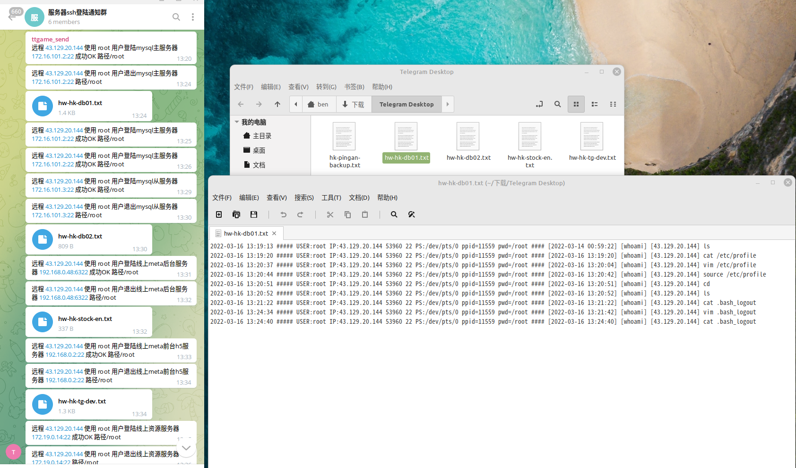

# ssh 登录/登出监控

> GitHub 仓库源文件：[点击打开网页渲染版](https://github.com/ben2023niao/ben-ops-notes/blob/main/doc/md/202206041506-%E7%9B%91%E6%8E%A7%2BShell%2B%E7%9B%91%E6%8E%A7%E5%91%8A%E8%AD%A6-ssh%20%E7%99%BB%E5%BD%95-%E7%99%BB%E5%87%BA%E7%9B%91%E6%8E%A7.md)

> 原文：[ssh 登录/登出监控](https://xn--6o0a585a.gitbook.io/devops/jian-kong/ssh-deng-lu-deng-chu-jian-kong.html)

> 来源：GitBook 网页 HTML｜页面时间：2022-06-04 15:06｜日期依据：GitBook 页面更新时间



Telegram接收SSH登陆提醒

```bash
#!/bin/sh
# Telegram接收SSH登陆提醒
#编辑 /etc/ssh/sshrc 放入以下代码
IP="$(echo $SSH_CONNECTION | cut -d " " -f 1)"
HOSTNAME=$(hostname)
NOW=$(date +"%e %b %Y, %a %r")

CONTENT="$IP 登录到主机 $HOSTNAME 时间 $NOW."

RES=$(curl -X POST \
  -F "chat_id=-446223495" \
  -F "text=${CONTENT}" \
  -o /dev/null --silent \
  -w %{http_code} \
  "https://api.telegram.org/bot1964244239:AAFIY_CqMoCR0V7dN04ADrjJxZ-rfdrAcXU/sendMessage")
#每次登陆 SSH 后 Telegram Bot 都会发送一条通知给你
#注意
#创建了 ~/.ssh/rc 的用户在登陆时只执行该文件，/etc/ssh/sshrc 会被忽略。
#ssh登录端口转发时会触发，但是开启 -N 选项后不会触发。
#当然这也并不是就万无一失了。提高安全意识，按时更换密码和私钥，不使用来历不明的代码才是正确的姿势。
#最后当然是祈祷这个脚本一次也不要派上用场。（别被黑客日了）
```

Telegram接收SSH退出提醒
