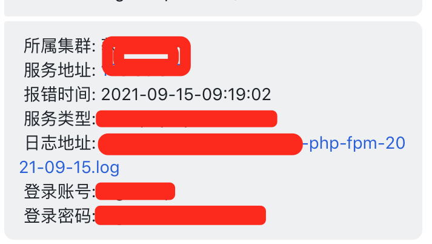

# 飞书日志监控

> GitHub 仓库源文件：[点击打开网页渲染版](https://github.com/ben2023niao/ben-ops-notes/blob/main/doc/md/202206041930-%E7%9B%91%E6%8E%A7%2BNginx%2B%E7%9B%91%E6%8E%A7%E5%91%8A%E8%AD%A6-%E9%A3%9E%E4%B9%A6%E6%97%A5%E5%BF%97%E7%9B%91%E6%8E%A7.md)

> 原文：[飞书日志监控](https://xn--6o0a585a.gitbook.io/devops/jian-kong/fei-shu-ri-zhi-jian-kong.html)

> 来源：GitBook 网页 HTML｜页面时间：2022-06-04 19:30｜日期依据：GitBook 页面更新时间



Nginx 的log日志文件下载查看配置

```
  server {
     listen 80;
     auth_basic "Nginx";
     auth_basic_user_file /usr/local/nginx/conf/passwd1;
     autoindex on;
     server_name log.hanye;
     charset utf-8;

     location / {
          root  /data/sh/log;
          autoindex_exact_size off; # 关闭计算文件确切大小（单位bytes），只显示大概大小（单位kb、mb、gb）
          autoindex_localtime on;
          autoindex on;
      }
  }
```
