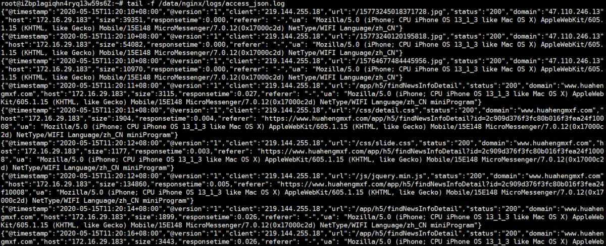
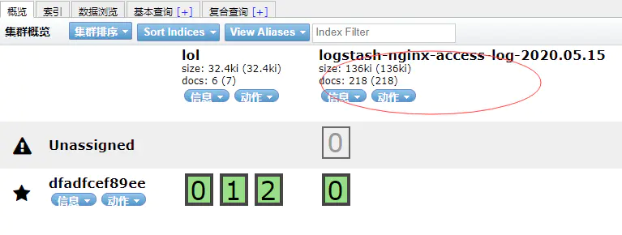
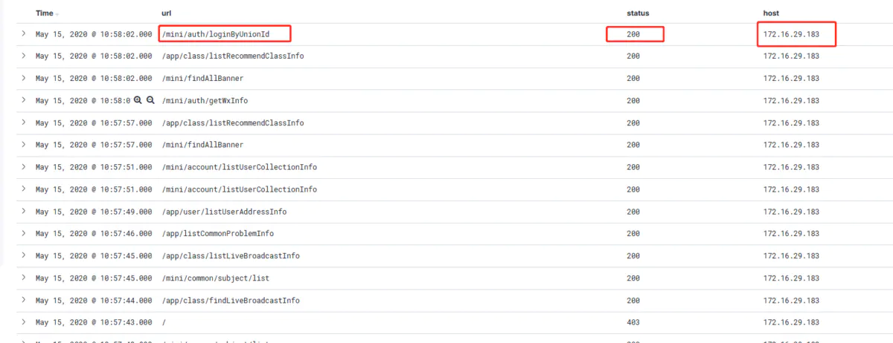
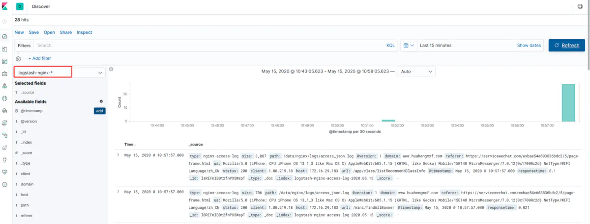
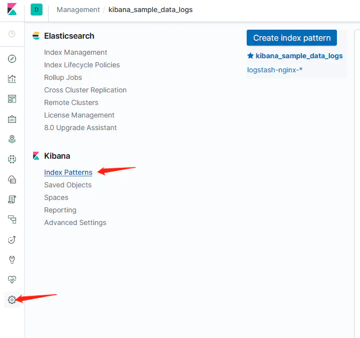

# ELK 分析nginx日志

> GitHub 仓库源文件：[点击打开网页渲染版](https://github.com/ben2023niao/ben-ops-notes/blob/main/doc/md/202206051501-%E6%9C%8D%E5%8A%A1%E9%83%A8%E7%BD%B2%2BDocker%2BNginx-ELK%20%E5%88%86%E6%9E%90nginx%E6%97%A5%E5%BF%97.md)

> 原文：[ELK 分析nginx日志](https://xn--6o0a585a.gitbook.io/devops/fu-wu/elk-fen-xi-nginx-ri-zhi.html)

> 来源：GitBook 网页 HTML｜页面时间：2022-06-05 15:01｜日期依据：GitBook 页面更新时间

#### 1.配置nginx日志

编辑nginx.conf文件 `vim /etc/nginx/nginx.conf` 在http节点下配置如下

```
log_format json '{"@timestamp":"$time_iso8601",'
                           '"@version":"1",'
                           '"client":"$remote_addr",'
                           '"url":"$uri",'
                           '"status":"$status",'
                           '"domain":"$host",'
                           '"host":"$server_addr",'
                           '"size":$body_bytes_sent,'
                           '"responsetime":$request_time,'
                           '"referer": "$http_referer",'
                           '"ua": "$http_user_agent"'
               '}';
    access_log /data/nginx/logs/access_json.log json;
```

目的就是将nginx的日志以json的形式进行文件存储，方便es存储
访问nginx 查看日志 `tail -f /data/nginx/logs/access_json.log` 可以看到新的入职信息说明配置正常



#### 安装elk

采用docker-compose

配置

- 配置logstash.yml
在`config/logstash.yml`文件下追加

- 配置logstash日志处理文件
新增`conf.d/logstash.conf`文件 内容如下：

说明：

- start_position 指从文件开始位置读取
- stat_interval 指每间隔两秒读取一次
- index 指定索引名称
- user | password 这里没有安装`xpack`插件，所以用户名，密码不用配置，如果需要可以 自行配置
启动`docker-compose`
`docker -compose up -d --build`
之后打开head插件发现发出来一个index库



Management-->index patterns-->create index pattern
输入`logstash-nginx-*` 就是在logstash中配置的索引名称前缀
然后配置时间排序字段 `@timestamp` 这样kibana就可以根据此字段进行时间倒序展示了
配置好之后就可以在左侧`discover`中查看对应的日志索引信息了



另外可以进行字段筛选显示





打开`http:{host}:5601`在kibana中添加nginx日志匹配规则
