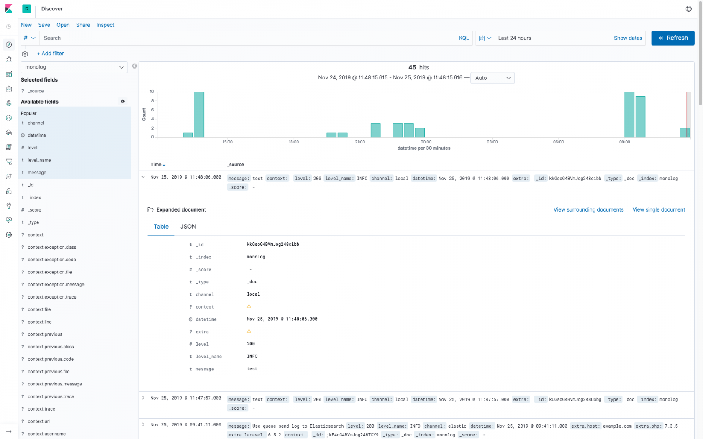
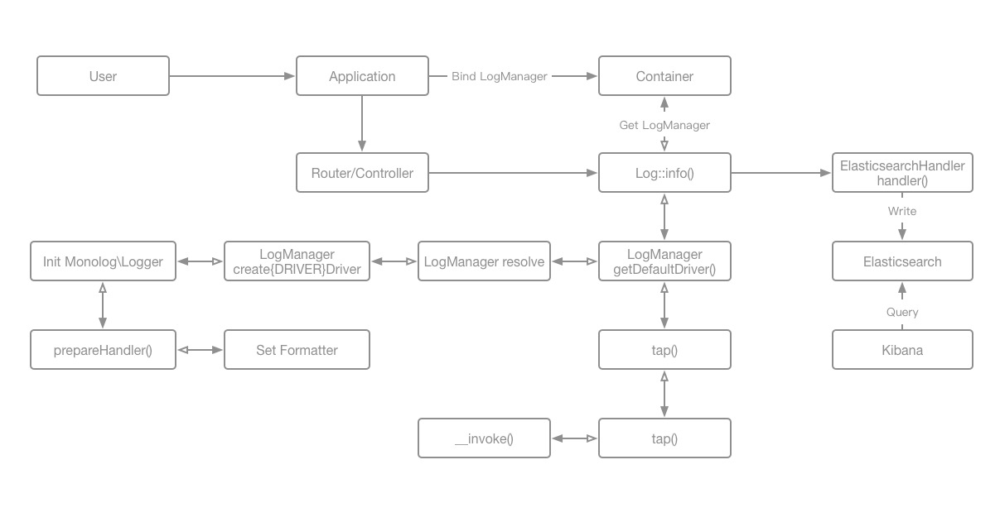

# ELK 分析 Laravel 日志

> GitHub 仓库源文件：[点击打开网页渲染版](https://github.com/ben2023niao/ben-ops-notes/blob/main/doc/md/202206051644-Docker%2BShell%2B%E5%AE%89%E5%85%A8%E8%BF%90%E7%BB%B4-ELK%20%E5%88%86%E6%9E%90%20Laravel%20%E6%97%A5%E5%BF%97.md)

> 原文：[ELK 分析 Laravel 日志](https://xn--6o0a585a.gitbook.io/devops/docker/centos7/bu-shu-es/elk-fen-xi-laravel-ri-zhi.html)

> 来源：GitBook 网页 HTML｜页面时间：2022-06-05 16:44｜日期依据：GitBook 页面更新时间



## **注意 ES 和 Kibana 以及IK分词器 版本要一致 7.2.0**

```bash
docker pull elasticsearch:7.2.0
docker pull kibana:7.2.0

#docker pull logstash:7.2.0 #通过改Laravel框架来搞

#ik分词器版本 elasticsearch-analysis-ik-7.2.0.zip
wget https://github.com/medcl/elasticsearch-analysis-ik/releases/download/v7.2.0/elasticsearch-analysis-ik-7.2.0.zip
```

#### 1 启动es 在浏览器中打开[http://localhost:9200](https://link.segmentfault.com/?enc=zBew536jmGij%2FKODPSlNQQ%3D%3D.u1JyRrr%2FR7cVh8nkLhJKExsV7VBtj6rtSQbpS83%2FkdU%3D) 检查

#### 2 修改es配置，解决跨域问题

首先进入到容器中，然后进入到指定目录修改`elasticsearch.yml`文件

在elasticsearch.yml的文件末尾加上

修改配置后重启容器

#### 3 安装ik分词器

es自带的分词器对中文分词不是很友好，所以下载开源的IK分词器来解决这个问题。
首先进入到plugins目录中下载分词器，下载完成后然后解压，再重启es即可。具体步骤如下:
**注意：**elasticsearch的版本和ik分词器的版本需要保持一致，不然在重启的时候会失败。
可以在 <https://github.com/medcl/elasticsearch-analysis-ik/releases> 查看所有版本

不添加`"analyzer": "ik_max_word",`则是每个字分词，可以在下面kibana安装完成以后尝试一下

然后可以在kibana界面的`dev tools`中验证是否安装成功；

#### 4 docker安装kibana

启动kibana容器使用`--link`连接到elasticsearch容器

启动以后可以打开浏览器输入 [http://localhost:5601](https://link.segmentfault.com/?enc=2UDcDiGMQNP9cSy5wQa%2FKQ%3D%3D.LNC5f45%2FKsC2jjJaW7MBPNDLOBjGkWafsIafy5xgfW4%3D) 就可以打开kibana的界面了

## 原理



所需依赖
`elasticsearch/elasticsearch`
`betterde/logger`（如果需要）

原理分析
Laravel 使用 monolog/monolog 作为默认日志处理模块。monolog 自带了很多 Handler 其中就有 ElasticsearchHandler。

生命周期 在 Illuminate\Foundation\Application 的构造函数中注册基本的服务提供者，其中就有 Illuminate\Log\LogServiceProvider。在 Illuminate\Log\LogServiceProvider 中将 Illuminate\Log\LogManager 注册到容器，此时还没有 Logger。当使用 Illuminate\Support\Facades\Log::info() 的时候，LogManager 会调用内部一系列方法根据配置文件创建 Logger 和其所需的 Handlers 最终调用 Logger 的 info ()、error ()、debug () 等方法，实现记录日志的功能。

所以只需要通过修改 `config/logging.php` 和 `.env` 文件就可以实现将日志直接写入 Elasticcsearch

`config/logging.php`

.env 增加 `LOG_CHANNEL=elastic`

发现当在写入日志的时候，Laravel 是单条同步进行的，对于使用原创存储来说这将影响一定的性能。所以需要在整个生命周期中临时保存所有的日志信息，在请求结束前触发同步或异步将日志批量写入存储。

为此直接使用扩展包 `betterde/logger` 解决

### 1 安装依赖

### 2 配置

将如下配置追加到 `config/logging.php` 的 `channels` 中

将 `\Betterde\Logger\Http\Middleware\BulkCollectionLog` 中间件添加到 `App\Http\Kernel.php` 文件中

在 `.env` 文件中添加如下配置项

修改 `config/logger.php` 配置文件
