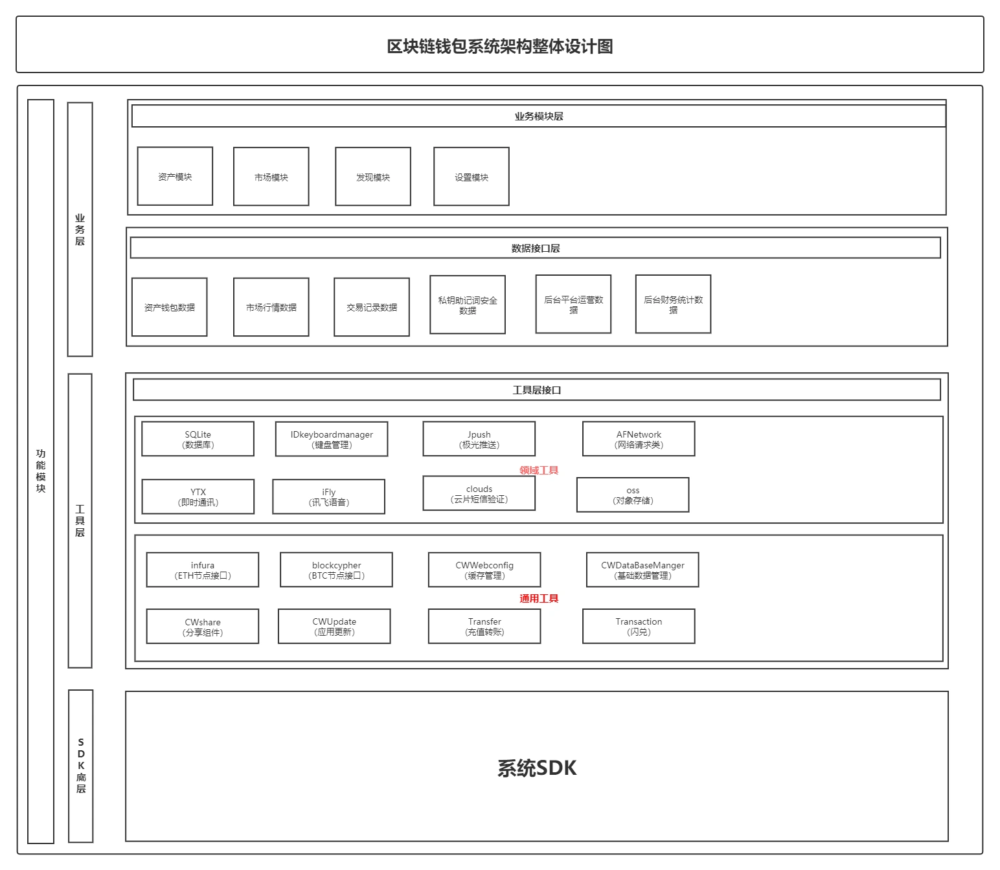

# 区块链钱包系统设计架构

> 原文：[区块链钱包系统设计架构](https://xn--6o0a585a.gitbook.io/devops/qu-kuai-lian/qu-kuai-lian-qian-bao-xi-tong-she-ji-jia-gou.html)

> 来源：GitBook 网页 HTML｜页面时间：2022-06-11 16:14｜日期依据：GitBook 页面更新时间

