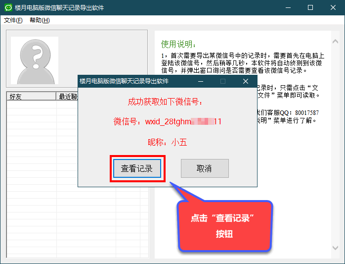
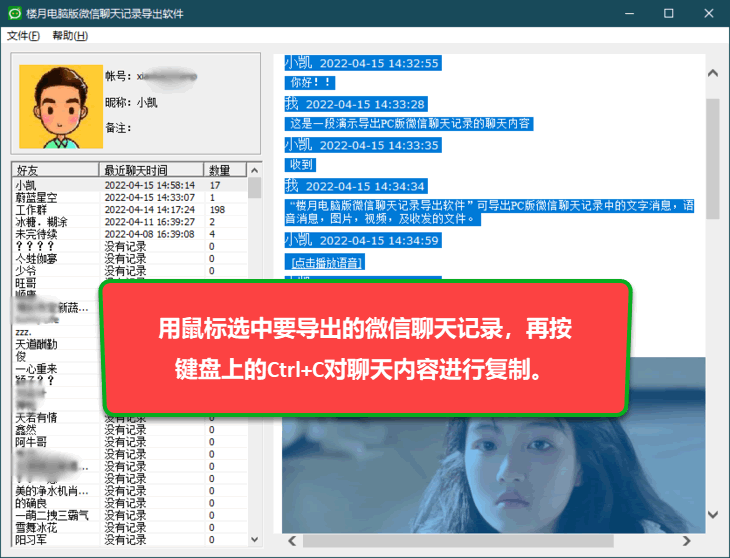
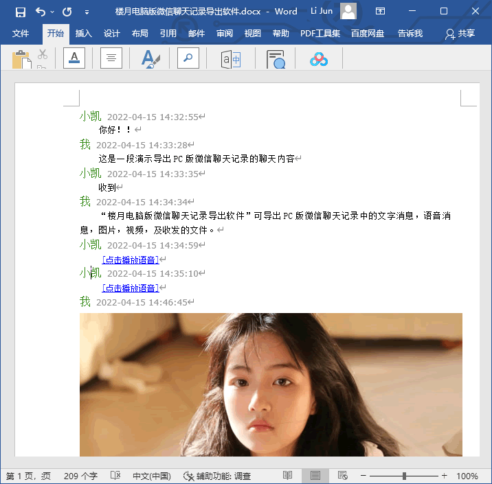
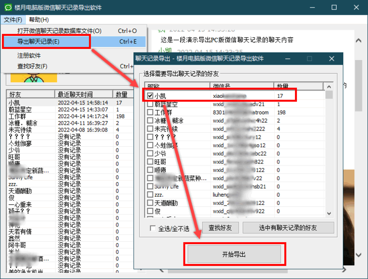
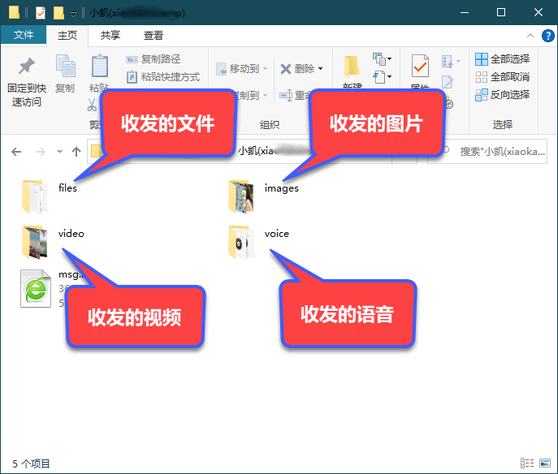
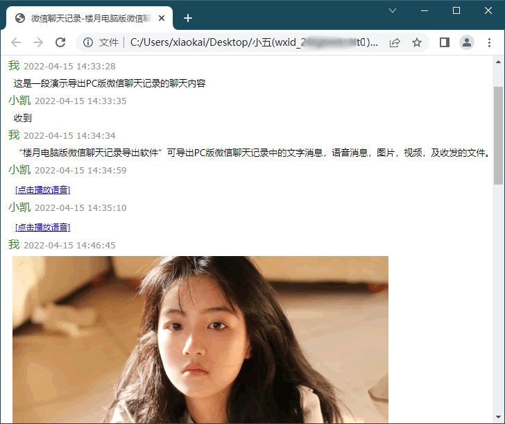
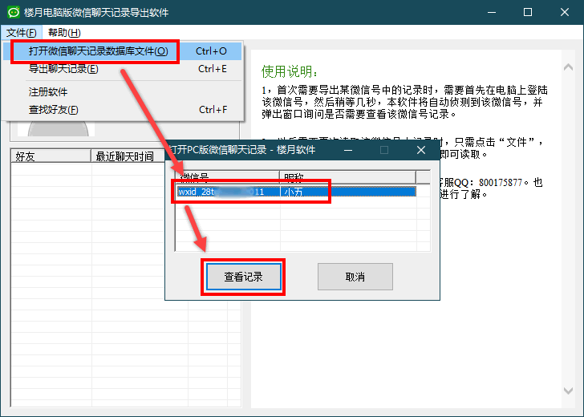
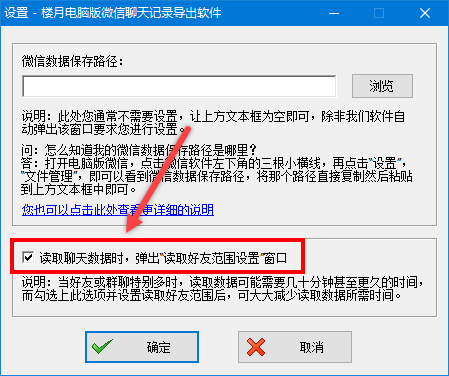
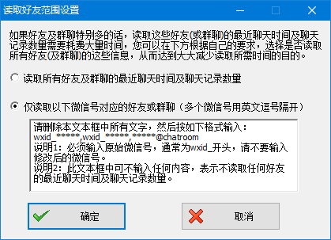

# 电脑版微信聊天记录导出恢复

下载地址：[本地下载1](https://louyue.com/down/louyuepcweixin_setup.exe)  <https://louyue.com/down/louyuepcweixin_setup.exe>

视频演示：<https://louyue.com/video/pcwx.mp4>

友情提示：以上视频可放大至全屏再观看。

PC版微信的聊天记录加密保存在电脑中，有时我们想将自己微信中的聊天记录导出来，但微信软件并不提供该功能。使用楼月电脑版微信聊天记录导出软件后，可将自己电脑版微信中的聊天内容批量导出来，包括文字，语音，图片，小视频及收发的文件等，这些记录导出后，可进行打印或作为数据备份用途。聊天记录可导出到Word文档中，也可导出到htm文件中。图片，语音，视频，收发的文件也将批量导出到对应的文件夹下，通常图片会以jpg或png格式导出，语音将以wav格式进行导出，视频以mp4格式导出，收发的文件则以原来相同的格式进行导出。所有导出的这些文件在原有文件名称前面加了数字序号进行命名，所以导出的内容按收发顺序进行了排序。

**软件使用步骤：**

1，首先需要在电脑上登陆上自己的微信号。

2，打开“楼月电脑版微信聊天记录导出软件”，稍等几秒后，软件将自动侦测到当前登陆的微信号，点击“查看记录”按钮。
说明1：如果360等安全软件弹出提示的话，需要点击“允许程序所有操作”，并勾选上“不再提醒”。
说明2：如果该微信号中好友或群聊特别多的话，读取好友列表可能会花费几十分钟甚至更久的时间，可通过让软件弹出“读取好友范围设置”窗口，来大大减少读取好友信息所需时间，详见本网页底部的常见问题3。

3，此时就可以在界面上查看到该微信号上与所有好友及群聊中的聊天内容了，如需将这些记录导出到Word文档中的话，可用鼠标选中要导出的内容（可按Ctrl+A全选所有记录），再按Ctrl+C进行复制。

4，再新建一个Word文档，并将内容粘贴到Word文档中即可。如需对记录进行打印的话，可在Word文档中对其进行打印。

5，也可在软件界面上点击“文件”，“导出聊天记录”菜单，选中要导出聊天记录的好友（或群聊），再进行导出。

6，在导出目录下，双击打开msg.htm可看到所有聊天内容。而对应的files，images，video，voice目录下则保存了与该好友所有收发的文件，图片，视频，及语音。
说明： 导出的图片，语音，视频文件均以数字序号命名进行了排序，并且文件名中还包括该消息收发的时间，如：[00008]2022-06-11 18:59:01.wav，表示该语音消息文件为与该好友（或该群聊中）收发的第8条语音消息，该语音消息的收发时间为2022年6月11日的18点59分01秒。

7，双击打开msg.htm后如下图所示：

8，当我们下次需要再导出该微信号中的聊天记录时，则不再需要登陆该微信号，只需要点击“文件”，“打开微信聊天记录数据库”菜单，然后在弹出窗口中选中要查看的微信号，再点击“查看记录”即可进行查看。

**常见问题：**

问1，是否在每次要导出自己某微信号中的记录时，都需要登陆该微信号？
答：不需要，只有在第一次导出该微信号中记录时才需要登陆一次微信，以后要导出该微信号中记录时，不需再登陆该微信号了，只需要点击“文件”，“打开微信聊天记录数据库”菜单，再选中想查看的微信号，再查看记录即可，并且查看到的是到当前时间为止的所有记录。

问2，为什么软件提示“侦测到一个登陆的微信号！但您安装的微信版本我们软件并不支持！”
答：因为不同版本的微信其加密方式不一样，所以我们软件不会对所有老版本微信进行支持，您只需要将微信更新到最新版本，即可查看及导出里面的聊天内容。如果您不知道怎么更新微信，或者还有其它任何问题的话，可与我们客服QQ：800175877联系。

问3，我的微信中有特别多的微信好友及群聊，导致读取好友列表时需要等待很长时间，该怎么缩短读取好友信息所需时间？
答：首先点击“文件”，“设置”菜单，在设置窗口中勾选上“读取聊天数据时，弹出‘读取好友范围设置’窗口”，如下图所示：

然后在读取聊天数据时，软件将弹出如下所示窗口，您只需要选择第二个选项，即“仅读取以下微信号对应的好友或群聊（多个微信号用英文逗号隔开）”，然后删除里面的所有内容，再输入需要读取的微信号即可。
说明1：可将文本框直接留空，即不输入任何微信号，这样软件将不读取任何好友的最近聊天时间及聊天记录数量，从而大大减少读取好友列表所需时间。
说明2：不读取最近聊天时间及聊天记录数量并不会影响软件的导出功能，只是好友列表中看不到该好友的聊天记录时间及聊天记录数量。

也可观看下方的视频演示：<https://louyue.com/video/pcwxdaochu.mp4>
