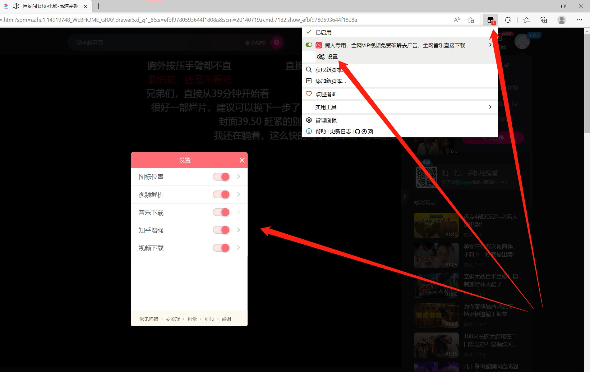
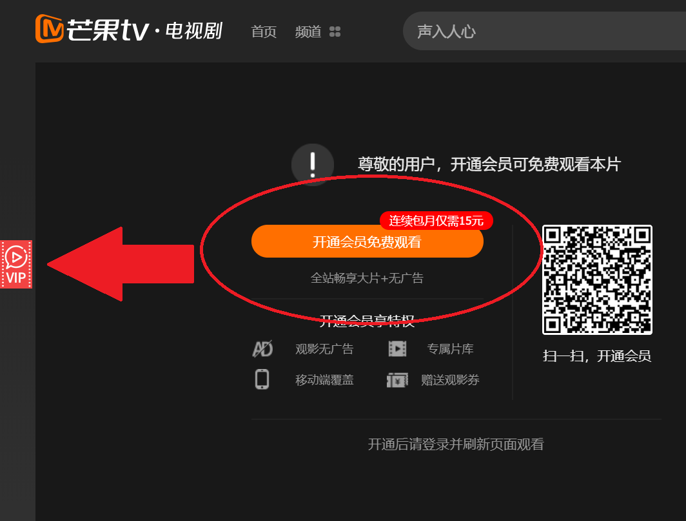
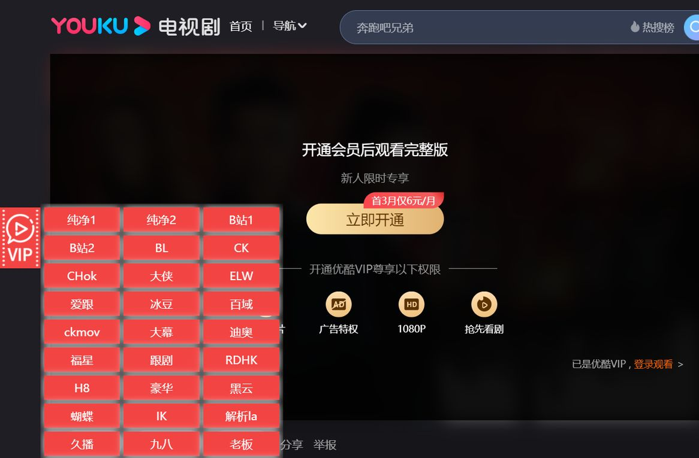

# 油猴脚本 VIP破解

> GitHub 仓库源文件：[点击打开网页渲染版](https://github.com/ben2023niao/ben-ops-notes/blob/main/doc/md/202207170000-%E5%AE%89%E5%85%A8%E4%B8%8E%E5%A0%A1%E5%9E%92%E6%9C%BA%2B%E9%AB%98%E7%BA%A7%E5%AE%89%E5%85%A8%2B%E5%A4%87%E4%BB%BD%E6%81%A2%E5%A4%8D%2B%E7%9F%A5%E8%AF%86%E7%AC%94%E8%AE%B0-%E6%B2%B9%E7%8C%B4%E8%84%9A%E6%9C%AC%20VIP%E7%A0%B4%E8%A7%A3.md)

## 懒人专用，全网VIP视频免费破解去广告、全网音乐直接下载、知乎增强、短视频无水印下载、百度网盘直接下载等多功能工具箱，功能可独立开关。长期更新，放心使用。v5.4

自用多功能脚本工具箱，完全免费、无广告、无需关注公众号，集合了优酷、爱奇艺、腾讯、B站(bilibili)、芒果等全网VIP视频(PC+移动端)免费破解去广告，网易云音乐、QQ音乐、酷狗、酷我、虾米、蜻蜓FM、荔枝FM、喜马拉雅等网站音乐和有声书音频免客户端下载，知乎增强(知乎视频下载、去广告、关键词屏蔽、去除侧边栏等)，视频无水印下载(bilibili、抖音、快手、西瓜)，百度网盘直接下载，优惠券自动查询等几个自己常用的功能，且功能可独立开关。

[安装此脚本](https://greasyfork.org/scripts/370634-懒人专用-全网vip视频免费破解去广告-全网音乐直接下载-知乎增强-短视频无水印下载-百度网盘直接下载等多功能工具箱-功能可独立开关-长期更新-放心使用-v5-4/code/懒人专用，全网VIP视频免费破解去广告、全网音乐直接下载、知乎增强、短视频无水印下载、百度网盘直接下载等多功能工具箱，功能可独立开关。长期更新，放心使用。v54.user.js)

[提问、发表评价](https://greasyfork.org/zh-CN/scripts/370634-懒人专用-全网vip视频免费破解去广告-全网音乐直接下载-知乎增强-短视频无水印下载-百度网盘直接下载等多功能工具箱-功能可独立开关-长期更新-放心使用-v5-4/feedback#post-discussion)，或者 [举报这个脚本](https://greasyfork.org/zh-CN/reports/new?item_class=script&item_id=370634)。

作者懒蛤蛤今日安装4,837总安装量6,811,188得分4738 158 116版本5.4.8创建日期2018/7/27最近更新前天许可证AGPL LicenseAntifeatures引荐链接

应用到[iqiyi.comqq.comyouku.commgtv.comle.comtudou.comsohu.compptv.combilibili.com163.comkugou.comkuwo.cnximalaya.comtaobao.comtmall.comtmall.hkliangxinyao.combaidu.comjd.comiq.comyiyaojd.comzhihu.comdouyin.comkuaishou.comixigua.com](http://iqiyi.comqq.comyouku.commgtv.comle.comtudou.comsohu.compptv.combilibili.com163.comkugou.comkuwo.cnximalaya.comtaobao.comtmall.comtmall.hkliangxinyao.combaidu.comjd.comiq.comyiyaojd.comzhihu.comdouyin.comkuaishou.comixigua.com)

## 本脚本无需注册用户，无需登录，无需关注公众号，且无任何广告。

目前所有线路电脑和手机观看均无广告，如发现有线路含有广告，**请千万不要相信**，并请及时反馈，我会第一时间移除该线路。
对于近期部分**用小号恶意举报/差评/辱骂/诋毁的人**

## 我劝你做个人!

---

 由于 safari 浏览器采用特殊机制限制油猴功能，造成脚本失效，请用 safari 浏览器的用户改用其他浏览器加载本脚本。

---

### 脚本功能

1.  脚本设置，支持脚本各功能的独立开关。
2.  全网VIP视频免费解析，支持PC+移动端优酷、爱奇艺、腾讯、B站(Bilibili)、乐视，芒果等各大视频网站。
3.  全网音乐免客户端下载，支持网易云音乐、QQ音乐、酷狗、酷我、虾米、蜻蜓FM、荔枝FM、喜马拉雅等音乐网站。
4.  查券，支持淘宝、天猫、京东的优惠券自动查询。
5.  知乎增强，支持知乎去广告、视频下载、屏蔽视频、关闭侧边栏、链接直接跳转、关键词屏蔽等。
6.  视频下载，支持抖音、快手、bilibili、西瓜视频等。
7.  网盘下载，百度网盘免客户端下载。

### 使用方法

#### 设置

脚本设置

在油猴的脚本设置中打开设置菜单，可单独开关功能。

#### 视频解析

站外解析(点击展开)
站内解析(点击展开)
移动端解析(点击展开)

#### 音乐下载

QQ音乐(点击展开)
喜马拉雅(点击展开)
网易云音乐和其他音乐网站(点击展开)

#### 查券

自动查券(点击展开)

#### 知乎增强

知乎增强(点击展开)

#### 短视频下载

抖音无水印下载(点击展开)
快手无水印下载(点击展开)
西瓜视频无水印下载(点击展开)
B站(bilibili)下载(点击展开)

#### 网盘下载

百度网盘(点击展开)

---

### 常见问题

[查看常见问题答疑](https://www.80note.com/2019/05/782.html)

如果出现莫名其妙的问题，请尝试安装兼容脚本:
<https://greasyfork.org/zh-CN/scripts/376078>

---

### 提示

**使用中有任何问题或反馈意见，请加 [QQ交流群](https://www.zuihuimai.net/t/qq.html)
进群暗号：懒人
有条件的还可以加 [Telegram群](https://t.me/joinchat/B_dyxBWnDUgJjPMoHavTaw)**

---

### 声明

本脚本在任何支持油猴的浏览器皆可使用，并秉承「不作恶」的原则，
无需用户注册登录，不跟踪不记录任何用户信息，无需关注公众号，不添加广告，使用手机打开观看可判断是否有广告。
如发现有广告，请反馈告知，我会第一时间移除该线路。

本脚本视频解析、音乐下载、知乎增强、短视频下载等功能皆为原创，且无任何隐藏、混淆和加密代码，所有代码开源可供用户查阅。

个别解析线路带有可选的额外收费提速功能，这是线路行为，与脚本作者无关。
不需要的用户可以无视。
也请有需要付费提速的用户不要错付给脚本作者。

另外我每周需要花费十多个小时的业余时间进行开发维护，视频站外解析和音乐解析网站也都需要服务器和带宽费用，仅靠用户打赏根本无法支撑，所以加入了优惠券查询aff，此功能完全绿色化，有券显示，没券则不显示，优惠券显示后，你可以领也可以不领，没有任何强制跳转，主动权完全在你，不会对您有任何影响以及隐私困扰。如果你在买必需品同时能顺手领券，在能给你省钱的同时，也能让我得到aff，等于是在打赏我，支持我进行脚本的持续开发和维护，在此表示深深感谢

---

### 更新记录

点击展开

2022年7月17日
升级优惠券样式，修复部分小问题。
2022年7月8日
修复腾讯和爱奇艺播放404。
2022年7月4日
修复B站有时候不显示下载按钮的问题。
2022年6月20日
新增bilibili视频下载
2022年6月13日
新增喜马拉雅批量下载
优化腾讯和爱奇艺解析
2022年6月8日
新增西瓜视频无水印下载
优化DGT解析
2022年6月2日
优化短视频下载
优化DGT解析
添加操作提示
2022年5月29日
修复酷狗音乐下载。
2022年5月26日
修复喜马拉雅下载。
喜马拉雅下载文件按音频标题命名。
短视频下载按视频标题命名。
2022年5月16日
新增快手无水印下载
2022年5月6日
新增抖音无水印下载
2022年4月27日
新增自定义解析线路功能
2022年4月22日
优化代码
添加图标延迟
修复暴力猴在部分网站无法使用的bug
2022年4月19日
重制脚本并修复部分bug
2022年4月15日
新增知乎增强功能
2022年3月27日
新增设置功能
全面支持移动端
2022年1月24日
修复多个问题
2022年1月5日
修复华数显示问题
2021年12月5日更新
修复移动浏览器爱奇艺占屏问题
2021年7月5日更新
记住已选择的线路
2021年6月24日更新
优化移动端支持
2021年5月20日更新
修复音乐下载
2021年5月11日更新
修复qq音乐下载
2021年4月2日更新
新增拖动图标位置功能
2021年1月30日更新
增加站内解析
优化解析线路
增加喜马拉雅有声书下载
恢复腾讯音乐下载
解决部分bug
11月27日更新
解决脚本图标冲突bug
7月11日更新
修复了优酷解析图标过大的bug
4月14日更新
修复酷我音乐
11月2日更新
减少资源占用，提升速度。
9月2日更新
解决视频解析重音问题。
8月30日更新
美化视频界面，修复QQ音乐接口。
8月21日更新
1，视频解析全新改版。
2，修复了QQ音乐解析下载的问题。
5月6日更新
修复了网易云音乐解析出错的问题。
4月23日更新
脚本重制。
4月8日更新
避开某同类脚本作者刻意制造的脚本冲突问题，不予回击，望好自为之。
4月2日更新
优化代码，新增全网音乐下载功能。
3月8日更新
新增手机版浏览器脚本支持
现在所有线路PC观看无广告，纯净线路手机观看无广告。同时更换了稍微醒目的播放图标

---
