# ZeroSSL免费申请IP的SSL证书

> GitHub 仓库源文件：[点击打开网页渲染版](https://github.com/ben2023niao/ben-ops-notes/blob/main/doc/md/202304141557-DevOps%20%E4%B8%8E%20SRE%2B%E4%BC%98%E5%8C%96%E6%96%B9%E6%A1%88%2BDNS%2BNginx-ZeroSSL%E5%85%8D%E8%B4%B9%E7%94%B3%E8%AF%B7IP%E7%9A%84SSL%E8%AF%81%E4%B9%A6.md)

一般来说，我们使用域名访问给域名加上SSL证书是建站的常规操作，但是有一些应用可能不需要使用域名访问，或者是不想绑定域名，而只是想用单纯的IP来实现访问。在现在全网都是HTTPS加密访问的背景下，有没有可能给IP地址也加上SSL证书实现访问呢？

有。但大多数面对IP的SSL证书都是收费的。而zeroSSL提供[免费SSL证书](https://wzfou.com/tag/mianfei-ssl/)是支持纯IP颁发的，本篇文章就来分享一下[zeroSSL](https://wzfou.com/tag/zerossl/)免费的纯IP SSL证书申请以及如何在自己的服务器（[宝塔面板](https://wzfou.com/tag/baota-mianban/)或者Nginx）安装配置zeroSSL免费SSL证书。更多的免费SSL请参考专题页面：[免费SSL证书收集整理汇总](https://wzfou.com/mianfei-ssl/)。

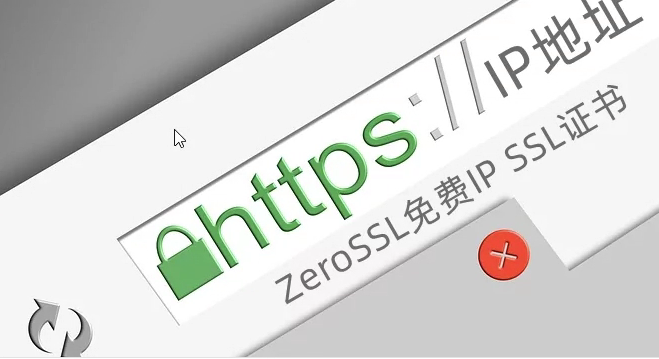

相关的[SSL证书](https://wzfou.com/ssl/)建站教程有：

1. [简单三步给网站申请安装letsencrypt免费SSL证书-acme.sh自动续期](https://wzfou.com/letsencrypt/)
2. [八个HTTPS和SSL优化使用心得-减少等待时间和降低Https性能损耗](https://wzfou.com/https-ssl/)
3. [三个免费的SSL证书在线监控和到期提醒服务-再也不用担心证书过期](https://wzfou.com/ssl-jiankong/)

**PS：更新记录。**

> 1、BuyPass提供了免费180天的SSL证书，同样支持acme.sh脚本安装与自动续期：[BuyPass免费SSL证书申请与使用教程-acme.sh自动申请和续期SSL证书](https://wzfou.com/buypass-ssl/)。2022.8.20
>
> 2、ZeroSSL可以像letsencrypt那样提供免费90天的SSL证书且可免费无限续期：[ZeroSSL免费SSL证书申请与使用-支持自动续期和免费泛域名SSL证书](https://wzfou.com/zerossl-ssl/)。2022.6.9

## 一、ZeroSSL证书申请

网站：

1. [https://zerossl.com](https://wzfou.com/go/zerossl)

### 1.1 手动申请

进入到[ZeroSSL](https://wzfou.com/tag/zerossl/)官网，注册一个账号，然后点击免费SSL证书申请。

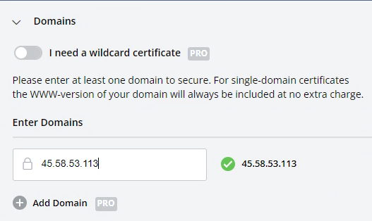

填写你的IP地址，然后选择免费SSL证书时长。

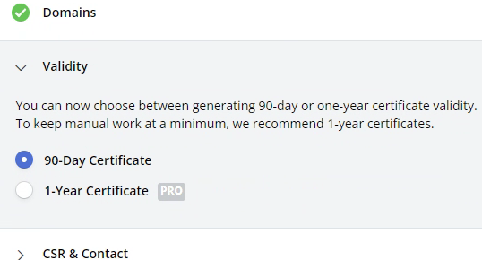

选择自动生成CSR。

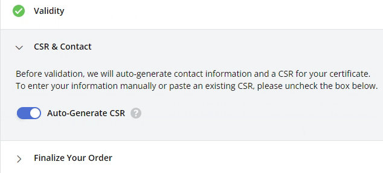

#### 1.2 验证域名

ZeroSSL免费SSL证书提供了两种域名验证方式，最简单的就是Web验证，但是前提是你要让你的IP地址实现Web访问。如果没有，你可以选择使用域名DNS添加TXT记录验证。

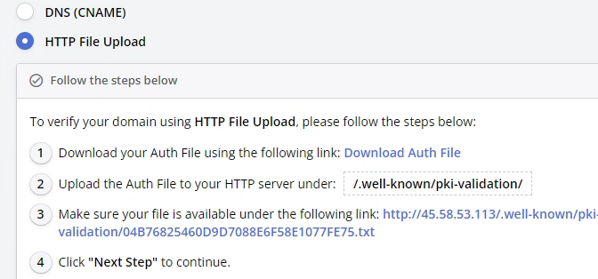

选择网站Web访问的话，直接下载验证文件，然后上传到IP地址默认的Web目录下，要求是路径保持如下：

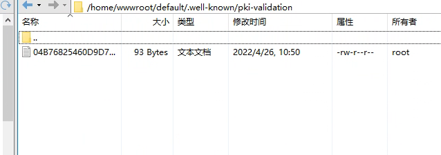

用你的浏览器打开IP，保证可以访问到验证文件。

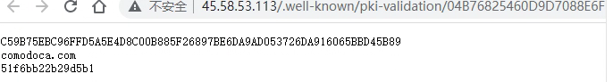

最后，回到ZeroSSL验证页面，点击完成验证。

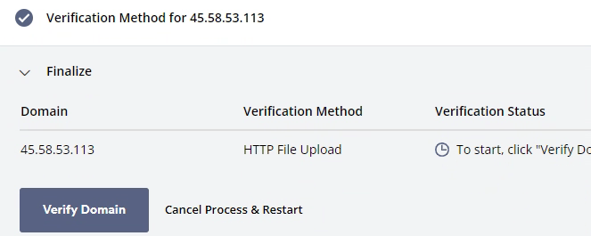

### 二、ZeroSSL证书安装

#### 2.1 下载证书文件

ZeroSSL证书验证成功后，你就可以下载证书文件了。[ZeroSSL SSL证书](https://wzfou.com/tag/zerossl-ssl-crt/)提供了多种形式，包括了Nginx、Apache等。

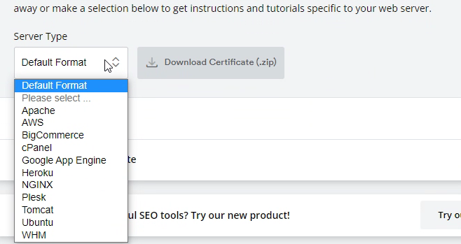

这里以Nginx为例，下载下来了ZeroSSL证书文件有三个：ca_bundle.crt和certificate.crt以及私钥key。

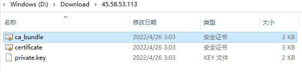

#### 2.2 合并SSL证书

对于Nginx服务器，需要将ca_bundle.crt和certificate.crt合并，方法是打开certificate.crt，然后将ca_bundle.crt的内容复制粘贴放在后面。

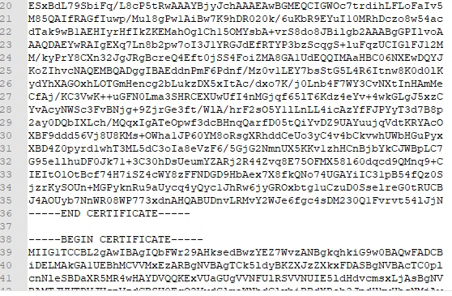
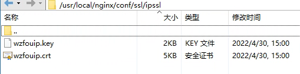

#### 2.3 安装SSL证书

如果你用的是宝塔面板，可以直接在后台点击安装SSL证书，然后将证书和密钥文件分别上传保存即可。

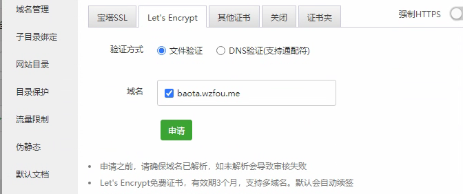

如果你用的是[Oneinstack一键包](https://wzfou.com/oneinstack/)和[LNMP一键安装包](https://wzfou.com/tag/lnmp-yzb/)，则需要打开你的Nginx配置文件（不是域名Nginx配置文件），参考以下格式修改，注意要将SSL证书的路径改成你自己的：
server
 {
 listen 443 ssl http2;
 #listen [::]:443 ssl http2;
 server_name _;
 index index.html index.htm index.php;
 root /home/wwwroot/default;

 ssl_certificate /usr/local/nginx/conf/ssl/ipssl/wzfouip.crt;
 ssl_certificate_key /usr/local/nginx/conf/ssl/ipssl/wzfouip.key;
 ssl_session_timeout 5m;
 ssl_protocols TLSv1 TLSv1.1 TLSv1.2 TLSv1.3;
 ssl_prefer_server_ciphers on;
 ssl_ciphers "TLS13-AES-256-GCM-SHA384:TLS13-CHACHA20-POLY1305-SHA256:TLS13-AES-128-GCM-SHA256:TLS13-AES-128-CCM-8-SHA256:TLS13-AES-128-CCM-SHA256:EECDH+CHACHA20:EECDH+CHACHA20-draft:EECDH+AES128:RSA+AES128:EECDH+AES256:RSA+AES256:EECDH+3DES:RSA+3DES:!MD5";
 ssl_session_cache builtin:1000 shared:SSL:10m;

## openssl dhparam -out /usr/local/nginx/conf/ssl/dhparam.pem 2048

 ssl_dhparam /usr/local/nginx/conf/ssl/dhparam.pem;

 access_log /home/wwwlogs/access.log;
 }

证书安装后，记得执行一次:nginx -t来检查一下是否有没有语法错误，没有的话直接重启Nginx完成SSL证书安装。打开IP地址你就可以看到IP SSL证书已经成功安装了。

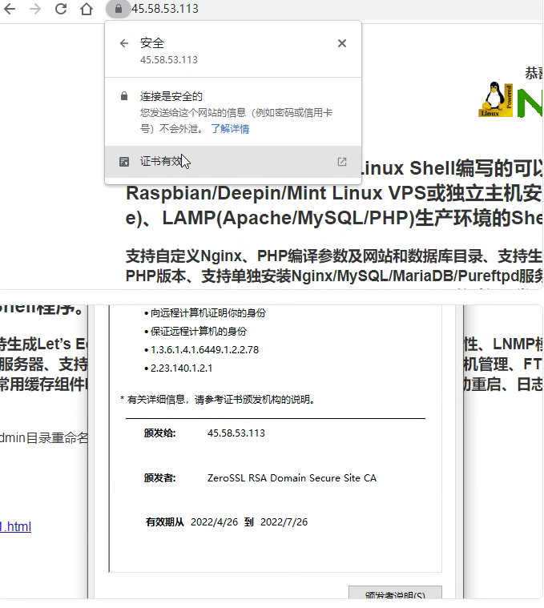

### 三、总结

就目前来看，纯IP的[ZeroSSL免费SSL证书](https://wzfou.com/tag/zerossl-mianfei-ssl/)暂时没有很好的工具来自动续期，Github有开发者使用golang写了个工具可以实现更新：<https://github.com/tinkernels/zerossl-ip-cert>，但是不好操作，所以比较简单的方法就是自己手动申请续期。
