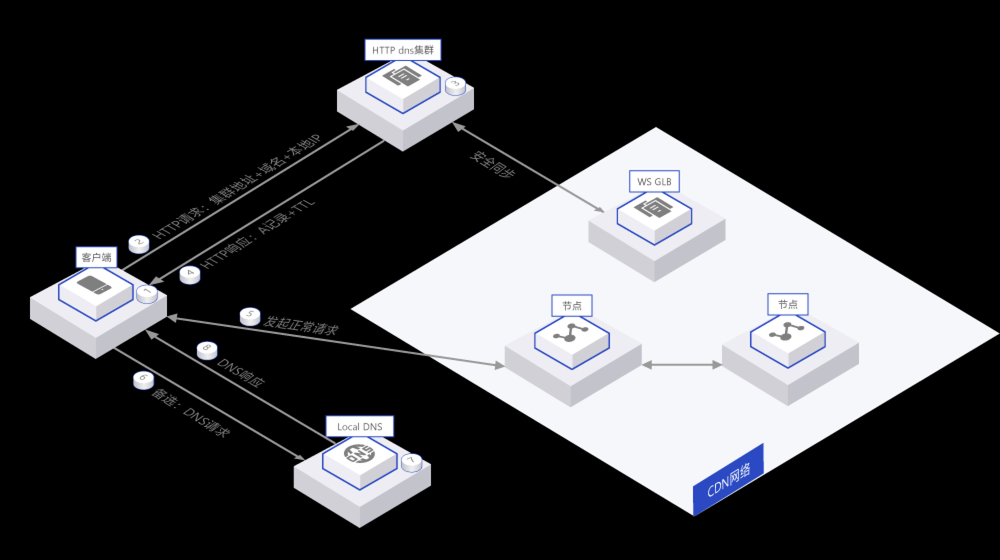
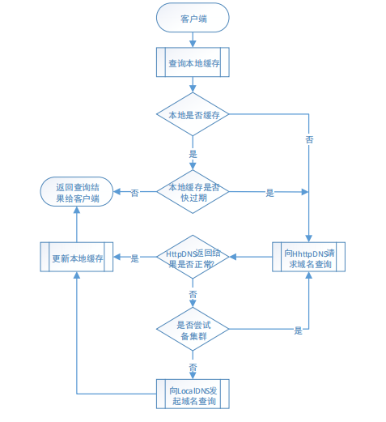

# 安卓 苹果 HTTPDNS（APP防劫持）防劫持方案

> GitHub 仓库源文件：[点击打开网页渲染版](https://github.com/ben2023niao/ben-ops-notes/blob/main/doc/md/202304141557-DevOps%20%E4%B8%8E%20SRE%2B%E4%BC%98%E5%8C%96%E6%96%B9%E6%A1%88%2BDNS%2B%E5%A4%87%E4%BB%BD%E6%81%A2%E5%A4%8D-%E5%AE%89%E5%8D%93%20%E8%8B%B9%E6%9E%9C%20HTTPDNS%EF%BC%88APP%E9%98%B2%E5%8A%AB%E6%8C%81%EF%BC%89%E9%98%B2%E5%8A%AB%E6%8C%81%E6%96%B9%E6%A1%88.md)

<https://defense.yunaq.com/httpdns/>
<https://www.wangsu.com/document/476/481>

- ### 域名防劫持

绕过本地运营商的Local DNS，从根本避免了劫持问题，防止DNS被污染拦截。

## HTTPDNS实现原理

用户通过HTTP/HTTPS协议向知道创宇云防御DNS服务器发送解析请求，服务器返回最近的云防御节点IP地址。

## 1. 方案背景

### 1.1. 运营商劫持

运营商，特别是一些小运营商，为了减少跨网结算成本，会在本地运营商网内搭建内容缓存服
务器。本地本网用户访问时，运营商把域名强行指向内容缓存服务器的 IP 地址，从而把本地本网
流量完全留在了本地，减少了跨网访问。为了获取更多利益，部分运营商们还会将对应解析内容替
换成第三方广告联盟的广告或是钓鱼网站等。
伴随着运营商劫持现象的频繁发生，对企业造成了诸多不良影响：
**⚫ 访问失败**
客户业务错综复杂，如果域名是通过 https 协议或其它端口提供服务的，用户访问就会出现
失败。部分特殊业务，比如视频类网站，由于涉及到防盗链或者视频拖拉等特殊订制功能，
一旦被运营商进行内容缓存，用户也会访问失败。
**⚫ 访问不稳定**
运营商的缓存服务器的运维水平参差不齐，可能会出现缓存服务器故障导致用户访问异常
的问题。
**⚫ 文件更新不及时**
运营商自建的缓存服务器配有自己的缓存策略，且该策略独立于 CDN，无法被客户所控制，
会造成当文件更新后，终端用户仍访问到被劫持的旧文件内容。
由于运营商自建缓存会导致被 DNS 劫持的访问出现故障、访问效果不佳、访问内容未更新甚
至访问到第三方广告等现象，最终造成用户大量投诉。

### 1.2. 转发解析请求

运营商的 LocalDNS 会存在解析转发的情况，解析转发是指运营商自身不进行域名递归解析，
而是把域名解析请求转发到其它运营商的递归 DNS 上。
客户使用 CDN 加速服务后，当解析被运营商转发，网宿的权威 DNS 收到的域名解析请求的来
源 IP 就成了其它运营商或其他地区的 IP（因为网宿的权威 DNS 是根据来源 IP 进行解析调度），那
么用户流量就被导向了错误的节点，造成跨域、跨省、跨运营商访问后果：网站访问缓慢甚至无法
访问。

### 1.3. DNS 多出口

DNS 多出口，是指运营商的 LocalDNS 按照标准 DNS 协议进行递归查询时，由于存在网络多
出口且配置了目标路由 NAT 的情况，最终导致 LocalDNS 进行递归解析的出口 IP 非本网 IP 地址。
使用网宿 CDN 加速服务后，网宿权威 DNS 会根据来源 IP 进行解析调度。DNS 多出口的情况
会造成调度系统收到的域名解析请求来源 IP 变成其它运营商的 IP，最终引发域名解析错误、流量
跨网。

### 1.4. DNS 攻击

当前网络攻击越来越激烈，从历史来看，每次攻击的影响范围都很大，主要攻击类型：
① 针对公网 dns 服务的攻击，这个攻击影响的是所有解析用户。一旦受攻击，意味着所有用
户的域名解析都会出问题，大家上网都会出现故障。
② 针对网宿 dns 服务的攻击，通常为 DDOS 攻击，网宿平台可应对，其余类型攻击则影响网
宿平台该 DNS 服务的所有用户。
由于 CDN 加速是通过 CNAME 的方式别名到网宿入口，无论是公网 DNS 受到攻击还是网宿
DNS 受到攻击，都将对客户的服务造成严重影响，甚者直接导致区域服务中断。

## 2. 网宿 HttpDNS 方案

### 2.1. HttpDNS 原理

常规域名解析是通过 DNS 协议进行解析的，其最终结果就是获取域名对应的真实服务器地址，
无法绕开 DNS 拦截和故障问题。
而 HttpDNS 则是以 HTTP 的方式代替传统 DNS 协议传递解析结果，能够有效避开 DNS 层面
的拦截和故障。客户端通过接口向网宿 HttpDNS 集群发起“DNS 查询”请求，网宿 HttpDNS 集群根
据请求携带的域名和 IP 信息，查询 CDN 内部调度策略，通过响应请求的方式，返回给客户端最优
节点 IP。客户端得到最优节点 IP，通过在 header 中指定 host 字段，进行正常的业务访问。

### 2.2. 访拓扑图流程

**⚫ 拓扑图
**

**⚫ 访问流程**
客户端已根据《HTTPDNS.接入指南》完成客户端改造，客户端与 HTTPDNS 系统的业务流程
如下：
① 客户端向网宿 HttpDNS 中心集群发起查询请求，携带用户域名和终端 IP（可选）。
② 服务集群查询 CDN 内部调度系统（若内部调度系统查询不到数据，目前返回为空,后续
考虑在中心集群进行递归查询），将域名最佳访问节点 IP 以 HTTP 响应的方式传递给客
户端。
③ 客户端，收到响应结果，向节点发起请求。
④ 若客户端向网宿 HttpDNS 集群请求失败，则启用备选，走正常 DNS 解析过程，向 Local
DNS 发起请求。
⑤ LocalDNS 进行递归查询。
⑥ 最终返回 DNS 结果
⑦ 客户端拿到最优 IP 后,建立连接,发起正常访问操作

### 2.3. 调用方式

**⚫ 网宿 HttpDNS 集群**
网宿 HttpDNS 集群中心在海外地区接入了 BGP Anycast 网络，遍布全球各大洲 20+节点，用户
可以实现就近快速接入服务。
国内网宿 HttpDNS 集群中心，调度服务器节点数量在 100+，支持海量 HttpDNS 访问，轻松支
撑上千万并发访问。
安全上，网 HttpDNS 建设有多个异地灾备点，当任意一个节点发生故障时均能无缝切换到备
份节点，保证用户解析正常。为了保证 HTTPDNS 业务稳定及正常，在保证 HttpDNS 中心集群稳定
性同时建立分布于全国各地的边缘服务网络。
**⚫ 调用方式**
可采用如下方式进行请求：
1.国内：
① 主-备-备方式
客户端访问的时候支持主备备的方式。当前访问主集群，如果收到的响应为空或者集群连
接超时，则切换备份集群，如果备份集群访问也为空或者连接不上，则可选择尝试下一个
备集群或者直接走正常的 dns 解析。
② 域名 https 方式
2.海外地区：
采用 Anycast ip 的方式调用，并实现了多地跨机房容灾。可以保证 HTTPDNS 服务的高可用性，
HttpDNS 方案·DNS 防劫持方案
网宿科技股份有限公司 [www.chinanetcenter.com](http://www.chinanetcenter.com) 第7页
使服务得到有效保障。

### 2.4. 查询方式

**⚫ 直接 HTTP 查询 DNS 接口访问方式**
网宿自定义两种 http 查询 dns 接口的方式：http 和 https
① http 方式：请求内容包括用户加速域名，客户端 IP；响应内容则包括 DNS 记录和 TTL 时
间。
② https 方式 ：对要查询的域名和返回结果进行加密传输，可以防止明文 HTTP 请求在传输
过程中被篡改，进一步保障传输安全性。

## 3. 方案优势&适用场景

### 3.1. 方案优势

**⚫ 高速稳定接入**
全国互通的多个 BGP 集群可择优接入，多个集群异地容灾。海外地区已经部署 Anycast IP。
可保证各个运营商用户都可高速稳定接入。
**⚫ 就近请求，快速响应**
引入边缘节点，就近访问，低延迟，分散中心风险。
**⚫ 大容量，高并发**
国内 100+节点服务器、海外 20+节点服务器，轻松支撑千万并发访问，日千亿请求。
**⚫ 支持接入的域名范围广**
支持所有的域名接入 HTTPDNS，即包括网宿加速的域名以及非网宿加速的域名。
**⚫ 绿色防劫持**
无劫持，无跳转，防止 DNS 被拦截，提升 DNS 解析成功率。
**⚫ DNS 安全通道**
若根域解析异常，客户端的域名解析不会受到 DNS 根域的影响。
**⚫ 精准调度**
精确识别来源请求，直接根据用户 IP 进行调度，将用户访问导向最佳的节点，提高访问速
度和体验。
**⚫ 解析效率提升**
HttpDNS 方案·DNS 防劫持方案
网宿科技股份有限公司 [www.chinanetcenter.com](http://www.chinanetcenter.com) 第8页
可在一次 http 请求中查询多个域名结果，提升了解析效率。
**⚫ 低成本**
接入网宿 HttpDNS 仅需在客户端接入层做少量改造即可，而且 Http 协议请求构造非常简
单，兼容性强，成本低。
3.2. 适用场景
当客户的网站或应用业务受到运营商劫持、DNS 解析出错、DNS 攻击等多方面影响时，企业
可考虑使用网宿 HttpDNS 方案，真正实现：
**⚫ 避免因为运营商劫持造成访问错误；**
**⚫ 避免因为运营商劫持访问到旧文件、广告文件等错误内容；**
**⚫ 避免因为 DNS 多出口、转发解析等因素，造成终端访问过慢，影响用户体验；**
**⚫ 保障在 DNS 受到攻击时，网站或应用服务能够照常进行。**
注：需要有客户端进行配合，进行一定的开发，适用于有客户端的场景。

## 4. 客户案例

网易游戏
业务场景：手游厂商，在线玩家人数众多，并经常需要进行游戏更新包升级。
存在问题：由于玩家 DNS 设置等问题，经常出现更新包下载过慢的情况
解决办法：使用网宿 HttpDNS 方案，获得用户终端 IP 对应的最佳加速节点，使更
新包下载速度得到很大提升

## 2. 接入指南

### 2.1. 客户端逻辑流程图



缓存说明
 缓存策略
移动互联网用户的网络环境比较复杂，为了尽可能地减少由于域名解析导致的延迟，建议在本
地进行缓存。 缓存规则如下：
① 缓存时间：
缓存时间建议采用查询得到域名 TTL。在客户端向网宿 HttpDNS 集群发起域名解析请求时，得
到请求响应的实体中会包含域名对应的 TTL 值。
查询本地缓存
本地是否缓存
② 缓存更新：
缓存更新应在以下两种情形下进行： i.
用户网络状态发生变化时
移动互联网的用户的网络状态由 3G/4G 切 Wi-Fi，Wi-Fi 切 3G/4G 的情况下，其接入点
的网络归属可能发生变化。所以用户的网络状态发生变化时，需要重新向网宿 HttpDNS
发起域名解析请求，以获得用户当前网络归属下的最优指向 IP。
ii. 缓存过期时
当域名解析的结果缓存时间到期时，客户端应该向网宿 HttpDNS 重新发起域名解析请求
以获取最新的域名对应的 IP。
③ 缓存时间更新优化：
为了减少用户在缓存过期后重新进行域名解析时的等待时间，建议在 TTL 快过期时（例如达
过期时间 75%时）就开始进行域名解析。例如本地缓存的 TTL 为 600s，那么在第
600*0.75=450s 时刻,客户端就应该进行域名解析。 ④ 配合缓存的其他建议：
i. 可在一次 http 请求中同时查询多个域名结果，批量得到结果，减少域名解析的次数，
提升了解析效率
ii. 建议在业务允许的情况下，尽量减少域名的数量。如需区分不同的资源，建议通过 url
来进行区分。

### 2.2. 接口使用说明

#### 2.2.1. HTTPDNS 服务接入方案（国内，海外）

网宿提供以下 HTTPDNS 服务接入方案，针对不同地区客户提供不同的接入 HTTPDNS 方
案：
1.国内客户：
⑴在接入过程中，测试期网宿只提供一个测试的 httpdns 服务 IP（测试时由网宿统一提供），
如果转正后，可以提供三组 httpDNS 的服务 IP。推荐使用这种方式接入 HTTPDNS 服务。
参数说明，详见 2.2.2
⑵https 接入方式（详见 2.2.3）：
a.IP 证书方式接入
b.域名接入方式
2.海外客户：
Anycast IP 接入方式，使用 Anycast IP: （由网宿统一提供），保证服务的高可用性。
获取节点 ip 的接口示例：
http://网宿服务 IP/v1/httpdns/clouddns?ws_domain=[www.a.com](http://www.a.com)&ws_ret_type=json&ws_cli_IP=203.0.113.1
参数说明，详见 2.2.2

#### 2.2.2. http 方式

 客户端请求客户端采用 HTTP 方式发起请求，具体内容包括：要查询的加速
域名+用户 IP
Curl "http:// httpDNS 服务 ip 或者域名/v1/httpdns/clouddns?ws_domain= www.
[chinanetcenter.com.com](http://chinanetcenter.com.com)
&ws_ret_type=json&ws_cli_IP=203.0.113.1 "
参数说明：
① httpDNS 服务 ip 或者域名： HTTPDNS 调度集群 IP 或者域名（包含 ipv4 或者 ipv6 的域名
入口）。国内客户测试阶段使用（由网宿统一提供）。
海外地区使用 Anycast IP,：（由网宿统一提供）
②ws_domain：客户的请求域名
③ws_ret_type：返回包格式，若该值为 json，则返回包格式为 json 格式，若不带该参数，则
返回格式为传统的 IP TTL 格式
④ws_cli_IP ：客户端 IP，可为空，若为空则表示 HTTPDNS 自动获取建连 IP 作为客户端 IP
 HttpDNS 响应若请求参数带 ret_type=json 则 DNS 解析结果以 json 形式返
回，返回格式为：
{“msg”:“Success”,“data”:{“[www.chinanetcenter.com.com](http://www.chinanetcenter.com.com)”:{“ips”:[“203.0.113.1”],“ttl”:300}},“retC
ode”:“0”}
若不带 ret_type 则返回普通格式，返回 DNS 解析结果，响应内容格式为：A 记录 TTL 时间
203.0.113.1 300
(IPV4 请求则响应 IPV4 的 A 记录，IPV6 请求则响应 IPV6 的 A 记录)
客户端根据获取到的 A 记录 IP 进行访问，并根据 TTL 时间实现客户端 DNS 记录缓存。

#### 2.2.3. https 方式

	1. ip 证书访问的方式
	客户端请求客户端采用 HTTPS 方式发起请求，具体内容包括：要查询的加速
	域名+用户 IP
	curl –H “[edge.wshttpdns.com](http://edge.wshttpdns.com)" <https://httpDNS> 服务 IP/v1/httpdns/ws_domain=www.
	[chinanetcenter.com.com](http://chinanetcenter.com.com)& ws_ret_type=json&ws_cli_IP=203.0.113.1" –k
	参数说明：
	①httpDNS 服务 IP：HTTPDNS 调度集群 IP。海外地区使用 Anycast IP, （由网宿统一提供）
	②ws_domain：客户的请求域名
	③ws_ret_type： 返回包格式，若该值为 json，则返回包格式为 json 格式，若不带该参数，则
	返回格式为传统的 IP TTL 格式
	④ws_cli_IP： 客户端 IP，可为空，若为空则表示 HTTPDNS 自动获取建连 IP 作为客户端 IP
	Ip 证书访问的验证方式：客户端请求主要是告知请求方式，上述例子加了”-k”参数，表示客
	户端不进行证书校验，对于
	APP 端，可采用如下方式完成 httpdns 请求：
	 Android
	try {
	String url =
	“https:// httpDNS 服务 IP /v1/httpdns/clouddns?ws_domain=www.
	[chinanetcenter.com.com](http://chinanetcenter.com.com)&ws_ret_type=json&ws_cli_IP=203.0.113.1”;
	HttpsURLConnection connection = (HttpsURLConnection) new URL(url).openConnection();
	connection.setRequestProperty(“Host”, “[edge.wshttpdns.com](http://edge.wshttpdns.com)”);
	connection.setHostnameVerifier(new HostnameVerifier() {
	/*
	- 关于这个接口的说明，官方有文档描述：
	- This is an extended verification option that implementers can provide. * It is to be used
	during a handshake if the URL’s hostname does not match the
	- peer’s identification hostname.
	- 使用 HTTPDNS 后 URL 里设置的 hostname 不是远程的主机名(如: [edge.wshttpdns.com](http://edge.wshttpdns.com))，
	与证书颁发的域不匹配，
	- Android HttpsURLConnection 提供了回调接口让用户来处理这种定制化场景。
	- 在确认 HTTPDNS 返回的源站 IP 与 Session 携带的 IP 信息一致后，您可以在回调方法
	中
	将待验证域名替换为原来的真实域名进行验证。

```bash
*/
@Override
public boolean verify(String hostname, SSLSession session) { return
HttpsURLConnection.getDefaultHostnameVerifier().verify(“edge.wshttpdns.com”, session);
return false;
}
});
connection.connect(); }
catch (Exception e) {
e.printStackTrace();
} finally {
}
 IOS 使用 NSURLSession/NSURLConnection 接口
来完成，
HttpDNS 响应若请求参数带 ret_type=json 则 DNS 解析结果以 json 形式返
回，返回格式为：
{“msg”:“Success”,
“data”:{“www.chinanetcenter.com.com”:{“ips”:[“203.0.113.1”],“ttl”:300}}, “retCode”:“0”}
若不带 ret_type 则返回普通格式，返回 DNS 解析结果，响应内容格式为：A 记录
TTL 时间
203.0.113.1 300
客户端根据获取到的 A 记录 IP 进行访问，并根据 TTL 时间实现客户端 DNS 记录缓存。
(IPV4 请求则响应 IPV4 的 A 记录，IPV6 请求则响应 IPV6 的 A 记录)
2) 域名 https 访问的方式
客户端请求
curl “https://httpDNS 集群域名/v1/httpdns/clouddns?ws_domain=www.
chinanetcenter.com.com&ws_ret_type=json&ws_cli_IP=203.0.113.1”
参数说明：
①httpDNS 集群域名：域名入口（包含 ipv4 或者 ipv6 的域名入口）。（入口由网宿
提供。）
②ws_domain：客户的请求域名
③ws_ret_type：返回包格式，若该值为 json，则返回包格式为 json 格式，若不带该参数，则
返回格式为传统的 IP TTL 格式
④ws_cli_IP ：客户端 IP，可为空，若为空则表示 HTTPDNS 自动获取建连 IP 作为客户端
IP HttpDNS 响应若请求参数带 ret_type=json 则 DNS 解析结果以 json 形式返回，返回格式
为： {“msg”:“Success”,
“data”:{“www. chinanetcenter.com.com”:{“ips”:[“203.0.113.1”],“ttl”:300}}, “retCode”:“0”}
若不带 ret_type 则返回普通格式，返回 DNS 解析结果，响应内容格式为：A 记录
TTL 时间
203.0.113.1 300
客户端根据获取到的 A 记录 IP 进行访问，并根据 TTL 时间实现客户端 DNS 记录缓存。
(IPV4 请求则响应 IPV4 的 A 记录，IPV6 请求则响应 IPV6 的 A 记录)
2.2.4. 多频道查询
支持同一个 HttpDNS 请求中带多个频道请求（多个域名以分号分隔）；并且在响应的时候，根
据网宿自定义的个数，返回多个频道的解析 A 记录。下面以 http 方式的形式举例，https 的情景类
似：
 客户端请求
http://ip/v1/httpdns/clouddns?ws_domain=www.
chinanetcenter.com.com;www.quansucloud.com&ws_ret_type=json
 HTTPDNS 响应（非 json 格式）
203.0.113.1 300
203.0.113.1 300
203.0.113.1 300
 HTTPDNS 响应（json 格式）
{“msg”:“Success”,
“data”:{“www.quansucloud.com”:{“ips”:[“203.0.113.1”],“ttl”:300},“www.
chinanetcenter.com.com”:{“ips”:[“203.0.113.1”,“203.0.113.1”],“ttl”:300}},
“retCode”:“0”}
(IPV4 请求则响应 IPV4 的 A 记录，IPV6 请求则响应 IPV6 的 A 记录)
```

### 2.3. 注意事项

 故障切换策略
虽然网宿 HttpDNS 集群已经接入 BGP Anycast，并实现了多地跨机房容灾。但为了保证在最
坏的情况下客户端域名解析依然不受影响。建议采用以下的故障切换保障策略：
① 第一步先向首选网宿 HttpDNS 集群发起域名查询请求。
② 如果查询返回的结果不是一个 IP 地址（结果为空、结果非 IP、连接超时等），则尝试下
一个集群或者直接通过本地 LocalDNS 进行域名解析。超时时间建议为 5s。注意，返回结果
为空可能情况为参数错误或者域名未开启 HttpDNS 服务，返回的状态码仍然是 200。
 日志记录
为了方便排查问题，需要记录提供服务的 HTTPDNS IP 是哪一个，以及日志输出记录是获取
到哪些节点 ip 等相关信息。建议采用以下的日志记录策略：
① 记录提供服务的 HTTPDNS 服务 IP 信息
② 记录通过 HTTPDNS 集群获取到的节点 IP 信息
③ 记录访问资源时所使用的节点 IP 信息
④ 记录客户端的 IP 信息
附录 1 错误码
retCode 含义
0 成功
1 参数错误
HttpDNS 方案·DNS 防劫持方案

### Android示例

针对HttpURLConnection接口。
try {
String url = “<https://203.0.113.1/?ws_domain=center.httpdns.com&ws_ret_type=json&ws_cli_IP=203.0.113.1>”;
HttpsURLConnection connection = (HttpsURLConnection) new URL(url).openConnection();
connection.setRequestProperty(“Host”, “[httpdns.wangsucloud.com](http://httpdns.wangsucloud.com)”);
connection.setHostnameVerifier(new HostnameVerifier() {
/*

	- 关于这个接口的说明，官方有文档描述：
	- This is an extended verification option that implementers can provide.
	- It is to be used during a handshake if the URL’s hostname does not match the
	- peer’s identification hostname.
	- 使用HTTPDNS后URL里设置的hostname不是远程的主机名(如:[httpdns.wangsucloud.com](http://httpdns.wangsucloud.com))，与证书颁发的域不匹配，
	- Android HttpsURLConnection提供了回调接口让用户来处理这种定制化场景。
	- 在确认HTTPDNS返回的源站IP与Session携带的IP信息一致后，您可以在回调方法中将待验证域名替换为[httpdns.wangsucloud.com](http://httpdns.wangsucloud.com)进行验证。

```
*/
@Override
public boolean verify(String hostname, SSLSession session) {
return HttpsURLConnection.getDefaultHostnameVerifier().verify(“httpdns.wangsucloud.com”, session);
return false;
}
});
connection.connect();
} catch (Exception e) {
e.printStackTrace();
} finally {
}
```

### iOS示例

此示例针对NSURLSession/NSURLConnection接口。

	- (BOOL)evaluateServerTrust:(SecTrustRef)serverTrust
	forDomain:(NSString *)domain
	{
	/*
	- 创建证书校验策略
	*/
	NSMutableArray *policies = [NSMutableArray array];
	if (domain) {
	[policies addObject:(__bridge_transfer id)SecPolicyCreateSSL(true, (__bridge CFStringRef)domain)];
	} else {
	[policies addObject:(__bridge_transfer id)SecPolicyCreateBasicX509()];
	}
	/*
	- 绑定校验策略到服务端的证书上
	*/
	SecTrustSetPolicies(serverTrust, (__bridge CFArrayRef)policies);
	/*
	- 评估当前serverTrust是否可信任，
	- 官方建议在result = kSecTrustResultUnspecified 或 kSecTrustResultProceed
	- 的情况下serverTrust可以被验证通过，<https://developer.apple.com/library/ios/technotes/tn2232/_index.html>
	- 关于SecTrustResultType的详细信息请参考SecTrust.h
	*/
	SecTrustResultType result;
	SecTrustEvaluate(serverTrust, &result);
	return (result == kSecTrustResultUnspecified || result == kSecTrustResultProceed);
	}
	/*
	- NSURLConnection
	*/
	- (void)connection:(NSURLConnection *)connection
	willSendRequestForAuthenticationChallenge:(NSURLAuthenticationChallenge *)challenge
	{
	if (!challenge) {
	return;
	}
	/*
	- URL里面的host在使用HTTPDNS的情况下被设置成了IP，此处从HTTP Header中获取真实域名
	*/
	NSString* host = [[self.request allHTTPHeaderFields] objectForKey:@“host”];
	if (!host) {
	host = self.request.URL.host;
	}
	/*
	- 判断challenge的身份验证方法是否是NSURLAuthenticationMethodServerTrust（HTTPS模式下会进行该身份验证流程），
	- 在没有配置身份验证方法的情况下进行默认的网络请求流程。
	*/
	if ([challenge.protectionSpace.authenticationMethod isEqualToString:NSURLAuthenticationMethodServerTrust])
	{
	if ([self evaluateServerTrust:challenge.protectionSpace.serverTrust forDomain:host]) {
	/*
	- 验证完以后，需要构造一个NSURLCredential发送给发起方
	*/
	NSURLCredential *credential = [NSURLCredential credentialForTrust:challenge.protectionSpace.serverTrust];
	[[challenge sender] useCredential:credential forAuthenticationChallenge:challenge];
	} else {
	/*
	- 验证失败，进入默认处理流程
	*/
	[[challenge sender] continueWithoutCredentialForAuthenticationChallenge:challenge];
	}
	} else {
	/*
	- 对于其他验证方法直接进行处理流程
	*/
	[[challenge sender] continueWithoutCredentialForAuthenticationChallenge:challenge];
	}
	}
	////////////////////////////////////////////////////////////
	////////////////////////////////////////////////////////////
	////////////////////////////////////////////////////////////
	////////////////////////////////////////////////////////////
	/*
	- NSURLSession
	*/
	- (void)URLSession:(NSURLSession *)session task:(NSURLSessionTask *)task
	didReceiveChallenge:(NSURLAuthenticationChallenge *)challenge
	completionHandler:(void (^)(NSURLSessionAuthChallengeDisposition disposition, NSURLCredential * __nullable credential))completionHandler
	{
	if (!challenge) {
	return;
	}
	NSURLSessionAuthChallengeDisposition disposition = NSURLSessionAuthChallengePerformDefaultHandling;
	NSURLCredential *credential = nil;
	/*
	- 获取原始域名信息。
	*/
	NSString* host = [[self.request allHTTPHeaderFields] objectForKey:@“host”];
	if (!host) {
	host = self.request.URL.host;
	}
	if ([challenge.protectionSpace.authenticationMethod isEqualToString:NSURLAuthenticationMethodServerTrust]) {
	if ([self evaluateServerTrust:challenge.protectionSpace.serverTrust forDomain:host]) {
	disposition = NSURLSessionAuthChallengeUseCredential;
	credential = [NSURLCredential credentialForTrust:challenge.protectionSpace.serverTrust];
	} else {
	disposition = NSURLSessionAuthChallengePerformDefaultHandling;
	}
	} else {
	disposition = NSURLSessionAuthChallengePerformDefaultHandling;
	}
	// 对于其他的challenges直接使用默认的验证方案
	completionHandler(disposition,credential);
	}

### 包年包月

更新时间：2020-04-27 14:42:52

```
请求数（万次）	价格（元）	超出部分计价
```

套餐A 50,000 2,000 0.1元/万次
套餐B 100,000 3,500
套餐C 200,000 5,000
套餐D 400,000 8,000
自定义套餐 定制 定制
备注 以上套餐若均无法满足要求，则可以联系我们制定自定义套餐
