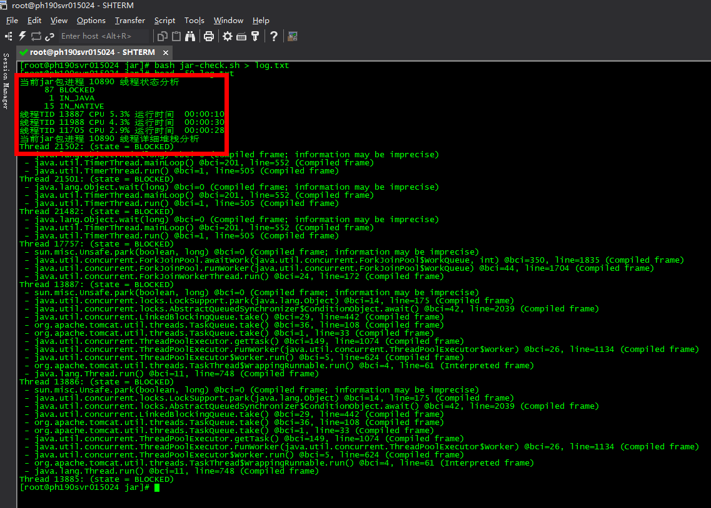

# 脚本分析 jar 线程性能问题(虚拟机+docker)

> GitHub 仓库源文件：[点击打开网页渲染版](https://github.com/ben2023niao/ben-ops-notes/blob/main/doc/md/202304141557-DevOps%20%E4%B8%8E%20SRE%2B%E4%BC%98%E5%8C%96%E6%96%B9%E6%A1%88%2BDocker%2BJava-%E8%84%9A%E6%9C%AC%E5%88%86%E6%9E%90%20jar%20%E7%BA%BF%E7%A8%8B%E6%80%A7%E8%83%BD%E9%97%AE%E9%A2%98%28%E8%99%9A%E6%8B%9F%E6%9C%BA%2Bdocker%29.md)



**jar-check.sh**

```
mkdir log 2> /dev/null ; ps -ef | grep java | grep jar | awk '{print $2}' > log/jar_pid.txt
PID=`cat log/jar_pid.txt` ; echo "当前jar包进程 $PID 线程状态分析" ; jstack -F "`cat log/jar_pid.txt`" > log/jar_jstack.txt
cat -n log/jar_jstack.txt | grep 'Thread' | grep '(' | grep 'state =' | grep ')' > log/jar_Thread.txt
cat log/jar_Thread.txt | awk '{print $6}' | sort -n | uniq -c | sed "s/)//g" ; ps -mp $PID -o THREAD,tid,time | sort -rn | sed '2d' |awk '{print "线程TID "$8" CPU "$2"% 运行时间　"$9}' | grep -v '%CPU%' | head -3 ; echo "当前jar包进程 $PID 线程详细堆栈分析" ; echo "当前jar包进程 $PID 线程详细堆栈分析"
cat log/jar_Thread.txt | while read line ;do state=`echo "${line}" | awk '{print $6}' | sed "s/)//g"` ; pid=`echo "${line}" | awk '{print "Thread "$3}'`
for i in BLOCKED DEADLOCK WAITING LOCKED;do if [[ "$state" = "$i" ]];then sed -n "/$pid/,\$p" log/jar_Thread.txt | head -2 | awk '{print $1}' > log/a.txt ; a=`cat log/a.txt | head -1` ; b=`cat log/a.txt | tail -1` ; sed -n "$a,$b p" log/jar_jstack.txt | sed '$d' | grep -v '^$' ;fi ;done done
```
