# 域名检测告警功能方案-目前最完美方案

> GitHub 仓库源文件：[点击打开网页渲染版](https://github.com/ben2023niao/ben-ops-notes/blob/main/doc/md/202304141557-DevOps%20%E4%B8%8E%20SRE%2B%E4%BC%98%E5%8C%96%E6%96%B9%E6%A1%88%2BDocker%2B%E7%9B%91%E6%8E%A7%E5%91%8A%E8%AD%A6-%E5%9F%9F%E5%90%8D%E6%A3%80%E6%B5%8B%E5%91%8A%E8%AD%A6%E5%8A%9F%E8%83%BD%E6%96%B9%E6%A1%88-%E7%9B%AE%E5%89%8D%E6%9C%80%E5%AE%8C%E7%BE%8E%E6%96%B9%E6%A1%88.md)

利用百度统计 在前台代码加 js 方式自动化收集域名方式

服务端部署
docker run -it --rm -d --name webfunny -p 8011:8011 -p 8010:8010 -v 映射目录:/app/config_variable/ webfunny/webfunny_monitor:版本号
心跳检测地址： 域名 + /server/health

监控项目端
进入项目设置页（projectSetting.html），复制探针代码，安插到域名项目的html中 （类似加百度统计）

参考项目详细官方文档
<https://www.webfunny.cn/des.html>

效果图

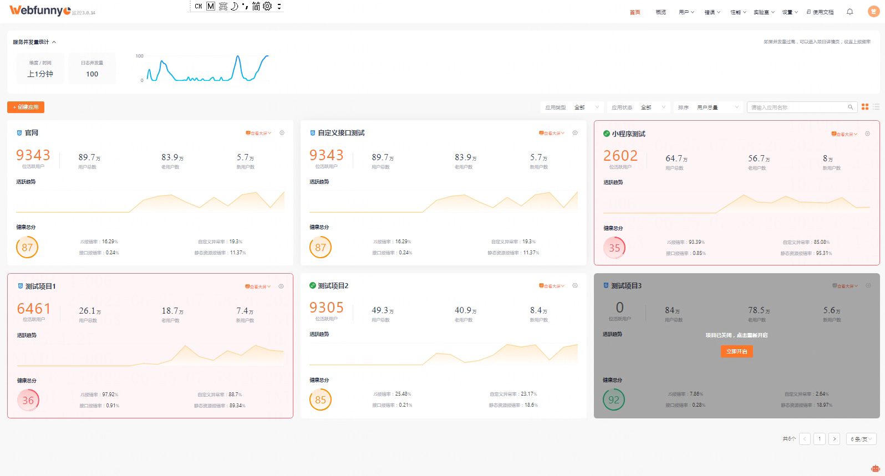

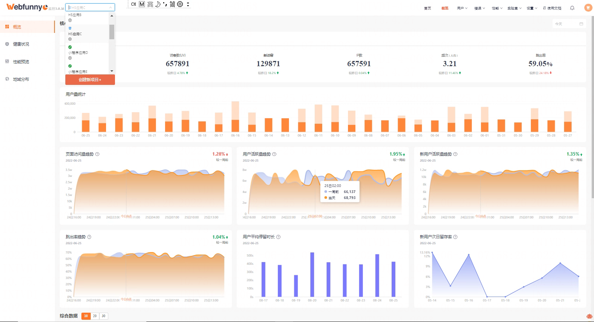

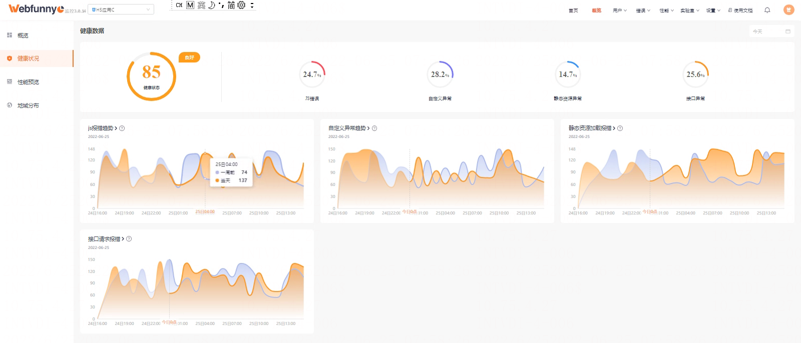
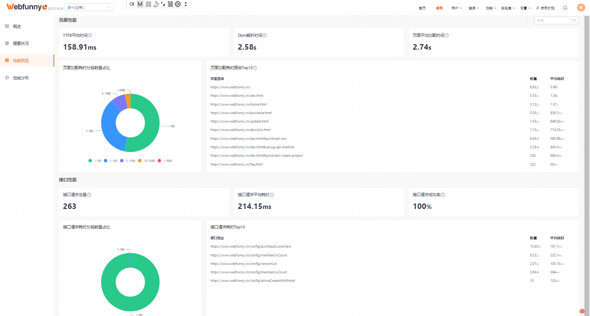
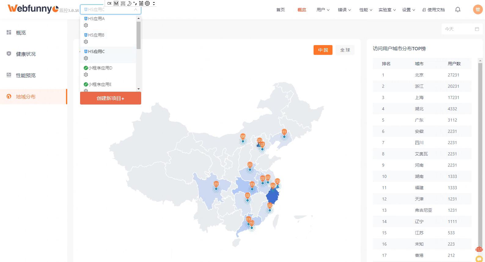
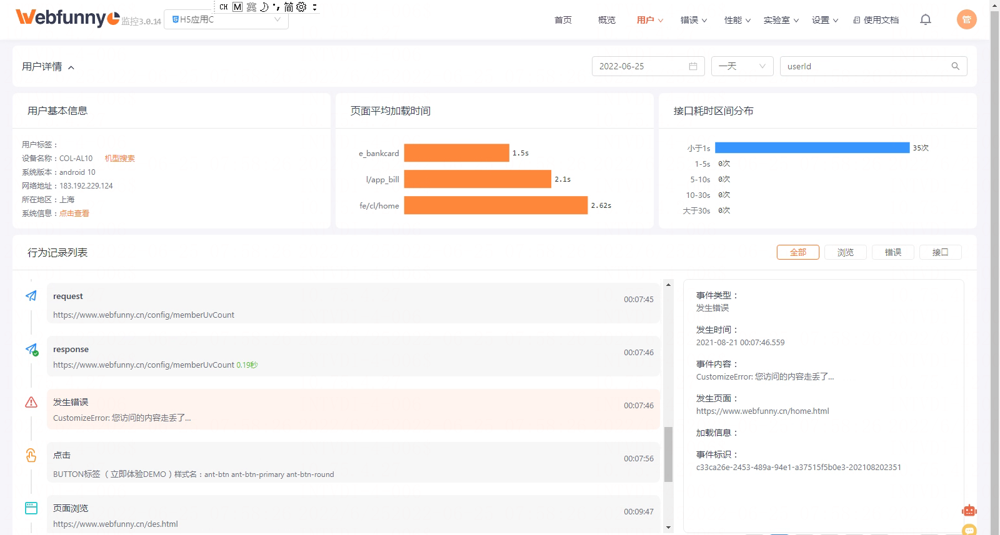

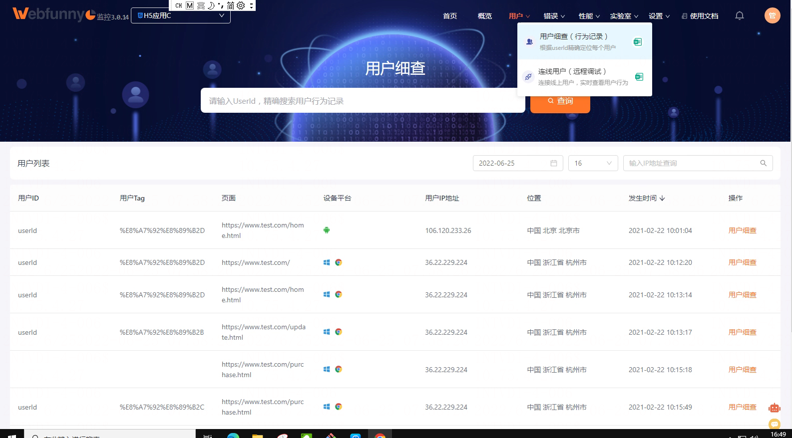
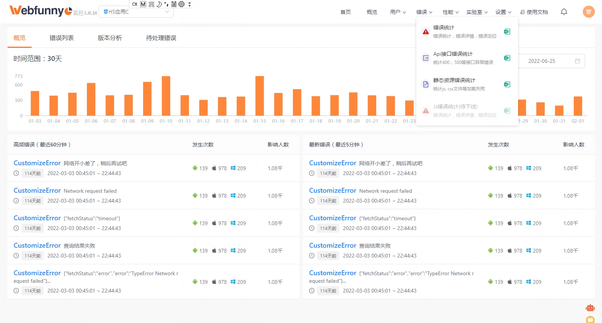
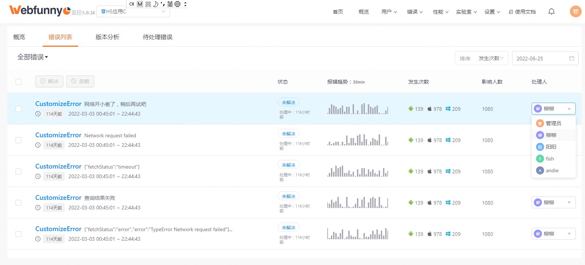
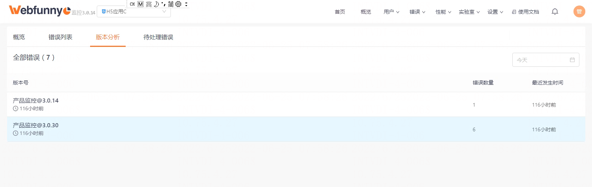
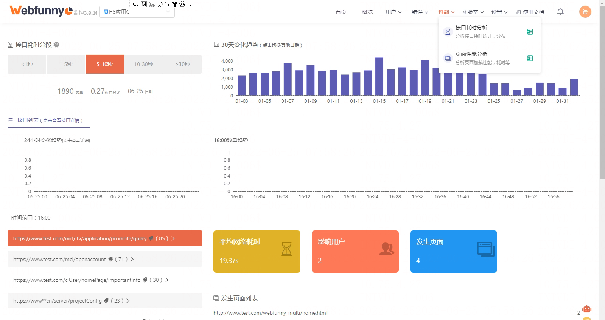
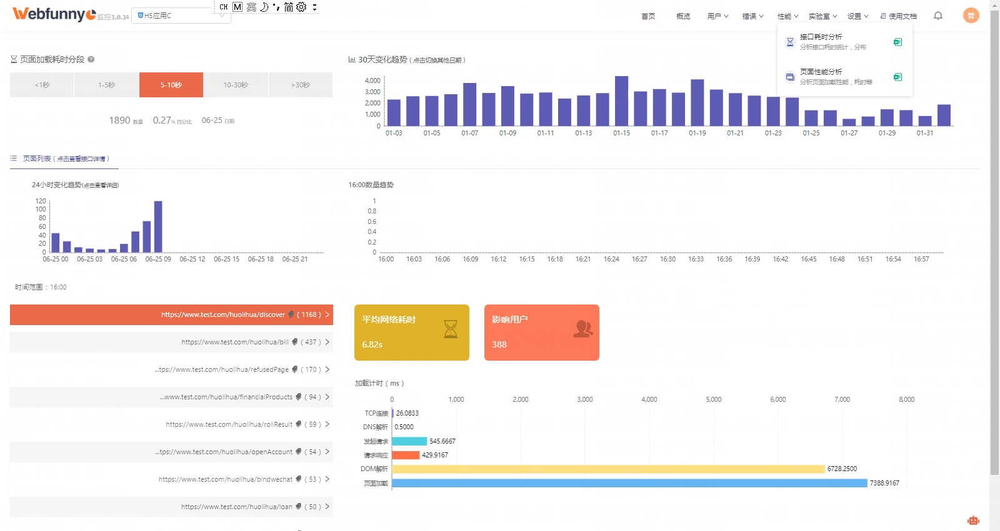
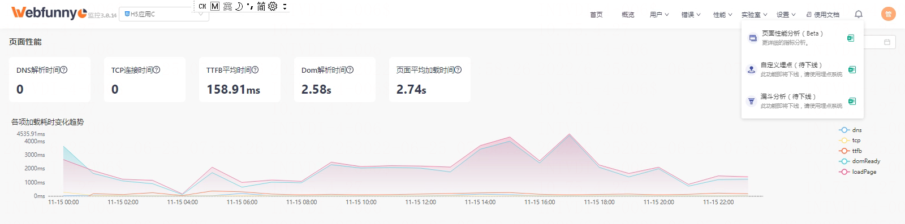
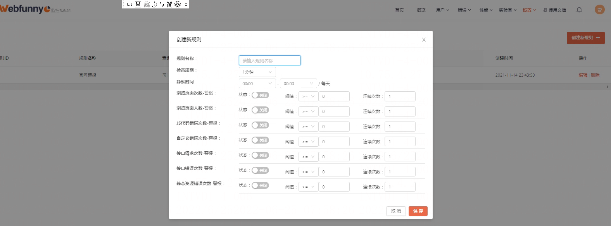
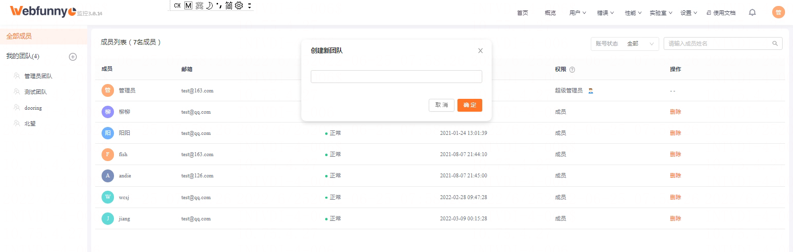
