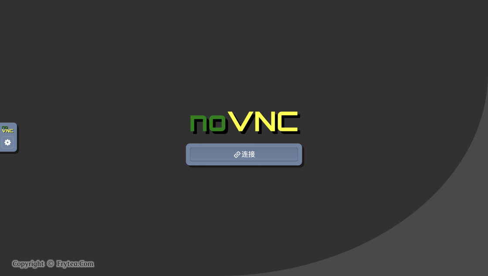
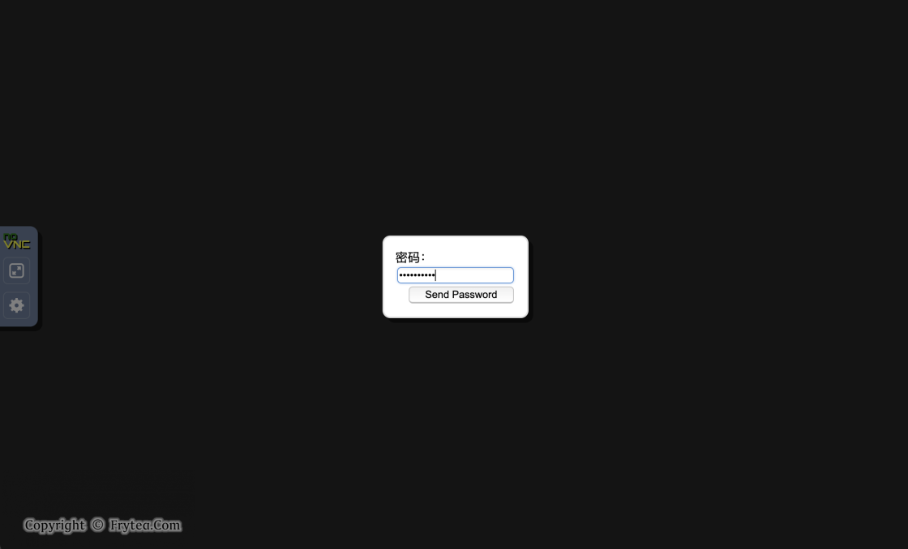
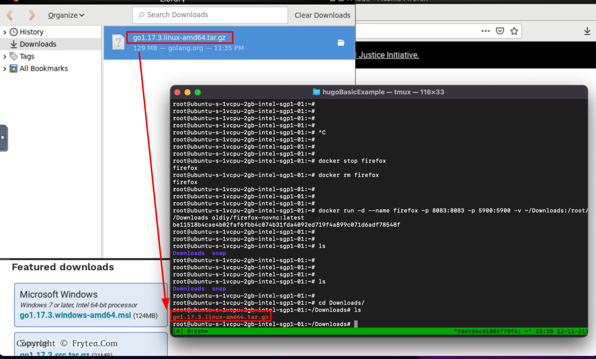

# 容器化浏览器

> GitHub 仓库源文件：[点击打开网页渲染版](https://github.com/ben2023niao/ben-ops-notes/blob/main/doc/md/202304141557-DevOps%20%E4%B8%8E%20SRE%2B%E4%BC%98%E5%8C%96%E6%96%B9%E6%A1%88%2BDocker%2B%E7%9F%A5%E8%AF%86%E7%AC%94%E8%AE%B0-%E5%AE%B9%E5%99%A8%E5%8C%96%E6%B5%8F%E8%A7%88%E5%99%A8.md)

解决公司内网访问项目调试非常非常卡顿问题
1: 安装 Docker

如果 VPS 已经装过 Docker，可以跳过这一步。这里直接使用 Docker 官方提供的一键安装脚本进行安装：(根据自己服务器的所在位置确定是否加 `--mirror Aliyun`，若在国内需要加，境外则不需要。)

```bash
curl -fsSL https://get.docker.com | bash -s docker --mirror Aliyun
```

2: 启动容器

docker 跑起来后，就开始跑我们的 firefox 容器，直接运行下面命令即可快速开始：(如果服务器配有安全组策略或防火墙，请**手动放通**上面两个端口，若端口冲突，请自行更换 `:` 前面的端口为**可用端口**！等待命令执行完成，放通端口，即可进行下一步。)

```bash
docker run -d --name firefox -p 8083:8083 -p 5900:5900 oldiy/firefox-novnc:latest
```

```
3: 远程连接
```

电脑浏览器访问 `http://<Your IP>:8083/vnc.html` 即可。如果一切正常，将会看到下面页面：

上面就是打开的效果了，如果 VPS 在墙外则可以直接访问 Google ，如果装在在局域网内则可以直接访问内网服务。若想从外部直接访问局域网内的服务，可以了解一下 **内网穿透** 技术。
上面的流程就可以迅速看到效果，还可以使用 Docker 的特性满足一些高级需求，下面给出两个拓展需求的实现案例。

案例一：增加访问密码

```bash
# 进入容器
$ docker exec -it firefox bash
# 交互式设定密码，写入文件请选 y
$ x11vnc -storepasswd
# 修改启动脚本，若不会使用 vi 请使用 apt 自行安装常用编辑器vim
$ vi /etc/supervisor/conf.d/supervisord.conf
# 找到下面 - 指定的行，修改为 + 指定的行
...
[program:x11vnc]
- command=/usr/bin/x11vnc
+ command=/usr/bin/x11vnc -rfbauth /root/.vnc/passwd
autorestart=true
...
# 修改完毕后退出容器，重启容器
$ exit
$ docker restart firefox
```

之后刷新浏览器，就可以看到需要密码才可使用了，安全性进一步增强。



案例二：挂载目录

如需挂载目录可在启动时加入 `-v <local path>:<docker path>` 参数挂载，比如这条命令，将 firefox 默认下载目录挂在到主目录下的 `Downloads` ，这样浏览器下载的内容在宿主机就能直接看到了。

```bash
docker run -d --name firefox -p 8083:8083 -p 5900:5900 -v ~/Downloads:/root/Downloads oldiy/firefox-novnc:latest
```

注：若已经运行过该容器，请修改名称、端口，或 `docker stop firefox` 再 `docker rm firefox` 删除容器之后重新运行。

由于启动参数带有 `-d` ，docekr 会一直在后台运行，可以帮我们完成一些必须浏览器才能完成的挂机下载任务了。
