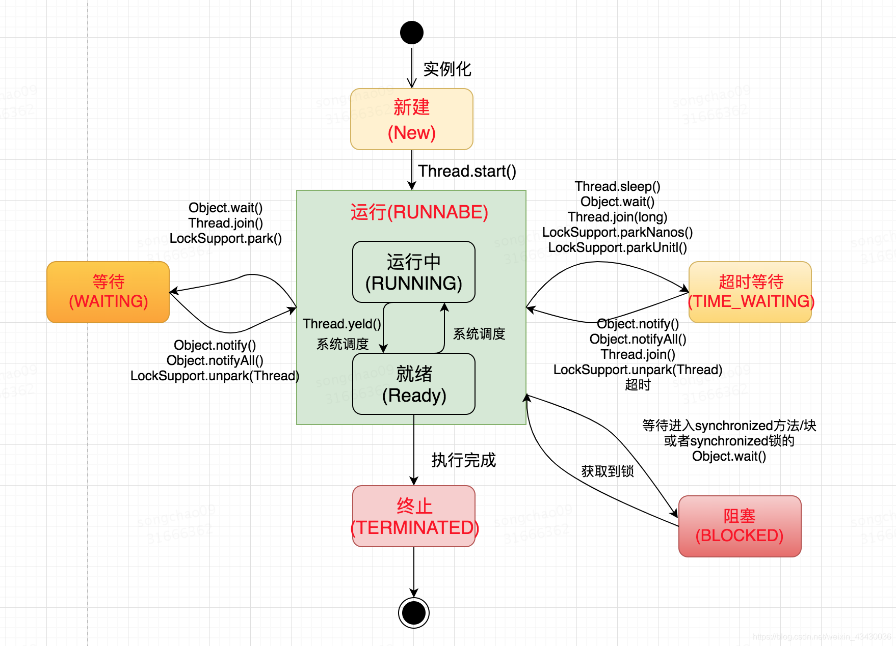
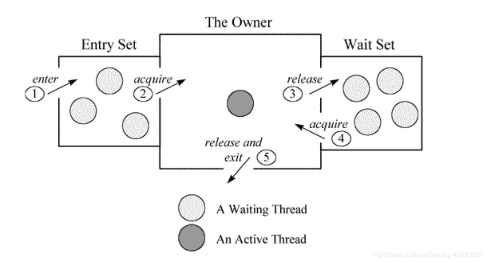

# jar 线程性能问题拓展知识

> GitHub 仓库源文件：[点击打开网页渲染版](https://github.com/ben2023niao/ben-ops-notes/blob/main/doc/md/202304141557-DevOps%20%E4%B8%8E%20SRE%2B%E4%BC%98%E5%8C%96%E6%96%B9%E6%A1%88%2BJava%2BSQL%E6%B3%A8%E5%85%A5-jar%20%E7%BA%BF%E7%A8%8B%E6%80%A7%E8%83%BD%E9%97%AE%E9%A2%98%E6%8B%93%E5%B1%95%E7%9F%A5%E8%AF%86.md)

系统线程状态 (Native Thread Status)
系统线程有如下状态：

deadlock
死锁线程，一般指多个线程调用期间进入了相互资源占用，导致一直等待无法释放的情况。

runnable
一般指该线程正在执行状态中，该线程占用了资源，正在处理某个操作，如通过SQL语句查询数据库、对某个文件进行写入等。

blocked
线程正处于阻塞状态，指当前线程执行过程中，所需要的资源长时间等待却一直未能获取到，被容器的线程管理器标识为阻塞状态，可以理解为等待资源超时的线程。

waiting on condition
线程正处于等待资源或等待某个条件的发生，具体的原因需要结合下面堆栈信息进行分析。

如果堆栈信息明确是应用代码，则证明该线程正在等待资源，一般是大量读取某种资源且该资源采用了资源锁的情况下，线程进入等待状态，等待资源的读取，或者正在等待其他线程的执行等。
如果发现有大量的线程都正处于这种状态，并且堆栈信息中得知正等待网络读写，这是因为网络阻塞导致线程无法执行，很有可能是一个网络瓶颈的征兆：
网络非常繁忙，几乎消耗了所有的带宽，仍然有大量数据等待网络读写；
网络可能是空闲的，但由于路由或防火墙等原因，导致包无法正常到达；
所以一定要结合系统的一些性能观察工具进行综合分析，比如netstat统计单位时间的发送包的数量，看是否很明显超过了所在网络带宽的限制；观察CPU的利用率，看系统态的CPU时间是否明显大于用户态的CPU时间。这些都指向由于网络带宽所限导致的网络瓶颈。

还有一种常见的情况是该线程在 sleep，等待 sleep 的时间到了，将被唤醒。
waiting for monitor entry 或 in Object.wait()

Moniter 是Java中用以实现线程之间的互斥与协作的主要手段，它可以看成是对象或者class的锁，每个对象都有，也仅有一个 Monitor。

从上图可以看出，每个Monitor在某个时刻只能被一个线程拥有，该线程就是 “Active Thread”，而其他线程都是 “Waiting Thread”，分别在两个队列 "Entry Set"和"Waint Set"里面等待。其中在 “Entry Set” 中等待的线程状态是 waiting for monitor entry，在 “Wait Set” 中等待的线程状态是 in Object.wait()。

（1）"Entry Set"里面的线程。
我们称被 synchronized 保护起来的代码段为临界区，对应的代码如下：

synchronized(obj) { }COPY

当一个线程申请进入临界区时，它就进入了 “Entry Set” 队列中，这时候有两种可能性：

该Monitor不被其他线程拥有，"Entry Set"里面也没有其他等待的线程。本线程即成为相应类或者对象的Monitor的Owner，执行临界区里面的代码；此时在Thread Dump中显示线程处于 “Runnable” 状态。

该Monitor被其他线程拥有，本线程在 “Entry Set” 队列中等待。此时在Thread Dump中显示线程处于 “waiting for monity entry” 状态。

临界区的设置是为了保证其内部的代码执行的原子性和完整性，但因为临界区在任何时间只允许线程串行通过，这和我们使用多线程的初衷是相反的。如果在多线程程序中大量使用synchronized，或者不适当的使用它，会造成大量线程在临界区的入口等待，造成系统的性能大幅下降。如果在Thread Dump中发现这个情况，应该审视源码并对其进行改进。

（2）"Wait Set"里面的线程
当线程获得了Monitor，进入了临界区之后，如果发现线程继续运行的条件没有满足，它则调用对象（通常是被synchronized的对象）的wait()方法，放弃Monitor，进入 "Wait Set"队列。只有当别的线程在该对象上调用了 notify()或者notifyAll()方法，"Wait Set"队列中的线程才得到机会去竞争，但是只有一个线程获得对象的Monitor，恢复到运行态。"Wait Set"中的线程在Thread Dump中显示的状态为 in Object.wait()。通常来说，

通常来说，当CPU很忙的时候关注 Runnable 状态的线程，反之则关注 waiting for monitor entry 状态的线程。

线程状态
状态    含义    触发方法    线程动作（线程状态产生的原因）    备注
NEW    Thread state for a thread which has not yet started.            不会出现在Dump中
RUNNABLE    Thread state for a runnable thread. A thread in the runnable state is executing in the Java virtual machine but it may be waiting for other resources from the operating system such as processor.        runnable
BLOCKED    Thread state for a thread blocked waiting for a monitor lock. A thread in the blocked state is waiting for a monitor lock to enter a synchronized block/method or reenter a synchronized block/method after calling Object.wait.    waiting for monitor entry
WAITING    Thread state for a waiting thread.    Object.wait with no timeout => WAITING (on object monitor)    in Object.wait()    A thread that has called Object.wait() on an object is waiting for another thread to call Object.notify() or Object.notifyAll() on that object.
Thread.join with no timeout=> WAITING (on object monitor)    in Object.wait()    A thread that has called Thread.join() is waiting for a specified thread to terminate.
LockSupport.park=> WAITING（parking）    waiting on condition
TIMED_WAITING    Thread state for a waiting thread with a specified waiting time.    Thread.sleep=> TIMED_WAITING (sleeping)    waiting on condition
Object.wait with timeout=> TIMED_WAITING (on object monitor)    in Object.wait()
Thread.join with timeout=> TIMED_WAITING (on object monitor)    in Object.wait()
LockSupport.parkNanos=> TIMED_WAITING (parking)    waiting on condition
LockSupport.parkUntil=> TIMED_WAITING (parking)    waiting on condition
TERMINATED    Thread state for a terminated thread. The thread has completed execution.            不会出现在Dump中
