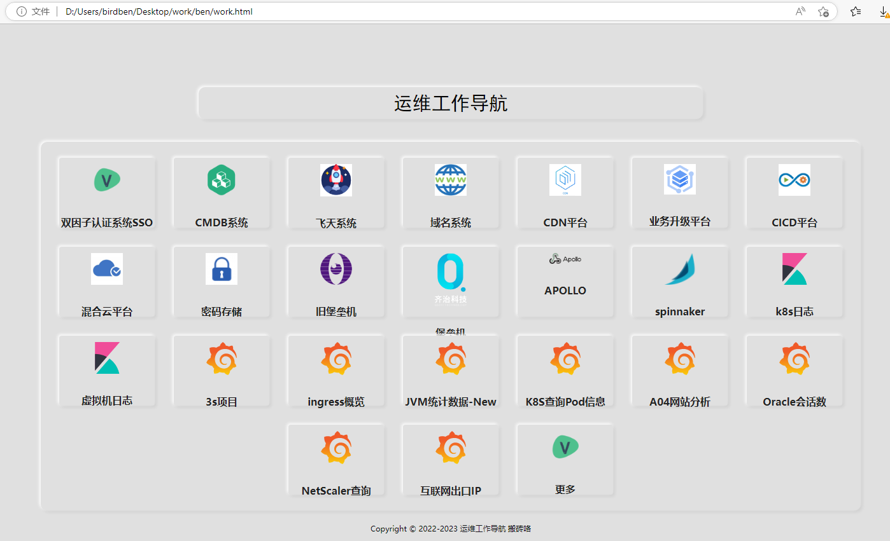
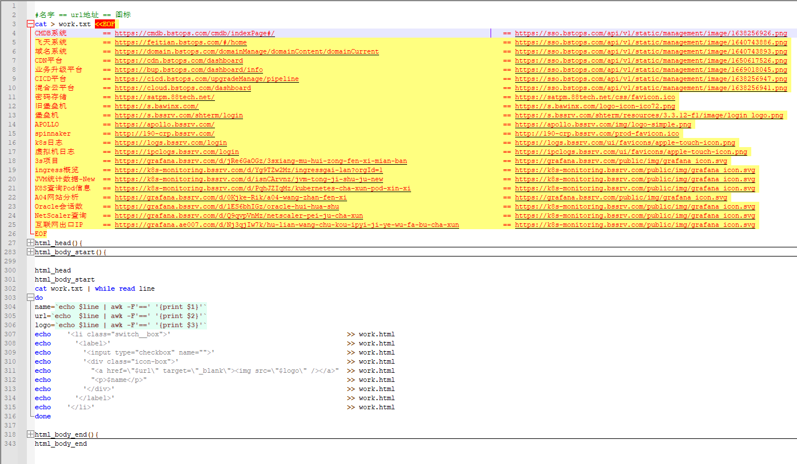

# 工作导航页

> GitHub 仓库源文件：[点击打开网页渲染版](https://github.com/ben2023niao/ben-ops-notes/blob/main/doc/md/202304141557-DevOps%20%E4%B8%8E%20SRE%2B%E4%BC%98%E5%8C%96%E6%96%B9%E6%A1%88%2BKubernetes%2B%E6%97%A5%E5%BF%97%E5%88%86%E6%9E%90-%E5%B7%A5%E4%BD%9C%E5%AF%BC%E8%88%AA%E9%A1%B5.md)



**work.sh** 展开源码

```
#名字 == url地址 == 图标
cat > work.txt <<EOF
CMDB系统         == https://cmdb.bstops.com/cmdb/indexPage#/                                                         == https://sso.bstops.com/api/v1/static/management/image/1638256926.png
飞天系统         == https://feitian.bstops.com/#/home                                                                == https://sso.bstops.com/api/v1/static/management/image/1640743886.png
域名系统         == https://domain.bstops.com/domainManage/domainContent/domainCurrent                               == https://sso.bstops.com/api/v1/static/management/image/1640743893.png
CDN平台          == https://cdn.bstops.com/dashboard                                                                 == https://sso.bstops.com/api/v1/static/management/image/1650617526.png
业务升级平台     == https://bup.bstops.com/dashboard/info                                                            == https://sso.bstops.com/api/v1/static/management/image/1669018045.png
CICD平台         == https://cicd.bstops.com/upgradeManage/pipeline                                                   == https://sso.bstops.com/api/v1/static/management/image/1638256947.png
混合云平台       == https://cloud.bstops.com/dashboard                                                               == https://sso.bstops.com/api/v1/static/management/image/1638256941.png
密码存储         == https://satpm.88tech.net/                                                                        == https://satpm.88tech.net/css/favicon.ico
旧堡垒机         == https://s.bawinx.com/                                                                            == https://s.bawinx.com/logo-icon-ico72.png
堡垒机           == https://s.bssrv.com/shterm/login                                                                 == https://s.bssrv.com/shterm/resources/3.3.12-f1/image/login_logo.png
APOLLO           == https://apollo.bssrv.com/                                                                        == https://apollo.bssrv.com/img/logo-simple.png
spinnaker        == http://190-crp.bssrv.com/                                                                        == http://190-crp.bssrv.com/prod-favicon.ico
k8s日志          == https://logs.bssrv.com/login                                                                     == https://logs.bssrv.com/ui/favicons/apple-touch-icon.png
虚拟机日志       == https://ipclogs.bssrv.com/login                                                                  == https://ipclogs.bssrv.com/ui/favicons/apple-touch-icon.png
3s项目           == https://grafana.bssrv.com/d/jRe6GaOGz/3sxiang-mu-hui-zong-fen-xi-mian-ban                        == https://grafana.bssrv.com/public/img/grafana_icon.svg
ingress概览      == https://k8s-monitoring.bssrv.com/d/Yg9TZw2Mz/ingressgai-lan?orgId=1                              == https://k8s-monitoring.bssrv.com/public/img/grafana_icon.svg
JVM统计数据-New  == https://k8s-monitoring.bssrv.com/d/isnCArvnz/jvm-tong-ji-shu-ju-new                              == https://k8s-monitoring.bssrv.com/public/img/grafana_icon.svg
K8S查询Pod信息   == https://k8s-monitoring.bssrv.com/d/PqhJZIqMz/kubernetes-cha-xun-pod-xin-xi                       == https://k8s-monitoring.bssrv.com/public/img/grafana_icon.svg
A04网站分析      == https://grafana.bssrv.com/d/0Kjke-Rik/a04-wang-zhan-fen-xi                                       == https://grafana.bssrv.com/public/img/grafana_icon.svg
Oracle会话数     == https://grafana.bssrv.com/d/lES6bhIGz/oracle-hui-hua-shu                                         == https://k8s-monitoring.bssrv.com/public/img/grafana_icon.svg
NetScaler查询    == https://grafana.bssrv.com/d/Q9qvpVnMz/netscaler-pei-ju-cha-xun                                   == https://k8s-monitoring.bssrv.com/public/img/grafana_icon.svg
互联网出口IP     == https://grafana.ae007.com/d/Nj3qjIw7k/hu-lian-wang-chu-kou-ipyi-ji-ye-wu-fa-bu-cha-xun           == https://k8s-monitoring.bssrv.com/public/img/grafana_icon.svg
EOF
html_head(){
cat > work.html <<EOF
<html>
<head>
  <title>运维工作导航</title>
  <meta http-equiv="Content-Type" content="text/html; charset=utf-8" />
  <meta name="viewport"
    content="width=device-width, initial-scale=1.0, minimum-scale=0.5, maximum-scale=2.0, user-scalable=yes" />
  <!-- 引入css -->
  <style>
.font {
  font-family: "Quicksand", sans-serif;
  font-weight: 600;
}
:root {
  --mainWhite: #E0E0E0;
  --buttonWhite:-2px -2px 5px rgba(255,255,255,1),
                  3px 3px 5px rgba(0,0,0,.07);
  --buttonWhiteActive:inset -2px -2px 5px rgba(255,255,255,1),
                      inset 3px 3px 5px rgba(0,0,0,.07);
  --iconWhiteVer:#6a9bd8;
  --mainDark:#222;
  --buttonDark:inset -2px -2px 5px rgba(0,0,0,0.5),
                     inset 3px 3px 5px rgba(255,255,255,.07);
  --buttonDarkActive:-2px -2px 5px rgba(0,0,0,0.5),
                  3px 3px 5px rgba(255,255,255,.07);
  --iconDarkVer:#8d948d;
  --iconDarkVerActive:0 0 10px rgba(33,156,243,1),
                       0 0 10px rgba(33,156,243,1);
  --iconDarkLine:0 0 10px rgba(33,156,243,.5),
    0 0 20px rgba(33,156,243,.5),
    0 0 30px rgba(33,156,243,.5),
    inset 0 0 10px rgba(33,156,243,.5), ;
}
body {
  display: flex;
  justify-content: center;
  align-items: center;
  flex-direction: column-reverse;
  transition: 0.5s;
}
body.neumorphism {
  background: var(--mainWhite);
}
body.neumorphism .switch {
  background: var(--mainWhite);
  box-shadow: var(--buttonWhite);
}
body.neumorphism .switch input[type=checkbox] ~ .icon-box {
  background: var(--mainWhite);
  box-shadow: var(--buttonWhite);
}
body.neumorphism .switch input[type=checkbox] ~ .icon-box img {
  color: var(--iconWhiteVer);
}
body.neumorphism .switch input[type=checkbox]:checked ~ .icon-box {
  box-shadow: var(--buttonWhiteActive);
}
body.dark {
  background: var(--mainDark);
}
body.dark .switch {
  background: var(--mainDark);
  box-shadow: var(--buttonDark);
}
body.dark .switch input[type=checkbox] ~ .icon-box {
  background: var(--mainDark);
  box-shadow: var(--buttonDark);
}
body.dark .switch input[type=checkbox] ~ .icon-box p {
  color: var(--iconDarkVer);
}
body.dark .switch input[type=checkbox]:checked ~ .icon-box {
  box-shadow: var(--buttonDarkActive);
}
body.dark .switch input[type=checkbox]:checked ~ .icon-box p {
  text-shadow: var(--iconDarkVerActive);
  color: white;
}
body.dark .title {
    color: white;
    background-color: #17181b;
    box-shadow: var(--mainDark);
  }
body.dark .title a{
    color: white;
    text-decoration:none;
}
.switch {
  position: relative;
  display: flex;
  flex-direction: row;
  justify-content: center;
  align-items: center;
  flex-wrap: wrap;
  border-radius: 10px;
  padding: 10px;
  width: 80%;
  height: auto;
  margin-bottom: 20px;
}
.switch__box {
  position: relative;
  list-style: none;
  text-align: center;
  margin: 15px;
}
.switch__box label {
  position: relative;
}
.switch__box label input[type=checkbox] {
  position: absolute;
  opacity: 0;
  cursor: pointer;
}
.switch__box label input[type=checkbox] ~ .icon-box {
  width: 150px;
  height: 110px;
  /* display: flex; */
  align-items: center;
  justify-content: center;
  border-radius: 4px;
}
.switch__box label input[type=checkbox] ~ .icon-box img {
    width: 50px;
    transition: width 0.2s ease-out;
    margin-bottom: 5px;
    padding-top: 10px;
}
.switch__box label input[type=checkbox] ~ .icon-box p {
  color: #222;
  font-weight: bold;
  text-align: center;
  position:0 auto;
  padding-top: 10px;
  padding-bottom: 2px;
}
.switch__box label input[type=checkbox]:checked ~ .icon-box img {
  transform: scale(0.95);
}
.colormode {
  transform-style: preserve-3d;
  perspective: 200px;
  height: 40px;
  border-radius: 40px;
  margin-bottom: 20px;
  margin-right: 0px;
  position:fixed;
  top:20px;
  right:40px;
}
.colormode input[type=checkbox] {
  width: 80px;
  height: 30px;
  margin: 0;
  -webkit-appearance: none;
  outline: none;
  transition: 0.5s ease;
  cursor: pointer;
}
.colormode input[type=checkbox] ~ span {
  position: absolute;
  top: 0;
  width: 50%;
  height: 30px;
  line-height: 30px;
  text-align: center;
  text-transform: uppercase;
  font-weight: bold;
  pointer-events: none;
  transform-style: preserve-3d;

}
.colormode input[type=checkbox] ~ span:nth-of-type(1) {
  left: 0;
  border-top-left-radius: 40px;
  border-bottom-left-radius: 40px;
  background: var(--mainWhite);
}
.colormode input[type=checkbox] ~ span:nth-of-type(1)::before {
  content: "";
  position: absolute;
  top: 0;
  left: 0;
  width: 100%;
  height: 100%;
  background: linear-gradient(90deg, #464343, #17181b);
  border-top-left-radius: 40px;
  border-bottom-left-radius: 40px;
  transform-origin: right;
  transition: 1s;
  backface-visibility: hidden;
}
.colormode input[type=checkbox] ~ span:nth-of-type(2) {
  color: var(--mainWhite);
  right: 0;
  border-top-right-radius: 40px;
  border-bottom-right-radius: 40px;
  background: var(--mainDark);
}
.colormode input[type=checkbox] ~ span:nth-of-type(2)::before {
  content: "";
  position: absolute;
  top: 0;
  left: 0;
  width: 100%;
  height: 100%;
  background: linear-gradient(90deg, #fefefe, #f2f2f2);
  border-top-right-radius: 40px;
  border-bottom-right-radius: 40px;
  transform-origin: left;
  transition: 1s;
  backface-visibility: hidden;
  transform: rotateY(180deg);
}
.colormode input[type=checkbox]:checked ~ span:nth-of-type(1)::before {
  transform: rotateY(180deg);
}
.colormode input[type=checkbox]:checked ~ span:nth-of-type(2)::before {
  transform: rotateY(360deg);
}
.title{
    width: 50%;
    height: 50px;
    font-size: 30px;
    font-family: '黑体';
    text-align: center;
    line-height:50px;
    margin: 0 auto;
    margin-top: 60px;
    margin-bottom: 20px;
    background-color: #6a9bd8;
    border-radius: 10px;
    background: #e0e0e0;
    box-shadow: var(--buttonWhite);
}
.title2{
  margin-bottom: 20px;
  text-align: center;
  font-size: 10px;
}
.title2 a{
    color: #17181b;
    text-decoration:none;
}
</style>
</head>
EOF
}
html_body_start(){
cat >> work.html <<EOF
<body class="neumorphism">
  <div class="title2">Copyright © 2022-2023 <a href="#">运维工作导航</a> 搬砖咯</div>
  <ul class="switch">
    <li class="switch__box">
      <label>
        <input type="checkbox" name="">
        <div class="icon-box">
          <a href="https://sso.bstops.com/sso/main" target="_blank"></a>
          <p>双因子认证系统SSO</p>
        </div>
      </label>
    </li>
EOF
}

html_head
html_body_start
cat work.txt | while read line
do
name=`echo $line | awk -F'==' '{print $1}'`
url=`echo $line | awk -F'==' '{print $2}'`
logo=`echo $line | awk -F'==' '{print $3}'`
echo '<li class="switch__box">' >> work.html
echo '<label>' >> work.html
echo '<input type="checkbox" name="">' >> work.html
echo '<div class="icon-box">' >> work.html
echo "<a href=\"$url\" target=\"_blank\"></a>" >> work.html
echo "<p>$name</p>" >> work.html
echo '</div>' >> work.html
echo '</label>' >> work.html
echo '</li>' >> work.html
done

html_body_end(){
cat >> work.html <<EOF
    <!-- 更多栗子 -->
 <li class="switch__box">
      <label>
        <input type="checkbox" name="">
        <div class="icon-box">
          <a href="/" target="_blank"> </a>
          <p>更多</p>
        </div>
      </label>
    </li>
  </ul>
  <div class="title">运维工作导航</div>
  <script>
    function js_open(num) {
      // console.log(num)
      var host = window.location.host;
      window.open("http://" + document.domain + ':' + num, "_blank")
    }
  </script>
</body>
</html>
EOF
}
html_body_end
```


