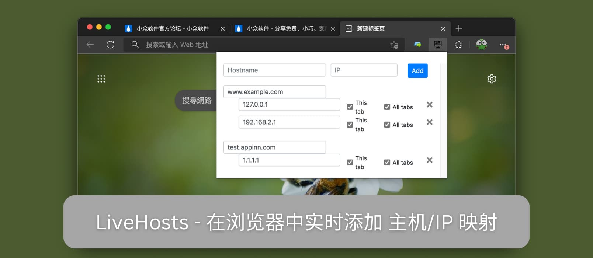
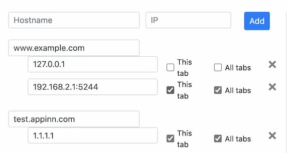

# LiveHosts– 在浏览器中实时添加 主机/IP 映射-无需修改 hosts 文件

> GitHub 仓库源文件：[点击打开网页渲染版](https://github.com/ben2023niao/ben-ops-notes/blob/main/doc/md/202304141557-DevOps%20%E4%B8%8E%20SRE%2B%E4%BC%98%E5%8C%96%E6%96%B9%E6%A1%88%2BLinux%2BWindows-LiveHosts%E2%80%93%20%E5%9C%A8%E6%B5%8F%E8%A7%88%E5%99%A8%E4%B8%AD%E5%AE%9E%E6%97%B6%E6%B7%BB%E5%8A%A0%20%E4%B8%BB%E6%9C%BA-IP%20%E6%98%A0%E5%B0%84-%E6%97%A0%E9%9C%80%E4%BF%AE%E6%94%B9%20hosts%20%E6%96%87%E4%BB%B6.md)

**LiveHosts** 是一款可以在 Chrome、Firefox 浏览器中实时添加 主机/IP 映射，无需修改 hosts 文件的开发者工具，纯跳转方式，方便进行网络测试。

## LiveHosts

这是一个不那么优雅的方式，次优解，但胜在方便。

### Hosts 文件

对于很多开发者来说，修改 hosts 文件简直是家常便饭，各大系统的 hosts 文件在这里

- Windows：*C*:\*Windows*\*System32*\*drivers*\*etc*\*hosts*
- Linux：/etc/hosts
- macOS：/etc/hosts

hosts 文件可以实现 主机 => IP 映射效果，比如你在局域网里搭建了一个 [AList](https://www.appinn.com/alist-file-list-program/) 服务，地址在 `203.0.113.1:5244`，修改 hosts 之后可以实现用 任意域名:5244 来访问这个 AList 服务。但每次都改 hosts 文件太麻烦了。

### LiveHosts 重定向

LiveHosts 可以帮忙随时随地修改域名映射，甚至可以一个域名/主机对应多个 IP，并可以随时切换生效，以及仅针对当前标签页还是所有标签页，总之很灵活。

甚至可以直接把端口写进去：

不过实现原理不同，它只能硬跳转，即访问 [www.example.com](http://www.example.com) 之后，直接跳转至 203.0.113.1:5244，与 hosts 的效果完全不同。

不过，胜在方便。如果你有在开发时需要在同一个主机下经常切换多个版本，那就太方便了。

### 已知问题

重定向后，用户实际上是在一个与他们预期不同的域中。他们可能会注意到一些功能上的差异。

- 根据服务器的不同，网页中引用网站URL的部分（如href和src属性）可能与原来的不同
- window.location有不同的值，有可能会影响到 JavaScript 代码。
- 大多数跨源请求不会工作

仅重定向到 IP 不会有问题，如果你想要主机名正常工作，会遇到以上问题。

## 获取

- [GitHub](https://github.com/Aioros/livehosts)
- [Chrome 商店](https://chrome.google.com/webstore/detail/livehosts/hdpoplemgeaioijkmoebnnjcilfjnjdi)
- [Firefox 商店](https://addons.mozilla.org/en-US/firefox/addon/livehosts/)
