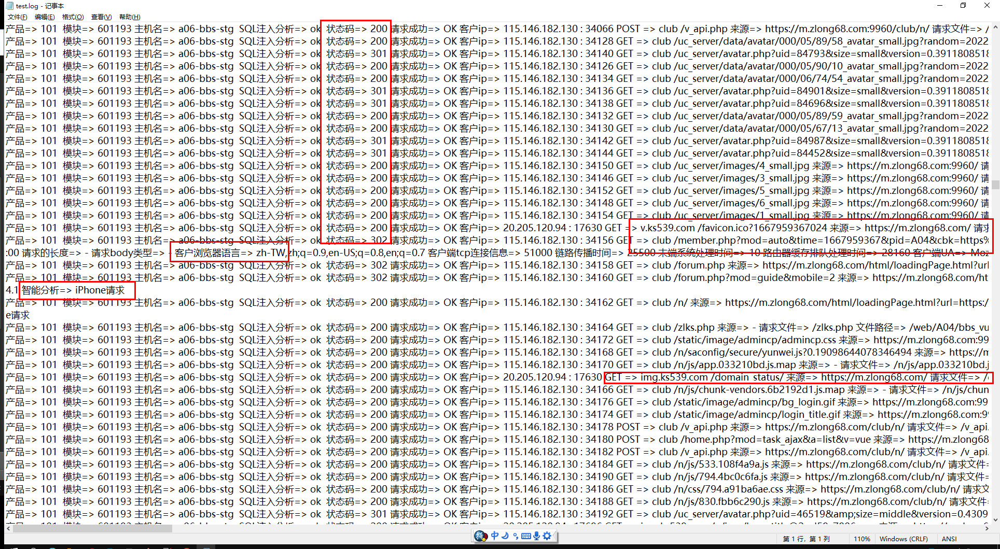
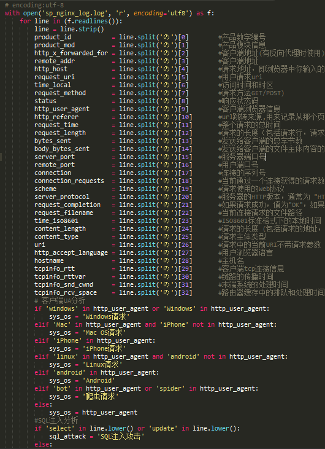
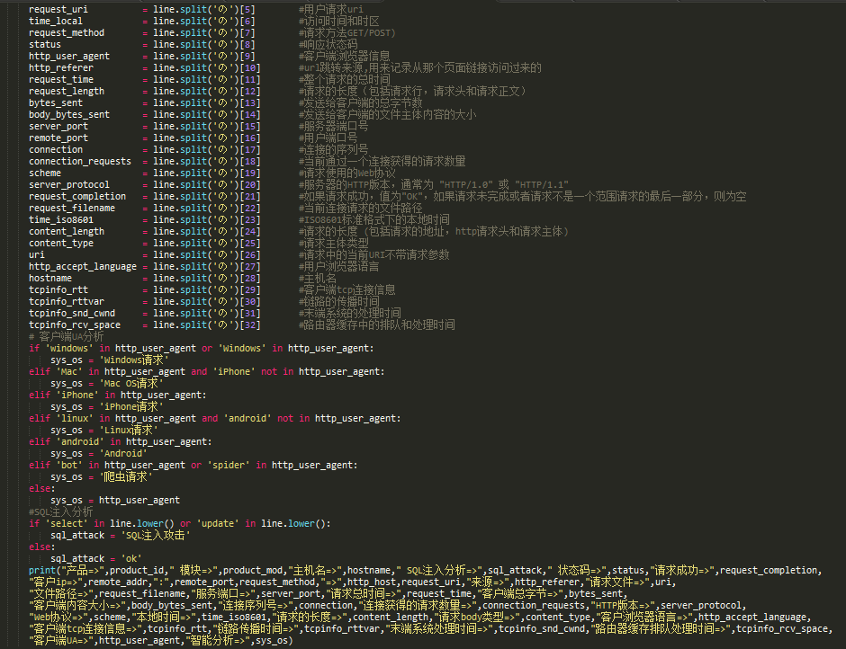

# python 分析项目日志

> GitHub 仓库源文件：[点击打开网页渲染版](https://github.com/ben2023niao/ben-ops-notes/blob/main/doc/md/202304141557-DevOps%20%E4%B8%8E%20SRE%2B%E4%BC%98%E5%8C%96%E6%96%B9%E6%A1%88%2BLinux%2BWindows-python%20%E5%88%86%E6%9E%90%E9%A1%B9%E7%9B%AE%E6%97%A5%E5%BF%97.md)



```
Birdben@/log $ ls
log.sh* test.log
Birdben@/log $ bash log.sh test.log
开始切割日志 test.log
正在分析日志 sp_nginx_log_aa
正在分析日志 sp_nginx_log_ab
正在分析日志 sp_nginx_log_ac
正在分析日志 sp_nginx_log_ad
正在分析日志 sp_nginx_log_ae
正在分析日志 sp_nginx_log_af
正在分析日志 sp_nginx_log_ag
正在分析日志 sp_nginx_log_ah
正在分析日志 sp_nginx_log_ai
正在分析日志 sp_nginx_log_aj
日志 test.log.txt 分析完毕
Birdben@/log $ ls
log.sh* test.log test.log.txt
```

**log.sh**

```bash
#!/bin/bash
echo "开始切割日志 $1"
split -l 50000 "$1" sp_nginx_log_

cat > nginx-log.py <<EOF
# encoding:utf-8
with open('sp_nginx_log.log', 'r', encoding='utf8') as f:
    for line in (f.readlines()):
        line = line.strip()
        product_id           = line.split('の')[0]        #产品数字编号
        product_mod          = line.split('の')[1]        #产品模块信息
        http_x_forwarded_for = line.split('の')[2]        #客户端地址(有反向代理时使用)
        remote_addr          = line.split('の')[3]        #客户端地址
        http_host            = line.split('の')[4]        #请求地址，即浏览器中你输入的地址（IP或域名）
        request_uri          = line.split('の')[5]        #用户请求uri
        time_local           = line.split('の')[6]        #访问时间和时区
        request_method       = line.split('の')[7]        #请求方法GET/POST)
        status               = line.split('の')[8]        #响应状态码
        http_user_agent      = line.split('の')[9]        #客户端浏览器信息
        http_referer         = line.split('の')[10]       #url跳转来源,用来记录从那个页面链接访问过来的
        request_time         = line.split('の')[11]       #整个请求的总时间
        request_length       = line.split('の')[12]       #请求的长度（包括请求行，请求头和请求正文）
        bytes_sent           = line.split('の')[13]       #发送给客户端的总字节数
        body_bytes_sent      = line.split('の')[14]       #发送给客户端的文件主体内容的大小
        server_port          = line.split('の')[15]       #服务器端口号
        remote_port          = line.split('の')[16]       #用户端口号
        connection           = line.split('の')[17]       #连接的序列号
        connection_requests  = line.split('の')[18]       #当前通过一个连接获得的请求数量
        scheme               = line.split('の')[19]       #请求使用的Web协议
        server_protocol      = line.split('の')[20]       #服务器的HTTP版本，通常为 "HTTP/1.0" 或 "HTTP/1.1"
        request_completion   = line.split('の')[21]       #如果请求成功，值为"OK"，如果请求未完成或者请求不是一个范围请求的最后一部分，则为空
        request_filename     = line.split('の')[22]       #当前连接请求的文件路径
        time_iso8601         = line.split('の')[23]       #ISO8601标准格式下的本地时间
        content_length       = line.split('の')[24]       #请求的长度 (包括请求的地址，http请求头和请求主体)
        content_type         = line.split('の')[25]       #请求主体类型
        uri                  = line.split('の')[26]       #请求中的当前URI不带请求参数
        http_accept_language = line.split('の')[27]       #用户浏览器语言
        hostname             = line.split('の')[28]       #主机名
        tcpinfo_rtt          = line.split('の')[29]       #客户端tcp连接信息
        tcpinfo_rttvar       = line.split('の')[30]       #链路的传播时间
        tcpinfo_snd_cwnd     = line.split('の')[31]       #末端系统的处理时间
        tcpinfo_rcv_space    = line.split('の')[32]       #路由器缓存中的排队和处理时间
        # 客户端UA分析
        if 'windows' in http_user_agent or 'Windows' in http_user_agent:
            sys_os = 'Windows请求'
        elif 'Mac' in http_user_agent and 'iPhone' not in http_user_agent:
            sys_os = 'Mac OS请求'
        elif 'iPhone' in http_user_agent:
            sys_os = 'iPhone请求'
        elif 'linux' in http_user_agent and 'android' not in http_user_agent:
            sys_os = 'Linux请求'
        elif 'android' in http_user_agent:
            sys_os = 'Android'
        elif 'bot' in http_user_agent or 'spider' in http_user_agent:
            sys_os = '爬虫请求'
        else:
            sys_os = http_user_agent
        #SQL注入分析
        if 'select' in line.lower() or 'update' in line.lower():
            sql_attack = 'SQL注入攻击'
        else:
            sql_attack = 'ok'
        print("产品=>",product_id," 模块=>",product_mod,"主机名=>",hostname," SQL注入分析=>",sql_attack," 状态码=>",status,"请求成功=>",request_completion,
        "客户ip=>",remote_addr,":",remote_port,request_method,"=>",http_host,request_uri,"来源=>",http_referer,"请求文件=>",uri,
        "文件路径=>",request_filename,"服务端口=>",server_port,"请求总时间=>",request_time,"客户端总字节=>",bytes_sent,
        "客户端内容大小=>",body_bytes_sent,"连接序列号=>",connection,"连接获得的请求数量=>",connection_requests,"HTTP版本=>",server_protocol,
        "Web协议=>",scheme,"本地时间=>",time_iso8601,"请求的长度=>",content_length,"请求body类型=>",content_type,"客户浏览器语言=>",http_accept_language,
        "客户端tcp连接信息=>",tcpinfo_rtt,"链路传播时间=>",tcpinfo_rttvar,"末端系统处理时间=>",tcpinfo_snd_cwnd,"路由器缓存排队处理时间=>",tcpinfo_rcv_space,
        "客户端UA=>",http_user_agent,"智能分析=>",sys_os)
EOF
for log in `ls | grep 'sp_nginx_log_'`;do
echo "正在分析日志 $log"
mv $log sp_nginx_log.log
python nginx-log.py >> $1.txt
rm -f sp_nginx_log.log
done
rm -f nginx-log.py
echo "日志 $1.txt 分析完毕"
```


